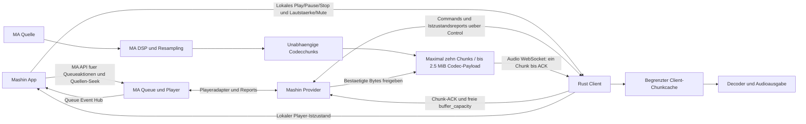

# Implementierungsvertrag: Mashin PlayerProvider und Rust-Client V1

Datum: 2026-10-14
Status: Zielmodell und Implementierungsvorgabe; keine implementierte Provider-/Clientloesung.
Domain: `mashin`. Protokollversion: `1`. Provider-Version: eigenstaendige SemVer.
MA-Referenz: Music Assistant Server `1611ea10b`, Branch `dev`.

Dieses Dokument ist eigenstaendig an ein Provider-/Client-Zielrepository
uebergebbar. Es definiert genau einen Chunktransport: unabhaengig dekodierbare
Audiochunks, einen Serverlieferpuffer fuer maximal zehn Chunks, bestaetigte Uebergabe an den
Client-Chunkcache und ausschliesslich clientseitige lokale Cache-Seeks.
Der Provider schiebt freigegebenes Audio; genau ein Chunk wartet auf Empfangs-ACK.
Waehrenddessen darf ein Produzent weitere Chunks bis zur gemeinsamen Zehn-Chunk-
Grenze fuer A/B vorbereiten, inklusive laufender Produktionsreservierungen.
Der Client meldet seine freie buffer_capacity zusammen mit jedem Chunk-ACK und
bei erneuter Platzfreigabe. Dies ersetzt das bisherige Request-/Creditmodell
vollstaendig, ohne parallelen Lieferpfad oder Kompatibilitaetsnachrichten.
Keine serverseitigen Cache-Seeks, Volltrackcaches, PCM-Seekcaches oder eigenen
Mashin-Seek-Commands. Normale Quellen-Seeks gehen ueber die vorhandene MA-API.
MUSS und DARF NICHT sind verbindlich; SOLL verlangt eine begruendete Abweichung.
Dokument-/Modellpruefungen sind kein Nachweis fuer laufende MA-/Codecintegration.

## 1. Ziel, Grenzen und Autoritaet

Mashin ist ein echter MA-PlayerProvider fuer mehrere gleichzeitig verbundene,
autorisierte Clients. Eine Providerinstanz registriert jeden Client anhand seiner
stabilen device_id als eigenes Device mit genau einem stabilen MA-Player und
eigener MA-Queue, aehnlich der Clientregistrierung bei Sendspin. Die 1:1-Zuordnung
gilt ausschliesslich zwischen Client/Device und Player, nicht zwischen Provider
und Client. Reconnect verwendet denselben Player. Keine Gruppen,
Multiroom-Synchronisierung oder mehrere Player fuer dasselbe Device. MA besitzt
je Player Queue, Nutzerrechte, Quellenwahl, Shuffle, Repeat, Next, Enqueue und
Quellen-Seeks; keine unabhaengige clientseitige Queue.

Alle nachfolgenden Stream-, A/B-, Verbindungs-, Puffer-, Decoder-, Reparatur- und
Lifecyclegrenzen gelten je Device/Player, sofern nicht ausdruecklich anders
angegeben. Verschiedene Devices duerfen unabhaengig gleichzeitig spielen und
verbinden; ihre Commands, Epochen, Bindungen, Audio-IDs, Cursor, Kapazitaet,
Quellenhandles und Tasks duerfen sich nicht gegenseitig ersetzen oder freigeben.
Musikdienstweite Concurrent-Stream-Limits, Entitlements und MA-Pacing bleiben
ueber alle Player hinweg unveraendert durch MA durchgesetzt.

V1 unterstuetzt normale endliche Tracks, FLAC, Opus 96/128/192/256 kbit/s,
Play/Pause/Stop, Lautstaerke/Mute, nativen MA-Enqueue, lokalen Clientcache-Seek,
regulaeren MA-Seek, Transport-Reconnect und begrenzte automatische Quellenreparatur
mit PCM-Abgleich bei Quellenverlust. Nicht enthalten: Flow, Crossfade, Overlay,
Podcasts/Audiobooks, externe Native-Sources, garantierte Gapless-Ausgabe oder
garantierter samplegenauer Anschluss beliebiger neu geoeffneter Quellen.

Aktueller Track A und genau ein MA-freigegebener Nachfolger B duerfen Codecchunks
im Client halten. Der Provider haelt nur ihren begrenzten Lieferpuffer, kein
Trackarchiv. Dies ist eine Architekturgrenze, keine numerische MA-Usage-Policy.
Kein eigenstaendiger Zugriff auf C/D oder Vorladen ohne MA-Enqueuefreigabe.

Keine MA-Coreaenderungen, Monkeypatches, kopierten Musikprovider, privaten
Queue-State-Schreibzugriffe, eigenen Source-Slotzaehler oder parallelen Seekpfade.
MA-Pacing, Entitlements, Throttling und Concurrent-Stream-Limits erhalten.
Audio ausschliesslich fuer Wiedergabe; kein Download, Export, Archiv, Disk-Spooling
oder Transport geschuetzter Musikservice-URLs zum Client.

## 2. Ownership und Datenweg

| Verantwortung | Eigentuemer |
| --- | --- |
| Queue, Quellenrechte, Quellenabruf, Enqueue und Quellen-Seek | MA |
| Dekodierung der Quelle, Normalisierung, DSP und Ausgabeplan | MA |
| Auswahl und sequenzielle Push-Lieferung des freigegebenen A/B, Chunkencoder und Lieferpuffer | Mashin Provider |
| Empfangsannahme/-ablehnung, freie buffer_capacity und begrenzter Chunkcache | Rust-Client |
| Lokale UI-Aktionen fuer Play/Pause/Stop und Lautstaerke/Mute | Rust-Client, unmittelbar angewendet und als Istzustand an Provider gemeldet |
| Lokaler Sekunden-Seek, Decoder und Audioausgabe | Rust-Client |
| Tatsaechlicher Playerzustand, Ausgabezeiger, angewendete Lautstaerke/Mute und hoerbar aktiver Track | Rust-Client, an Provider gemeldet |
| Gesamtdauer des aktiven Tracks fuer die lokale Anzeige | StreamDescriptor.duration_millis des Providers aus MA |
| Queuezustand fuer die Client-UI, Items/Reihenfolge, Shuffle und Repeat | MA Event-Hub-WebSocket und bestehende MA-Abfragen |
| MA-Playerprojektion, Queue-Tracker, History und Scrobbling | bestehender MA-Player-/Trackerpfad mit validierten Clientreports |

Der Client ist Audioempfaenger und lokaler Player, kein Quellenplaner. Er waehlt
keine nachzuladenden Tracks, stellt keine Chunk-/Streamabrufe und entscheidet
nicht ueber MA-Enqueuefreigaben. Der Provider bestimmt A/B, prueft MA-Rechte und
schiebt den jeweils zulaessigen Stream, sobald Annahme und Empfangskapazitaet
vorliegen. clear_next widerruft eine alte B-Freigabe bei Queueaenderungen.

Die lokale UI nimmt Queueitems, Reihenfolge, Shuffle und Repeat aus MA, aber
Position, playing/paused/buffering/ended/error sowie angewendete Lautstaerke und
Mute aus dem lokalen Player. Gesamtdauer ausschliesslich aus dem aktiven
StreamDescriptor; null bedeutet unbekannt, nicht Bufferdauer oder eine Schaetzung
aus Chunkindex/Bitrate. Keine MA-Positionsfortschreibung fuer den eigenen Player
anzeigen und keine verspaeteten MA-Playerwerte ueber lokale Istwerte schreiben.
Trackmetadaten ueber PlaybackIdentity mit MA-Items verknuepfen; hoerbarer A->B-
Wechsel folgt dem lokalen Player, auch wenn der MA-Queueevent noch A meldet.
MA bleibt Autoritaet fuer Queue, Quellen und Freigaben sowie den regulaeren
Steuerpfad anderer Clients. Lokale Playerbedienung wirkt unmittelbar im Rust-Client;
dies erzeugt keine unabhaengige Clientqueue.



PCM nur fuer Verarbeitung, begrenzten Codecvorlauf
und unmittelbare Ausgabe sowie ein begrenztes Quellenreparatur-Endfenster halten,
niemals als seekbaren Cache. Das Endfenster dient nur dem Abgleich neu geoeffneter
Quellen, nicht Client-Seeks, Replay oder der Wiederherstellung geloeschter Chunks.

## 3. MA-Integration und Providerstruktur

Manifest: type=player, domain=mashin, multi_instance=false, builtin=false.
Basisklassen PlayerProvider/Player. Zielpfad music_assistant/providers/mashin.
Player-ID aus autorisierter Devicebindung ableiten, nie durch Reconnect ersetzen.
Device-ID und Anzeigename sind keine Credentials.

PlayerFeatures: PLAY_MEDIA, ENQUEUE, PAUSE, VOLUME_SET und VOLUME_MUTE.
Kein Native-SEEK, NEXT_PREVIOUS, GAPLESS_PLAYBACK oder Gruppenfeature.
can_group_with leer; Gruppensources auch ueber uebergeordnete Pfade ablehnen.
Ein lokaler Clientcache-Seek ist Positionsreporting, kein Native-SEEK-Feature.

Player.play_media nimmt echtes MA-PlayerMedia an. Adapter validiert reales
Queueitem, queue_session_id, StreamDetails, Rechte und Player-Ausgabeplan.
PlayerMedia hat im Referenzstand keinen eigenen Seekoffset: den passenden
StreamDetails.seek_position vor asynchroner Arbeit im Produktionskontext sichern.
Keine spaete Lektuere gemeinsam veraenderlicher StreamDetails als Zeitbasis.

Zentraler PCM-Adapter mit get_queue_item_stream, explizitem Session-/Seekkontext
und gegebenenfalls vorbereitetem MA-Puffer. get_player_output_plan, Normalisierung,
Kanalverarbeitung und Resampling vollstaendig und genau einmal anwenden.
Flow/Crossfade/Overlay erkennen und explizit ablehnen, nicht heimlich umstellen.
track_loaded_in_buffer/mark_item_served beziehungsweise gepinnte aequivalente
Hooks nach erstem nutzbarem Audio erhalten. Nicht bereits beim Enqueue, nicht
erneut bei Chunk-Replay. Quellen-Callbacks von MA-History unterscheiden.

Client-UI verarbeitet Play/Pause/Stop und Lautstaerke/Mute unmittelbar im lokalen
Player, ohne vorherige MA-Anfrage oder Providerbestaetigung. Lokale Aktionen und
Provider-Commands verwenden dieselbe lokale Ausfuehrungslogik und werden serialisiert;
die UI zeigt erst den tatsaechlich angewendeten Zustand. Anschliessend meldet der
Client diesen ueber player_state an den Provider. Queueaktionen und Quellen-Seek
nutzen weiterhin vorhandene MA-Commands; kein eigenes mashin/seek oder dupliziertes
MA-Transport-API. Lokales Play setzt nur einen vorhandenen freigegebenen Stream
fort; neue Medien und Quellen bleiben MA vorbehalten.

Der lokale Player fuehrt ebenso die vom Provider ueber Control gesendeten
MA-Commands aus und meldet deren Ergebnis als Istzustand. Provider uebernimmt
validierte Reports in die MA-Playerprojektion und veranlasst erforderliche
MA-seitige Weiterverarbeitung. Lokaler Stop erfordert auch den regulaeren
MA-Stop-/Cleanup-Pfad fuer Queue-/Session- und Quellenfreigabe, nicht nur eine
Anzeigeaenderung. Bereits lokal angewendete Wirkungen nicht als neue Device-
Commands zurueckspiegeln; Reports und MA-Zustandsereignisse bilden keine
Command-Rueckkopplung.

Player.enqueue_next_media registriert nur den echten MA-Nachfolger. Queueevents
invalidieren B bei Remove/Replace/Shuffle/Repeat-Aenderung oder fehlendem Next;
MA sendet nicht zwingend enqueue(null). Identischer Enqueue ist idempotent.

Module nach Verantwortung: Registry/Lifecycle, Playeradapter, MA-PCM-/Pacingadapter,
Chunkencoder/Lieferpuffer, Control-/Audiotransport und typisierte Wiremodelle.
Serialisierung nur an Grenzen. Konstruktion, Lifecycle, Commands, Abfragen,
Ereignisse und private Helper gruppieren; keine obligatorische Datei je Nachricht.

Gepinntes MA-Containerimage mit ausschliesslich ergaenztem Providerverzeichnis.
Kein externer Plugininstaller im Referenzstand; Discovery braucht MA-Neustart.
Python 3.14+, FFmpeg 7+ und libopus; Runtime/Image/Modelle exakt pinnen.
Ein Versionsadapter und fokussierte Vertragstests sichern interne MA-APIs.
HA-Add-on separat nachweisen; Rust-Ausgabe auf Android arm64/Windows x64/arm64.

## 4. Codecprofile, Chunks und Pacing

### 4.1 Ausgabeprofile

Der Client muss beim Control-Handshake hello.audio_profile angeben. Das Profil
bestimmt Codec und gegebenenfalls Opus-Zielbitrate je Device, nicht je Provider.
Keine Providerkonfiguration und kein impliziter Default. Alle Profile sind V1-Pflicht.

| profile_id | container / codec | Ausgabe | target_bitrate_bps |
| --- | --- | --- | --- |
| flac | flac / flac | ausgehandelte 44.1/48 kHz, 16 Bit, Mono/Stereo | null |
| opus_96k | ogg / opus | 48 kHz, Stereo | 96000 |
| opus_128k | ogg / opus | 48 kHz, Stereo | 128000 |
| opus_192k | ogg / opus | 48 kHz, Stereo | 192000 |
| opus_256k | ogg / opus | 48 kHz, Stereo | 256000 |

OutputFormat hat genau profile_id, container, codec, sample_rate_hz, bit_depth,
channels, target_bitrate_bps und uses_vbr. FLAC: bit_depth=16, uses_vbr=false.
Opus: bit_depth=null, uses_vbr=true. VBR-Zielbitrate ist keine Byteobergrenze.
Profil/Ausgabeplan je Stream unveraenderlich; kein stiller Codec-/Profilfallback.
Neue Auswahl fuer neue Streams verwenden. Ein spaeteres set_audio_profile
ersetzt laufende Wiedergabe ueber einen autorisierten MA-Seek durch einen neuen
Stream an der bestaetigten Position; niemals den Codec bestehender Chunks wechseln.

Kontrollierter Encoder ohne Shell/frei gelieferte FFmpeg-Argumente. Opus mit
libopus, application=audio, compression_level=10, frame_duration=20, vbr=on und
expliziter Zielbitrate. Erprobte Codec-/Ogg-/WebSocketbibliotheken im Rust-Client.

FLAC verwendet feste Bloecke mit 4096 Sampleframes, nur der letzte FLAC-Frame
des Mini-Streams darf kleiner sein. Die gewaehlte Kodierung des gesamten
Subframebereichs inklusive Subframeheadern, Wasted-Bits-Signalisierung und
Bytepadding darf nicht groesser sein als unabhaengige 16-Bit-VERBATIM-Kanaele
ohne Wasted Bits: block_frames * channels * 2 + channels Bytes. Der Encoder
muss diese Auswahl garantieren, auch bei Stereo-Dekorrelation mit 17-Bit-Side-
Kanal; andernfalls ist der Encoder nicht fuer V1 zugelassen. VERBATIM ist ein
regulaerer verlustfreier FLAC-Kodierungsmodus, kein Codec-/Profilfallback.
fLaC-Signatur und alle Metadatenblockheader/-inhalte zusammen maximal 1024 Bytes;
nur STREAMINFO und optional ein begrenzter Encoder-Vendor-Kommentar, keine
Quelltags, Bilder, Seektable, Application-/Cuesheet-Bloecke oder Metadatenpadding.

Opus verwendet Channel Mapping Family 0 mit einem gekoppelten Stereostream.
Jedes Audiopaket enthaelt genau einen 20-ms-Opus-Frame im Code-0-Framing:
maximal 1275 Framebytes plus ein TOC-Byte, also 1276 Bytes pro Paket
(RFC 6716, Abschnitt 3.2.1/3.2.2). Kein Repacketizing in andere Framedauern
oder zusaetzliches Opus-Bytepadding. Encoderlookahead bei 48 kHz abfragen und
auf maximal 960 Sampleframes (20 ms) begrenzen; keine weitere Anlaufhistorie.
OpusHead und OpusTags zusammen maximal 1024 Paketbytes inklusive Vendorstring;
keine Quelltags, Bilder oder Kommentar-/Binaerpadding. Ogg enthaelt genau einen
logischen Stream, keine verketteten/zusaetzlichen Streams, leeren Seiten oder
ueber Seitengrenzen aufgeteilten Pakete. OpusHead und OpusTags jeweils auf ihrer
eigenen Seite; Audiopakete duerfen gemeinsam auf Seiten stehen, EOS auf der
letzten Audioseite. Damit hoechstens eine Ogg-Seite pro Paket.

### 4.2 Eigenstaendig dekodierbare Chunks

Jeder Chunk ist ein kompletter FLAC- oder Ogg-Opus-Mini-Stream mit eigenen
Headern und gueltigem Containerabschluss. Kein Decoderzustand des vorherigen
Chunks erforderlich; keine getrennten Header-/EOS-Chunks oder abhaengigen Splits.
Chunk-EOS ist nicht Trackende. WebSocketfragmentierung ist nur Transportfragmentierung.

Regulaere Chunks enthalten genau 1000 ms gueltiges Audio, also 48000 Sampleframes
bei 48 kHz oder 44100 bei 44.1 kHz. Nur der letzte Chunk bei regulaerem EOF darf
kuerzer sein. Ein Sampleframe umfasst ein Sample je Kanal, nicht ein
einzelnes Kanalsample. first_frame bezeichnet den ersten gueltigen Frame im
aufbereiteten PCM-Eingang relativ zum Streamanfang, frame_count dessen gueltige
Laenge. Bereich [first_frame, first_frame+frame_count), beide in Descriptor-Samplerate.
Erster Chunk beginnt bei Frame 0, Folgechunks schliessen lueckenlos an.
Kein Beweis fuer Quellsamplepositionen vor MA-DSP/Resampling.

Genau der letzte Chunk eines regulaer beendeten Streams hat is_final_chunk=true,
alle vorherigen false. Die Markierung gehoert zum Mashin-Wireheader, nicht zum
Codec-EOS, und wird zusammen mit Framebereich und Codecbytes unveraenderlich
gespeichert. Auch ein letzter Chunk mit genau 1000 ms muss final markiert sein.
Vor Chunkcommit regulaeres EOF oder mindestens einen weiteren PCM-Sampleframe
nachweisen. Fuer einen vollen Chunk darf der eine Produzent hierzu hoechstens
einen Sampleframe am MA-PCM-Adapter vorauslesen und im begrenzten Verarbeitungs-
zustand halten. Dieser EOF-Probesampleframe gehoert zum Abschluss der bestehenden
Produktionsreservierung; er ist die einzige Ausnahme vom Verbot des PCM-Bezugs
fuer einen noch nicht reservierten Folgechunk. Kein weiterer Vorauslauf, eigener
Worker oder Codecchunk. Positiven Probesampleframe erst nach Reservierung und
Freigabe des Folgechunks als dessen ersten Frame uebernehmen, niemals ausgeben
oder verlieren; MA-Pacing und Verarbeitungsspeicher beruecksichtigen.
MA-interner Vorauslauf bleibt gemaess Abschnitt 4.3 separat begrenzt.
Fehler/Truncation beim Lesen sind kein EOF: ungecommitteten Chunk verwerfen und
gemaess Abschnitt 4.4 behandeln. Keine nachtraegliche Final-Markierung eines
bereits gespeicherten oder gesendeten Chunks, keine leeren Abschlusschunks.

Maximal 262144 Codecbytes je Chunk inklusive Header/Vorlauf. Unter den verbindlichen
Encoder-/Containergrenzen aus Abschnitt 4.1 gelten folgende konservative Obergrenzen,
nicht nur empirische Messwerte oder aus der VBR-Zielbitrate abgeleitete Groessen:

| Profil / groesster Ausgabefall | Herleitung inklusive Codec-/Containerheader | Maximalbytes |
| --- | --- | --- |
| flac, 48 kHz, Stereo, 16 Bit | 48000 * 2 * 2 + ceil(48000 / 4096) * 20 + 1024 | 193264 |
| flac, 44.1 kHz, Stereo, 16 Bit | 44100 * 2 * 2 + ceil(44100 / 4096) * 20 + 1024 | 177644 |
| opus_96k / opus_128k / opus_192k / opus_256k | 55 * 1276 + (55 + 2) * 282 + 1024 | 87278 |

FLAC: maximal 16 Bytes Frameheader einschliesslich Header-CRC, zwei Bytes
Subframeheader und zwei Bytes Frame-CRC ergeben 20 Bytes Aufwand pro Stereo-
Frame; der Subframebereich wird gegen VERBATIM begrenzt. Mono und kuerzere
EOF-Reste sind kleiner. Opus: ceil((48000 + 3840 + 960) / 960) = 55 Audiopakete
fuer gueltige Frames, hoechstens 80 ms Historie und hoechstens 20 ms Lookahead.
Ogg-Seitenheader sind maximal 27 + 255 = 282 Bytes inklusive Segmenttabelle und
CRC (RFC 3533, Abschnitt 6); die zwei Headerpakete sind separat eingerechnet.
Die 262144 Bytes bleiben als gemeinsames Transport-/Reservierungslimit mit
Reserve bestehen; der 41-Byte-Mashin-Binaerheader zaehlt nicht zum Codec-Payload.
Gepinnte Encoder/Muxer muessen diese Vorgaben nachweislich einhalten, bevor sie
zugelassen werden; vor Produktion weiterhin das gemeinsame Byte-Limit reservieren.
Ueberschreitung ist encoder_failed, kein Split in kuerzere regulaere Chunks.
Gueltige Dauer/Seekgrenzen aus first_frame/frame_count validieren, nicht blind
aus Chunkindex oder Zielbitrate ableiten. EOF-Rest nie kuenstlich auffuellen.

FLAC dekodiert exakt frame_count Eingabeframes. Opus bekommt genau die letzten
min(first_frame, 3840) verfuegbaren vorangehenden PCM-Sampleframes bei 48 kHz
zur Initialisierung, also maximal 80 ms; am Streamanfang keine erfundene
Vergangenheit. pre_skip ist Historienlaenge plus abgefragter Encoderlookahead.
Genau ceil((frame_count + pre_skip) / 960) Audiopakete erzeugen; am Ende nur
das zum Flush des Lookaheads und zur Vervollstaendigung des letzten Pakets
noetige PCM-Padding, keine weiteren Flushpakete. Vorlauf, Encoderlookahead und
Padding ueber regulaere pre_skip-/Granulepositionen trimmen. Gueltige Ausgabe
muss genau frame_count
sein; Abweichung ist stream_failed. Grenzqualitaet und CPU-Kosten nachweisen,
keine Bitidentitaet gegen einen kontinuierlichen Opus-Encoder behaupten.

### 4.3 Provider-Push und kapazitaetsgesteuerte Produktion

MA-Pacing erhalten: normale nicht-realtime Tracks im Referenzstand maximal
60 s Anfangsburst, danach 1.1x; realtime 3 s/1.01x. Quelle darf langsamer sein.
Das ist eine Obergrenze, kein zugesicherter oder erzwungener Vorrat.

Der Provider startet den freigegebenen A-Stream selbst, B erst gemaess Abschnitt
11. Barriere: accepted-load/prepare, aktuelles audio_ready, danach bestaetigte
verbindungsweite buffer_capacity gemaess Abschnitt 8 und ausreichend freier Platz. Kein
vom Mashin-Adapter ausgeloester PCM-Bezug/Quellenstart allein durch Descriptor,
Binding oder einen UI-Wunsch. MA-internes Vorpuffern ist davon getrennt.

Genau ein data-Chunk je Player darf unbestaetigt sein, gemeinsam fuer A/B.
Vom Sendebeginn bis zu seinem gueltigen chunk_ack keinen weiteren Chunk senden.
Waehrenddessen darf ein einziger Produzent die unmittelbar folgenden Chunks
sequenziell am MA-PCM-Adapter anfordern und kodieren. Maximal zehn Chunkplaetze
je gebundenem Device/Player gemeinsam fuer A/B: gesendete/auf Retry wartende,
vorproduzierte und in Produktion befindliche Chunks zaehlen zusammen. Ein in
Produktion befindlicher Chunk belegt seinen Platz bereits vor der ersten PCM-
Anforderung. Sind alle zehn Plaetze belegt, kein PCM fuer einen elften Chunk
anfordern und keine weitere Kodierung beginnen; einzig die EOF-Probe des bereits
reservierten Chunks gemaess Abschnitt 4.2 darf einen Sampleframe vorauslesen.
Bei einem ausstehenden ACK
bleiben somit hoechstens neun weitere Chunks einschliesslich laufender Produktion.
Sender und Produzent duerfen ueberlappen, werden aber gemeinsam koordiniert;
keine weiteren Mashin-Prefetchworker oder verdeckten Codecwarteschlangen.
Eine Kapazitaetsmeldung allein ersetzt niemals den ausstehenden Chunk-ACK.
Bei Annahme den bestaetigten Chunkplatz freigeben und den bereits produzierten
Nachfolger senden, sofern die gemeldete freie Kapazitaet reicht; laeuft dessen
Produktion noch, auf deren Abschluss warten. Bei Ablehnung bleiben derselbe
Chunk und seine bereits produzierten Nachfolger erhalten. Keinen Nachfolger
vorziehen; erst eine spaetere buffer_status-Meldung darf den abgelehnten Chunk
erneut freigeben. Ablehnung gibt keinen Chunkplatz frei, keine Retry-Pollingschleife.

Bei fehlender Freigabe oder zu wenig buffer_capacity fordert Mashin kein neues
PCM am Adapter an und beginnt keine Chunkproduktion oder data-Sendung.
Schon laufende Operationen nur innerhalb ihrer vorab reservierten Chunkplaetze
und RAM-Budgets beenden. Fuer neue Produktion muss nach Abzug aller noch nicht
bestaetigten lokalen Payloadreservierungen die sichere Worst-Case-Payloadgroesse
in die zuletzt gemeldete freie Clientkapazitaet passen. Gespeicherte/gesendete
Chunks mit ihrer bekannten Payloadlaenge, laufende Produktion mit 262144 Bytes
beruecksichtigen. Insbesondere waehrend ACK-Warten die Payload des ausstehenden
Chunks weiter abziehen, auch bei einer neueren Kapazitaetsmeldung; eine darin
eventuell bereits beruecksichtigte Uebernahme wird erst mit gueltigem ACK aufgeloest.
Das ist eine konservative interne Reservierung, kein additiver Wire-Credit.
Nach accepted-ACK den neuen absoluten Kapazitaetswert verwenden, bestaetigte
Bytes nicht erneut abziehen und verbliebene lokale Reservierungen erhalten.
Bei Versand eines gespeicherten Chunks dessen bekannte Payloadlaenge erneut
gegen die aktuelle Kapazitaet pruefen; seine eigene Reservierung nicht doppelt
zaehlen. Keine spekulative Produktion bei vollem Clientbuffer.
Fehler-/Controlverkehr darf nicht durch Backpressure blockieren.

Ein Sekunden-Chunk amortisiert genau einen Empfangs-Roundtrip. Weniger Nachrichten
und Codec-Neustarts als bei 500-ms-Chunks bedeuten nicht halbierte Audiobytes.
Die Produktion des Nachfolgers darf Uebertragung und ACK-Warten ueberlappen.
Nachschub haengt weiterhin von Quellen-/Encoderzeit, Uebertragung und ACK-Latenz ab;
kontinuierliche Ausgabe und MA-Pacing unter Zielnetzbedingungen nachweisen.

Die Zehn-Chunk-Produktionsgrenze gilt am Mashin-PCM-Adapter, nicht als sofortiger Lesestopp
der Originalquelle. MA fuellt seinen AudioBuffer ueber einen eigenen Producer;
DSP-/Resampling-FFmpeg hat gegebenenfalls einen unabhaengigen Eingabe-Feeder.
Diese Verarbeitung darf innerhalb bestehender begrenzter PCM-/Quell-/Pipepuffer
vorauslaufen. Backpressure muss sich bei ausgeschoepften Puffern bis zur Quelle
fortpflanzen; keine unbegrenzt weiterlesenden oder zusaetzlichen Mashin-Puffer.
MA-internes Vorpuffern eines Nachfolgers wird nicht durch den Mashin-ACK gesperrt
und erteilt keine Mashin-Produktions-/Lieferfreigabe fuer B oder weitere Tracks.
MA-eigene Puffer, Verarbeitungsvorlauf und parallele Quellen im Integrationsgate
gesondert nachweisen, einschliesslich RAM-Grenzen und Service-/Source-Slotlimits;
sie sind nicht Bestandteil des Zehn-Chunk-Codec-Lieferpuffers.
Fuer ACK-Warten/Empfangsbackpressure keinen MA-Pause-/Stop-Command senden und
Reader/FFmpeg nicht allein deshalb abbrechen oder neu starten. Iteratoren und
Verarbeitungskette offen halten; Control-/ACK-Verarbeitung bleibt unabhaengig.
Lieferpuffer voll: Mashin-Produktion/Versand bremsen, nichts verdraengen.
Fortsetzung behaelt Quelle/Produktion/Pacingzaehler, ohne neuen Anfangsburst.
MA-Service-/Source-Slotlimits auch beim Pausieren erhalten.

### 4.4 Begrenzte Quellenreparatur mit PCM-Abgleich

Quellenverlust waehrend Backpressure oder unerwarteter Abbruch waehrend Lieferung
duerfen Reparatur ausloesen. Zulaessige Gruende sind nachgewiesener Quellenfehler/
Truncation und von MA/Quelle erzwungener Ressourcenverlust. Mashin startet keine
eigene Verbindungs-Quellenhaltefrist; regulaeres Quellen-EOF niemals reparieren.
Transportverlust, fehlende Empfangskapazitaet, Nutzerpause und normaler Unterlauf allein
sind keine Quellenfehler. Auth-/Rechtefehler, geaenderter Inhalt, Stop, neuer
Load/Quellen-Seek und ungueltige MA-Freigabe verbieten Reparatur des alten Streams.

Schliesst MA oder der Musikdienst eine unvollstaendige Quelle oder gibt MA deren
PCM-Puffer frei, diesen tatsaechlichen Ressourcenverlust als Reparaturvorfall
erfassen. Keine fixe externe 30-s-Stillstandsfrist voraussetzen und keine
MA-Fehlerereignisse allein aus Verbindungsverlust ableiten. Solange die Quelle nur durch Backpressure wartet
und noch fortsetzbar ist, keinen Reparaturvorfall erzeugen. Gespeicherte Chunks,
Produktionscursor und PCM-Endfenster erhalten; bei fehlender Empfangsfreigabe
zunaechst warten. Erneut freie Kapazitaet darf auch bei weiterhin pausierter
Ausgabe den Reparaturpfad freigeben; kein vorheriges play erforderlich.

Reparatur ist Best Effort mit sicherem Rueckfall, keine Erfolgsgarantie. Genau ein
Reparaturvorgang je Player und ein Quellenversuch gleichzeitig. Alten Reader/
Encoder beenden und Source-Slot freigeben, bevor MA die Ersatzquelle oeffnet.
Reopen nur ueber den MA-Adapter mit unveraendertem fachlichen Playbackkontext;
ein regulaerer MA-Queue-Seek ist kein transparenter Reopen, sondern neuer Load.
Ein vom Adapter fuer die Ersatzquelle ausgefuehrter MA-Quellen-Seek samt
Decoder-/DSP-Anlauf gehoert dagegen zum PCM-Reparaturversuch: nicht zuerst einen
Queue-Seek/Load ausloesen und danach unter der alten stream_id weiterliefern.
Kann MA diesen Kontext nicht erhalten, nur den Rueckfallpfad verwenden.

Interner source_attempt_id >=1 steigt bei jedem Quellenversuch, unabhaengig von
Stream-/Playbackgeneration. Alte Reader-/Encoder-/EOFcallbacks nach Attempt und
Generation sperren. Quellenidentitaet umfasst MA-Item, Musikproviderinstanz,
Aufnahme-/Versionsidentitaet und Quellformat; gleiche Item-ID allein reicht nicht.
Identische Aufnahme und Quellformat verifizieren; Descriptor-Samplerate und -Kanaele
beibehalten. DSP-Konfiguration und Ausgabeplan sind keine Vorab-Sperre fuer einen
Best-Effort-Abgleich. MA wendet die regulaere Verarbeitung an; der Vergleich entscheidet
anhand des tatsaechlichen Encoder-Eingangs-PCM. Keine alternativen Aufnahmen/Formate
unter bestehender stream_id. Bestehende Wiedergabegrenzen fuer Crossfade, Flow-Modus
und Overlays werden dadurch nicht aufgehoben.

resume_frame ist first_frame+frame_count des letzten atomar im Lieferpuffer
gespeicherten Chunks, oder 0 vor dem ersten Chunk. ACK-Freigabe aendert diese
Produktionsgrenze nicht. Teilchunks und ungepruefte PCM-Suffixe eines abgebrochenen
Versuchs verwerfen; bereits gespeicherte Chunks inklusive ungesendeter bleiben
unveraenderlich. Endfenster mit jedem Chunkcommit atomar auf diese Grenze verschieben.

Provider haelt ein festes 3000-ms-Endfenster des unmittelbar vorhergehenden
Encoder-Eingangs-PCM in Float32, Descriptor-Samplerate/-Kanaele. Sind seit dem
Streamanfang weniger als drei Sekunden vorhanden, nur diese vorhandenen Frames
halten, nicht auffuellen. Zugehoerigen
Framebereich und Inhalt ohne Audio-Logging halten, auch nach Payload-ACK-Freigabe.
Das Endfenster ist unabhaengig vom Codec-Lieferpuffer und belegt keinen seiner
zehn Chunkplaetze. Die Dauer begrenzt das Fenster; kein Byte-Limit fuer das
Endfenster und kein gemeinsames RAM-Budget fuer Endfenster, Decode-/Suchpuffer,
Bibliothekspuffer oder Matcher-Arbeitsspeicher. Dauer-/Such-/Versuchsgrenzen
der Reparatur bleiben verbindlich; PCM aus verworfenen Quellenversuchen nicht
akkumulieren und nach Abschluss/Abbruch nicht mehr benoetigte Reparaturpuffer freigeben.
Kein Volltrack-/PCM-Seekcache. Der Abgleich verlangt immer ein vollstaendiges
dreisekuendiges Vergleichsfenster; kein Verkuerzen auf einzelne passende Ausschnitte.
Bei weniger als drei Sekunden oder mehrdeutigem Material Rueckfall. Bei resume_frame=0 ist
Reopen am urspruenglichen Anker ohne Matching erlaubt, da keine Chunks existieren.

Bei verlorener Quelle und weiterem Backpressure zuerst waiting: keine neue Quelle
oeffnen, keinen Match-Vorlauf lesen oder den Serverpuffer spekulativ fuellen.
Erst bei erneut gueltiger MA-/Clientfreigabe, freigegebener Audioverbindung, ohne
ausstehenden Chunk-ACK, ausreichender buffer_capacity und freiem Produktionsplatz
innerhalb der Zehn-Chunk-Grenze
Matching beginnen. Warten verbraucht keine Versuche/aktive Reparaturzeit;
Rechte/Control-Lifecycle gelten weiter. Bestehende Chunks duerfen normal geliefert/
ACKt und Clientvorrat normal ausgegeben werden; ein lokaler Seek bleibt moeglich.

Nominelles Quellenziel ist media_start_position_millis + resume_frame/rate*1000.
Ersatzquelle 5000 ms davor oeffnen, fruehestens Medienanfang: drei Sekunden
Vergleichsfenster plus zwei Sekunden DSP-Anlauf. MA-ganzsekundigen
Seek nach unten runden und dadurch ergaenzten Vorlauf beruecksichtigen. Zielzeit
ist nur eine Suchhilfe, kein Beweis fuer die Anschlussposition. Maximal 12000 ms
Ersatz-PCM untersuchen; Kandidaten nur innerhalb +/-1000 ms um den erwarteten
Anschluss pruefen. Fuer diese Reparaturpuffer gilt keine zusaetzliche Byte-/
RAM-Budgetgrenze; weiterhin nichts auf Platte schreiben.

Entwicklungsentscheidung: Reparatur als Best-Effort-Abgleich des Encoder-Eingangs-PCM
nach regulaerer MA-Verarbeitung und dem begrenzten Vorlauf versuchen. DSP-Filter,
Normalisierung, Fade-in und Rate-/Kanalumwandlung nicht vorab ausschliessen; deren
Zustand wird weder gesondert untersucht noch wiederhergestellt. Keine doppelte
DSP-Anwendung. Ein akzeptierter Match schaetzt die Anschlussposition, beweist aber
weder Sampleidentitaet noch wiederhergestellten DSP-/Resamplerzustand oder einen
unhoerbaren Uebergang. Bei nicht ausreichendem Abgleich den Rueckfallpfad verwenden.

Erprobte DSP-/Korrelationsbibliothek verwenden. Grobsuche darf herunterabtasten;
finale Verifikation auf voller Samplerate ueber das gesamte dreisekuendige Fenster
in mehreren aufeinanderfolgenden Bloecken und allen Kanaelen. Genau ein konsistenter
ganzzahliger Frameversatz, ausreichende
Signalenergie, hohe normalisierte Korrelation, begrenzter normalisierter PCM-Fehler
und ausreichender Abstand zu alternativen Versatzkandidaten erforderlich. Vorlaeufig
gepinnt: Korrelation >=0.995 ueber das Gesamtfenster und jeden der sechs 500-ms-Bloecke
in jedem Kanal; mittlere zentrierte Signalenergie >=1e-7 fuer beide Blocksignale;
normalisierter quadratischer PCM-Fehler <=0.01 je Block/Kanal. Das entspricht maximal
10 Prozent relativem RMS-Fehler, nicht 1 Prozent Amplitudenfehler. Der beste Gesamtpeak
muss um >=0.005 ueber Alternativen liegen; direkt benachbarte +/-5 Frames zaehlen als
derselbe Peak. Synthetische Positiv-/Negativtests belegen diese Parameter, ersetzen
aber keine Codec-/Provider-/DSP-Abnahme; kein automatisches Lockern bei Retry.
Stille, periodische Passagen, Zeitdrift, fehlende Ueberlappung und mehrere plausible
Treffer gelten als nicht nachgewiesen. Aehnlichkeit allein beweist keine Sampleidentitaet.

Erst nach sicherem Abgleich Wiederholung einschliesslich des gesamten Endfensters
verwerfen und am ersten neuen Frame hinter resume_frame weiterkodieren. Opus-
Historie an dieser Grenze erhalten bzw. aus verifizierter Ueberlappung herstellen.
Kein Crossfade, Time-Stretch, Zeitoffset-Raten oder Aendern alter Codecbytes.
stream_id, Descriptoranker, MA-Session/Instanz/Generation, naechster Chunkindex,
ACK-Cursor und Ausgaberevision bleiben erhalten. Kein neues set_media/Cacheflush
bei Erfolg. Pacingbudget ueber Reopen erhalten, einschliesslich begrenzter
Ueberlappungsarbeit; kein neuer Burst, keine zusaetzlichen Source-Slots.
Ein gemeinsamer PCM-Lesezaehler je Stream belastet auch verworfene Ueberlappung;
Reparatur-Rueckfall und B-Neuvorbereitung uebernehmen diesen Zaehler. Die normale
MA-Auswahl vor dem ersten Quellenstart darf die Quelle noch bestimmen; danach
Quellenidentitaet fuer die Reparatur festhalten und strikt pruefen.
Loaded-/Served-/Historyhooks nicht fuer verworfenen Vorlauf oder Reopen wiederholen.

Reparaturablauf und Abgleichstatus bleiben ausschliesslich providerintern;
keine eigene Reparaturmeldung oder Statusabfrage auf dem Wire. Neue PCM-Suffixe
bleiben bis zum sicheren Abgleich gesperrt. Bei Erfolg die normale Chunklieferung
fortsetzen, ohne Client-Sollzustand oder Cache zu aendern. Reconnect und state_request
melden keinen Reparaturstatus und starten allein keine neue Reparatur. Bei
fehlgeschlagenem Abgleich nur die notwendigen bestehenden Rueckfall-Commands
ausfuehren; endgueltiges Scheitern ueber die regulaere error-Meldung mit sicherem
ProtocolError melden.

Bei nicht belegtem Anschluss, fehlender Seekbarkeit/Quellenidentitaet oder
erschoepftem Matchingbudget den Rueckfallpfad verwenden, soweit dessen Zeit-/
Versuchsbudget reicht. Aktueller A-Stream: die zuletzt vom Client gemeldete und
vom Provider validierte position_frame mit zugehoeriger output_revision und
Streamidentitaet verwenden. Unmittelbar vor dem Rueckfall aktuellen Stream,
MA-Session/Generation, Rechte und Freigabe erneut pruefen; nach Reconnect zuerst
den erhaltenen Clientzustand abstimmen. Keine Position eines alten Streams oder
einer ueberholten Ausgaberevision und keine zeitbasierte Hochrechnung verwenden.
Fehlt eine zuordenbare validierte Position, kein automatischer Rueckfall-Load;
recovery_failed ueber den regulaeren Fehlerpfad melden.

Trackzeit aus letzter validierter Position und Descriptoranker gemaess Abschnitt
10.1 berechnen, MA-Sekunden-Seek nach unten runden und regulaeren MA-Queue-/Loadpfad
nutzen. Dem Client normales set_media mit neuer Session/Generation/Instanz/stream_id,
Frame 0 und passendem Anker senden; autoplay folgt dem regulaeren MA-Load.
Einen weiterhin gueltigen Pausezustand dabei erhalten: autoplay=false, keine
automatische Ausgabefortsetzung allein durch Reparatur oder Quellenneustart.
Der Client ersetzt den alten A/B-Kontext wie bei jedem anderen akzeptierten Load.
Keine zusaetzliche Reparaturnachricht, kein vorheriger Ausgabehalt und kein Warten
auf eine gesonderte Positionsantwort. Bis zum neuen Load kann gueltiger Clientvorrat
weiter ausgegeben werden. Kein samplegenauer oder nahtloser Anschluss im Rueckfall:
Alter des letzten Reports, weitere Ausgabe waehrend Reparatur/Neustart und
MA-Sekundenrundung koennen eine merkliche Wiederholung verursachen; keine Begrenzung
auf weniger als eine Sekunde zusichern.

Noch nicht promovierter B-Stream: A nicht anhalten/neu laden. Alte B-Freigabe
mit clear_next widerrufen und ueber aktuellen MA-Enqueuekontext einen neuen
B-Descriptor ab dessen urspruenglichem Anker vorbereiten; neue stream_id und
next_revision, keine Wiederverwendung seiner alten Chunks. MA-Freigabe erneut
pruefen; bei inzwischen promoviertem B den aktuellen A-Rueckfallpfad verwenden.

Maximal zwei Matching-Reopenversuche und ein MA-Rueckfall-Load je Vorfall; zusammen
30 s aktive Reparatur einschliesslich Reopen/Matching/Backoff und Rueckfall sowie
hoechstens sechs Quellenoeffnungen je Minute und Player. Rueckfall benoetigt
verbleibende Zeit und ein freies Oeffnungskontingent, sonst failed. Neuer Load darf
das Zeit-/Ratenbudget nicht zuruecksetzen. Bei neuer Backpressure Arbeit begrenzt
anhalten, keinen Restart
zum Weiterlesen erzwingen. Bei nicht erreichbarem Client/MA oder gescheitertem
Rueckfall recovery_failed ueber die regulaere error-Meldung; kein regulaeres Trackende/Next,
kein wiederholter Auto-Load.
Stop/Load/Seek/Rechteentzug gewinnen atomar gegen Matching und Rueckfall.

Watchdog-Ownership beim Eintritt in einen Reparaturvorfall atomar uebergeben:
normale Mashin-stream_start_timeout-/source_idle_timeout-Watchdogs deaktivieren
und deren verspaetete Callbacks sperren. Waehrend waiting, Reopen, Decoder-/DSP-
Anlauf, Matching und Reparatur-Rueckfall gilt ausschliesslich das gemeinsame
max_source_recovery_duration_seconds-Budget fuer Mashin-Quellenarbeit. Nur das
bereits definierte Warten auf Freigabe/Kapazitaet zaehlt nicht als aktive Zeit;
PCM-Fortschritt, neue Audiofreigabe, Quellenversuch oder Rueckfall-Load setzen
das Budget nicht zurueck. Insbesondere laeuft waehrend Matching kein paralleler
10-s-Starttimer, auch nicht nach Reconnect oder set_media des Rueckfalls.
Verbindungs-/ACK-/Setupfristen und verbindliche externe MA-/Musikdienstfristen
bleiben wirksam. Ein externer Quellenabbruch waehrend Reparatur scheitert den
aktuellen Versuch innerhalb desselben Vorfalls; kein verschachtelter Vorfall
und kein neues Zeit-/Versuchskontingent.

Den Vorfall erst nach atomarem Commit des ersten neu erzeugten gueltigen
Codecchunks hinter resume_frame beziehungsweise des ersten Chunks des
Rueckfall-Loads erfolgreich abschliessen, nicht bereits beim Matchingtreffer,
Welcome oder ACK alten Vorrats. Bis dahin gilt das verbleibende Reparaturbudget.
Danach source_idle_timeout fuer die fortgesetzte regulaere Produktion frisch
beginnen; stream_start_timeout ist durch das erste nutzbare Audio erledigt
und wird durch Audio-Reconnect nicht erneut aktiviert. Bei endgueltigem
Scheitern beide normalen Quellenwatchdogs gesperrt lassen und den bestehenden
recovery_failed-Pfad verwenden. Neue unabhaengige autorisierte Loads erhalten
ihre normalen Watchdogs; keine alten Timer auf deren Kontext uebertragen.

## 5. Identitaeten, Modelle und Nachrichtenhuelle

PlaybackIdentity hat genau player_id, queue_id, queue_item_id, queue_session_id,
playback_generation und playback_instance_id. MA-IDs aus echtem PlayerMedia.
Generation >= 1 steigt bei ersetzendem MA-Load/Quellen-Seek/Restart und invalidiert
alte A/B-Freigaben. Repeat desselben Items bekommt eine neue Instanz.
Ein lokaler Seek veraendert keine MA-Session, Generation oder Trackinstanz.
A/B besitzen dieselbe Generation; Enqueue/Transport-Reconnect und erfolgreich
verifizierter Quellen-Reopen erhoehen sie nicht. Interne Quellenversuche verwenden
source_attempt_id, nicht eine neue fachliche Playbackgeneration.

stream_id ist UUIDv4 je neuem PCM-Ursprung/Trackvorkommen. Vor set_media/prepare_next
vergeben, noch ohne Quellenzugriff. Unveraendert bei lokalem Seek und Reconnect;
verifizierter Quellen-Reopen behaelt denselben PCM-Ursprung, regulaerer Quellen-
Seek/Rueckfall erzeugt neue ID. audio_connection_id ist ein vom Client vergebener
Integer 1..9007199254740991, im audio_hello uebermittelt. Pro Control-Epoche ab 1
bei jedem neuen Audioverbindungsversuch strikt erhoehen, auch nach gescheitertem
Aufbau; Luecken sind erlaubt. Provider haelt nur die hoechste nach gueltiger
Bearer-/ACL-/Tokenpruefung beanspruchte ID je Epoche und lehnt IDs kleiner oder
gleich diesem Stand ab. ID-Verbrauch, Bindungsverbrauch und Socketzuordnung
atomar ausfuehren; ein nachfolgender Cursor-/Setupfehler gibt die ID nicht wieder
frei. Keine Liste alter UUIDs/Verbindungen und keine historische ID pro Reconnect.
Bei Control-Reconnect beginnt der Zaehler in der neuen Epoche wieder bei 1;
Zuordnung stets ueber (connection_epoch, audio_connection_id). Vor Zaehlerende
Control geordnet neu verbinden, niemals innerhalb derselben Epoche zuruecksetzen
oder umbrechen. Die ID bleibt bei A/B-Wechsel
und neuem Load auf derselben Audioverbindung erhalten. Chunk-ACKs und
Kapazitaetsmeldungen sind an diese ID und die aktuelle Control-Epoche gebunden.
Sie ist ein Zuordnungswert, kein Authentifizierungsgeheimnis oder Bindungstoken.
connection_epoch ist zufaellige Controlsession.
output_revision beginnt je Stream bei 0, steigt bei lokalem Seek und sperrt alte
Decoder-/Outputcallbacks; Positionsberichte duerfen innerhalb der Revision nur
durch echte Ausgabe voranschreiten. Keine Gleichsetzung dieser Identitaeten.

StreamDescriptor hat genau stream_id, playback, output_format,
media_start_position_millis und duration_millis nullable. playback ist
PlaybackIdentity, output_format ist OutputFormat. duration_millis ist gesamte
MA-Mediendauer, nicht die verbleibende Laenge nach Seek.
media_start_position_millis ist der nominelle MA-Quellenoffset fuer Frame 0,
nach Codec-Trimming. Originalstart 0; Quellen-Seek 150 s ergibt 150000.
Bei lokalem Seek bleibt dieser Wert unveraendert. V1-Quellen-Seek ganzsekundig
gemaess MA-API; lokale Seeks ebenfalls ganzsekundig an regulaeren Chunkanfaengen.
position_frame selbst bleibt fuer echte Ausgabe und Reporting framegenau.

StreamSnapshot hat genau stream, next_received_chunk_index,
next_produced_chunk_index, is_complete, final_frame_count und error nullable.
Beide Cursor ab 1; next_produced ist der erste noch nicht produzierte Chunk.
next_received ist der serverseitig bestaetigte Uebergabecursor. is_complete nur
nach Commit des final markierten Chunks bei regulaerem Quellen-EOF; final_frame_count
dann dessen first_frame+frame_count und damit die Gesamtsumme gueltiger Frames,
sonst null. is_complete bedeutet produziert, nicht vollstaendig empfangen oder
gehoert. Fehler bleibt Fehler, kein regulaeres EOF.

ClientStreamCursor hat genau stream_id (UUIDv4) und next_chunk_index (Integer
1..9007199254740991), erster fehlender Chunk ab 1. Cursor hinter dem finalen
Chunk bestaetigt implizit die erhaltene Final-Markierung und Endmetadaten aus
Abschnitt 8/9; keine zusaetzlichen EOF-/Endmetadatenfelder im Cursor.
ClientResumeState hat genau current_stream_id nullable,
output_revision, output_state, position_frame, volume_percent, is_muted,
next_revision und received_streams. received_streams enthaelt maximal zwei
ClientStreamCursor fuer registriertes A/B, keine Cachebereichsliste. Jeden noch
registrierten aktuellen oder vorbereiteten Stream genau einmal aufnehmen,
auch ohne Audiobytes mit next_chunk_index=1. Cursor 1 bestaetigt nur die atomare
Descriptorregistrierung, keinen Audioempfang; groessere Cursor ausschliesslich
fuer wirklich atomar uebernommene Chunks. Reihenfolge der maximal zwei Eintraege
hat keine Semantik, doppelte/unbekannte Stream-IDs sind ungueltig. Nach lokalem
Stop, angenommenem Widerruf oder Freigabe des alten A nach Promotion dessen
Eintrag entfernen. Sonst bedeutet ein fehlender erwarteter Eintrag verlorenen
Kontext, nicht Cursor 1, freiwillige Eviction oder neuen Lieferauftrag; Resume
mit cache_unavailable ablehnen, sofern keine passende Pending-Command-/Stop-/
Promotionsabstimmung die Entfernung erklaert. Cursor registriert keinen Stream
implizit und ersetzt keine MA-Freigabe. Ohne aktuellen Stream
Position/Revision und next_revision 0. Bekannter Idle-/Stopzustand hat
current_stream_id=null, output_state=idle und received_streams=[] sowie die
aktuell angewendeten Lautstaerke-/Mutewerte. Diesen kleinen Snapshot nach lokalem
Stop im laufenden Client erhalten, obwohl A/B-Audiocache und Decoder geloescht
sind. Er behauptet keinen Audioempfang und benoetigt kein neues Stop-Intent-Feld.
Dieser Snapshot verbindet Ausgabeidentitaet und Empfangscursor, ohne daraus
eine Queue-/Quellenwahl oder eigene Wiederladeberechtigung zu machen.

AudioProfileId ist ein String-Enum mit genau flac, opus_96k, opus_128k, opus_192k
und opus_256k. Keine beliebigen Codec-/Profilnamen. Profilarrays sind nichtleere,
duplikatfreie Arrays von AudioProfileId; Reihenfolge hat keine Prioritaetssemantik.

ClientCapabilities hat genau die folgenden sieben Pflichtfelder; keine nullable
oder implizit vorbelegten Felder. hello.capabilities ist ClientCapabilities.

| Feld | Typ | V1-Vertrag |
| --- | --- | --- |
| audio_profiles | Array<AudioProfileId> | Alle fuenf Pflichtprofile muessen enthalten sein. |
| sample_rates_hz | Array<Integer> | Nichtleer, duplikatfrei, Werte nur 44100/48000; 48000 ist fuer Opus Pflicht. FLAC darf 44100 nur bei gemeldeter Unterstuetzung verwenden. |
| bit_depths | Array<Integer> | In V1 genau [16], fuer FLAC; Opus hat weiterhin bit_depth=null. |
| max_channels | Integer | In V1 genau 2 wegen Pflicht-Stereo-Opus; FLAC-Mono bleibt moeglich. |
| can_pause | Boolean | In V1 true erforderlich. |
| can_set_volume | Boolean | In V1 true erforderlich. |
| can_mute | Boolean | In V1 true erforderlich. |

welcome.audio_profiles ist Array<AudioProfileId> aller fuenf Provider-Pflichtprofile,
nicht eine Liste von OutputFormat-Objekten. welcome.selected_audio_profile ist
genau ein AudioProfileId, im Providerarray und in ClientCapabilities enthalten,
entsprechend dem expliziten hello.audio_profile des Clients. Kein automatischer
Fallback auf ein anderes Profil bei fehlender Unterstuetzung. Das konkrete
Format/Samplerate/Kanalzahl liefert ausschliesslich StreamDescriptor.output_format.
Erhaltene Streams behalten ihr altes Format. Die Handshakeauswahl gilt fuer neue
Streams; fuer einen sofortigen Wechsel eines erhaltenen Streams set_audio_profile
gemaess Abschnitt 6.1 senden. Keine Umkodierung erhaltener Chunks.
Fehlende Pflichtprofile/Raten mit profile_unsupported, fehlende verpflichtende
Playerfaehigkeiten mit incompatible_server vor welcome ablehnen.

Version1Limits ist ein typisiertes Objekt mit genau allen Limitfeldern aus
Abschnitt 12, jedes verpflichtend und als nichtnegativer Integer im dortigen
Wertebereich und mit dessen Festwert-/Budgetklassifikation. Client validiert
alle Felder vor Annahme von welcome; unzulaessige Werte/Kombinationen sind
incompatible_server, keine Einladung zu einem abweichenden Betriebsmodus.
welcome.limits ist Version1Limits, keine freie Konfigurationsmap.
Bytewerte als ganze Bytes, *_millis als ganze Millisekunden und *_seconds als
ganze Sekunden senden; keine Einheitenstrings oder Gleitkommazahlen. Angaben wie
"30 s", "8 MiB" oder "80 ms maximal" sind nur Dokumentdarstellung. Zaehlerlimits
sind ganze Anzahlen; die dortigen Schutzgrenzen bleiben verbindlich.

ProtocolError hat genau code, sichere message, is_retryable und
retry_after_millis nullable. Keine nackten Exceptions oder Musikservice-URLs.
Externes Error-Mapping einmal an der Providergrenze.

Textnachrichten auf beiden Kanaelen haben genau protocol_version, type,
message_id, connection_epoch und payload. Version=1; Epoche vor welcome null,
danach Pflicht. IDs eindeutig, Unknown Fields ablehnen, keine implizite
String-/Boolkonvertierung. Integer nichtnegativ und <=9007199254740991, sofern
nicht enger begrenzt. UUIDs kanonisch. Sonstige String-IDs maximal 128 ASCII-Zeichen.
Kein MA-JSON-RPC auf den Mashin-WebSockets. Alle Attribute Englisch/snake_case.

## 6. Verbindung, Auth und Handshake

Control: WebSocket GET /mashin/v1/control, Audio: GET /mashin/v1/audio am
MA-Hauptwebserver. Dieselben beiden Routes bedienen alle Clients einer
Providerinstanz. Je Device genau eine Verbindung je Kanal, eine aktive
Audiolieferung und ein aktiver Mashin-Quellen-/Encoderproduzent. A/B je Player
sequenziell liefern; kein separater Transfer-Lifecycle pro Stream und keine
providerweite Einzelclientbegrenzung.

TLS, MA-Bearer-Authentifizierung und Player-/Device-ACL bei beiden Upgrades.
Keine Tokens in Querystrings. TLS, Bearer und beide Player-Scopes vor dem Upgrade
pruefen; nach hello beziehungsweise audio_hello die device_id einem eigenen
Player zuordnen und Nutzerbindung sowie Player-ACL vor welcome/audio_ready
pruefen. Ein neuer Client wird bei seinem ersten autorisierten Control-hello
registriert; Audio allein darf weder ein Device anlegen noch dessen Besitzer
wechseln. Devicebindung an den authentifizierten Nutzer persistent erhalten.
Dieselbe device_id eines anderen Nutzers ablehnen, keine Uebernahme bestehender
Sessions. Reconnect desselben Nutzers betrifft nur sein Device. Rechteentzug
bereinigt nur betroffene Devices; Provider-Unload alle eigenen Devices.
PLAYERS_READ/PLAYERS_CONTROL pruefen, MA-Queueaktionen mit erforderlichen
Queue-Rechten. Scope-Tupel mit ODER-Semantik nicht als erforderliches UND behandeln.
Routes pruefen Auth selbst, wenn Standardmiddleware sie nicht abdeckt.

```json
{
	"protocol_version": 1,
	"type": "hello",
	"message_id": "hello-1",
	"connection_epoch": null,
	"payload": {
		"device_id": "device-7",
		"client_name": "Mashin Desktop",
		"client_version": "0.1.0",
		"resume_state": null,
		"audio_profile": "opus_128k",
		"capabilities": {
			"audio_profiles": ["flac", "opus_96k", "opus_128k", "opus_192k", "opus_256k"],
			"sample_rates_hz": [44100, 48000],
			"bit_depths": [16],
			"max_channels": 2,
			"can_pause": true,
			"can_set_volume": true,
			"can_mute": true
		}
	}
}
```

hello.payload hat genau device_id, client_name, client_version, resume_state,
capabilities vom Typ ClientCapabilities und audio_profile vom Typ AudioProfileId.
audio_profile ist verpflichtend; fehlende oder unbekannte Werte ablehnen.
resume_state ist nullable ClientResumeState: null nur bei
unbekanntem vorherigem Playerzustand, etwa nach Clientneustart ohne erhaltenen
Snapshot. Fehlende Audiobytes allein machen den bekannten Zustand nicht null.
Nach lokalem Stop den bekannten Idle-Snapshot aus Abschnitt 5 senden. null ist
keine Stopmeldung, bestaetigt keine Cursor und erlaubt weder transparentes Resume
noch einen automatischen neuen Load. Bekannten Idle-/Stopzustand vor welcome
gegen den zuletzt clientseitig angenommenen Playerkontext abstimmen und dessen
noch offene MA-/Quellenressourcen einmalig freigeben; nicht als verlorenen Cache
oder regulaeres Trackende behandeln. Weiterhin gueltige neue MA-Commands nach
Abstimmung separat ausfuehren, keine alte Wiedergabe aus Provider-Sollzustand
wiederherstellen. Der
Provider prueft jeden Cursor nach Abschnitt 9 sowie MA-Session/Rechte/Freigaben
vor welcome. Verlorene Promotionreports nur bei noch gueltiger historischer
B-Freigabe anhand current_stream_id/next_revision nachvollziehen; kein blindes
Umdeuten eines alten B in eine neue Freigabe. Nicht vereinbarer Zustand verlangt
explizite Fehlerbehandlung/neuen MA-Load, kein stilles Resume oder Cacheflush.

Vor End-/Promotionsabstimmung einen noch unbestaetigten Kontextcommand pruefen.
Provider speichert vor Sendebeginn von set_media/prepare_next/clear_next dessen
Epoche/command_id, unveraenderlichen Payload, betroffene Stream-/Freigabeidentitaet
und Annahmestatus im begrenzten Metadatenbudget. Genau ein solcher Kontextcommand
darf je Player unentschieden sein; keinen neuen Prepare/Load dahinter aufstauen.
Stop, neuer expliziter ersetzender MA-Auftrag oder Rechteentzug duerfen ihn
widerrufen und gewinnen; spaeteres ACK oeffnet keine alte Freigabe. Pending-Daten
ueber Controlwechsel nur fuer diese eine Reconciliation erhalten, nicht als
alte Commandautoritaet oder historische Payloadliste.

hello mit current_stream_id des pending-set_media und gueltiger Generation/
Revision/Cursorn erklaert dessen atomare Annahme, auch bei Position 0 und Cursor 1
ohne Audiobytes. Fuer pending-prepare_next muessen der zugeordnete aktuelle A,
next_revision und der registrierte B-Cursor mit dessen Descriptor uebereinstimmen;
ein gueltig promovierter B kann dieselbe Annahme plus Promotion erklaeren.
Client darf diese Identitaeten nur nach vollstaendiger Descriptorregistrierung
melden. Provider muss sie gegen seinen gespeicherten Payload und aktuelle
Rechte/MA-Auftrag pruefen. Damit die Annahme abschliessen, nicht Commandwirkung
erneut ausfuehren; in der neuen Epoche die normale Audio-/Kapazitaetsbarriere
durchlaufen. pending-clear_next gemaess Abschnitt 11 entscheiden. Bekannter
lokaler Idle-/Stopzustand gewinnt gegen alle alten Pending-Loads/Prepares und
loest Cleanup aus, niemals deren automatisches Replay. Bei altem, fehlendem
oder widerspruechlichem Kontext keine Annahme unterstellen; unbekannte Wirkung
explizit abstimmen. Nur ein weiterhin erforderlicher, aktuell autorisierter
MA-Auftrag darf danach einen neuen Command erzeugen, kein alter Sollzustand
oder verlorener ACK allein. Nach Entscheidung Pending-Daten freigeben.

Verlorenes track_ended ohne Promotion vor welcome einmalig abstimmen:
hello meldet denselben weiterhin zuordenbaren A mit output_state=ended oder
buffering, position_frame=final_frame_count und Cursor hinter dem finalen Chunk.
Der Snapshot darf dies nur nach realem Ausgabeende einschliesslich Geraetelatenz
behaupten. Provider prueft Revision, erhaltene Final-/Angebotsmetadaten und
Freigabe und fuehrt denselben regulaeren End-/Cleanup-Pfad wie bei track_ended
aus; keinen Queue-Next oder B-Start daraus ableiten. Fehlende Endvoraussetzungen
nicht aus Dauer, EOF-Empfang oder Wallclock ergaenzen. Bei validierter Promotion
aus hello ist auch das vorgelagerte reale A-Ende gemaess Abschnitt 11 erklaert;
einen noch offenen A-Abschluss im zugeordneten MA-Kontext einmalig nachholen,
einen schon abgeschlossenen niemals wiederholen. Dies verlangt keinen alten
A-Descriptor fuer die B-Startpruefung. Kleine Abschluss-/Freigabemetadaten bis
zur Abstimmung erhalten; Stop, Fehler oder ersetzender Load sind kein Endnachweis.

welcome.payload hat genau player_id, provider_version, server_revision, limits,
audio_profiles, selected_audio_profile, audio_binding_id, current_stream,
desired_output_state, next_revision und prepared_next. current_stream/prepared_next
sind nullable StreamSnapshot, desired_output_state=idle|playing|paused.
provider_version ist ein SemVer-String; server_revision ist ein nichtleerer
String mit maximal 128 ASCII-Zeichen fuer den gepinnten Serverstand. player_id
ist die stabile MA-Player-ID, audio_binding_id ein String mit mindestens 256 Bit
zufaelliger Entropie. limits/audio_profiles/selected_audio_profile sind die in
Abschnitt 5 definierten Typen; next_revision ist ein nichtnegativer Integer.
Caps/Pflichtprofile vor Annahme pruefen. Welcome ist kein Autoplay; Sollzustand
und Streamidentitaet gegen lokalen Zustand validieren.

Client wartet ab hello-Sendebeginn hoechstens welcome_timeout_seconds auf ein
gueltiges welcome. Provider begrenzt seine Handshake-/Reconciliationarbeit ab
Empfang des gueltigen hello auf dieselbe Frist. Bei Timeout Control samt altem
Audio sperren/schliessen und mit Backoff neu verbinden; keinen Sollzustand
anwenden. Eine bereits laufende Controlverlust-Grace nicht neu beginnen.
hello-Wiederholung oder sonstige Frames setzen diese Frist nicht zurueck;
verspaetetes welcome einer geschlossenen Verbindung ignorieren. Client kennt
die feste V1-Frist bereits vor welcome.limits; kein zirkulaerer Handshake.

audio_binding_id hat mindestens 256 Bit Entropie, einmalige Verwendung und 30 s
Erstbindungsfrist; gebunden an Nutzer/Device/Player/Epoche. Audio sendet
audio_hello mit genau device_id, audio_binding_id, audio_connection_id,
received_streams. received_streams ist der frische Empfangscursor-Snapshot wie
in ClientResumeState, einschliesslich Cursor 1 fuer registrierte leere Streams.
audio_hello enthaelt keine Kapazitaet und erlaubt allein
keine Produktion oder Lieferung. Provider validiert Bindung, Verbindungs-ID,
Cursor und Freigaben vor audio_ready mit leerem payload auf genau dieser
Audioverbindung. Der Client beantwortet
audio_ready mit frischem buffer_status auf Control fuer dieselbe audio_connection_id.
Provider installiert erst diese Kapazitaet als Freigabe gemaess Abschnitt 8.
Audioaufbau endet erst mit diesem ersten gueltigen buffer_status, auch bei Wert 0.
audio_setup_timeout_seconds laeuft monoton ab Ausgabe der Bindung bis zu diesem
Abschluss; Tokenwiederholung, Upgrade, audio_hello und audio_ready setzen die
Gesamtfrist nicht zurueck. Zusaetzlich die Kapazitaetsfrist aus Abschnitt 12
nach audio_ready beachten. Vor Ablauf verbrauchte Bindungen nicht wiederverwenden.
Binding ist zusaetzlich zur Bearer-/ACL-Pruefung, nicht deren Ersatz. Bei neuem
accepted-load/prepare initialen Cursor 1 registrieren; kein zusaetzlicher Abruf.

Audio-only-Reconnect: audio_reconnect_request(sequence,request_id) auf Control,
Antwort audio_binding(request_id,audio_binding_id). Alte Audioverbindung/Bindung
vor Ersatz sperren. Danach audio_hello mit neuer audio_connection_id und aktuellen
Empfangscursorn, audio_ready und frisches buffer_status; anschliessend providerseitig
data ab dem validierten Cursor liefern, kein separater Streamabruf. Control-
Epoche, Clientvorrat und Stream bleiben unveraendert. Keine Quelle allein durch
Binding starten. Identischer Reconnectrequest liefert gleiche noch unverbrauchte
Bindung; verbrauchte/abgelaufene ID verlangt neue request_id. Maximal ein Request.

Client wartet ab erstem Sendebeginn des Requests hoechstens
audio_binding_response_timeout_seconds auf die zugeordnete audio_binding;
Wiederholung desselben Requests und Ping/Pong verlaengern die Frist nicht.
Provider muss innerhalb derselben Frist ab Requestempfang antworten. Ohne
gueltige Antwort bleibt die Bindungswirkung unbekannt: Control schliessen und
neu abstimmen, nicht parallel eine neue request_id senden. Alte Antworten
duerfen keine Bindung ersetzen. Dies ist kein Quellenfehler; gueltigen Cache
gemaess Controlverlustpfad behalten. audio_setup_timeout_seconds beginnt erst
bei Bindungsausgabe und ersetzt diese vorgelagerte Antwortfrist nicht.

Beispiel Audio-Reconnect nach gespeichertem Chunk 42 und verlorenem ACK; die
neue Bindung und Cursor werden vor audio_ready und erneuter Kapazitaetsfreigabe validiert:

```json
{
	"protocol_version": 1,
	"type": "audio_hello",
	"message_id": "audio-resume-1",
	"connection_epoch": "epoch-1",
	"payload": {
		"device_id": "device-7",
		"audio_binding_id": "c568c267381b4d5d87f49e8d2c570ce7cf42617a65370bcf51b7828ff15b0608",
		"audio_connection_id": 2,
		"received_streams": [
			{
				"stream_id": "29ee3d61-e335-4e76-a6d4-15b66a16fa77",
				"next_chunk_index": 43
			}
		]
	}
}
```

Control-Reconnect erzeugt neue Epoche/Bindung und schliesst alten Audiokanal.
Alte Kanaele verlieren sofort ihre Autoritaet und Lieferfreigaben. Ihr nativer
Close-Handshake laeuft separat als referenzierte Bereinigung und blockiert weder
welcome noch audio_ready der Ersatzverbindung. Nach hoechstens 5 s wird der alte
Transport geschlossen; eine Close-Bestaetigung des Clients ist keine Voraussetzung
fuer den neuen Handshake. Alte Sockets zaehlen bis zur Bereinigung weiter gegen
die Verbindungsgrenze. Alte Reader, Pings, Sendelocks und Timer duerfen die neue
Verbindung nicht beeinflussen; Streams und Empfangscursor bleiben erhalten.
Kein ungepruefter Load/Enqueue aus alten Sessions. Rechteentzug beendet beide
Kanaele und weitere Ausgabe geschuetzten Audios. Keine anonyme Rueckfallverbindung.

Control-Liveness ausschliesslich mit nativen WebSocket-Ping/Pong-Frames gemaess
RFC 6455 pruefen. Nach welcome senden Client und Provider jeweils im 5-s-Takt
einen eigenen Ping, sofern kein eigener Ping aussteht. Eigene Pings enthalten
jeweils einen frischen 16-Byte-Korrelationswert. Empfangenen Ping unverzueglich
mit Pong und unveraendertem Payload beantworten, auch bei eigenem ausstehenden
Ping. Erprobte WebSocketbibliotheken fuer Framing und Pong-Antworten verwenden;
deren Automatik und Timer muessen die hier definierten Regeln einhalten.

Je Endpunkt hoechstens ein eigener Ping offen. Seine Frist beginnt ab Sendebeginn
und endet nach 15 s, gemessen mit monotoner Zeit. Nur ein Pong mit identischem
Payload auf derselben aktuellen Controlverbindung bestaetigt diesen Ping.
Fremde, doppelte, unaufgeforderte oder verspaetete Pongs bestaetigen ihn nicht;
JSON-Nachrichten, empfangene Pings und Audioverkehr verlaengern seine Frist nicht.
Bei Fristablauf Control als verloren markieren, alte Verbindung sperren/schliessen
und den Controlverlustpfad ausfuehren; Close oder Socketfehler loesen ihn sofort
aus. Ausstehende Pings und Timer gehoeren der Verbindung, nicht dem Stream;
beim Verbindungswechsel freigeben und alte Callbacks sperren.

Ping/Pong und ihre Timer unabhaengig von Audioarbeit, Playerlocks, Pause,
ACK-Warten und Empfangsbackpressure verarbeiten. Native Frames haben keine
JSON-Huelle, message_id oder sequence; keine JSON-ping-/pong-Nachrichten.
Sie bestaetigen keine Audiobytes, geben keine buffer_capacity frei und erteilen
keine Queue-/Quellenfreigabe. Audio-Pongs ersetzen keine Controlpruefung.

### 6.1 Clientseitiger Codec-/Qualitaetswechsel

Der Client kann sein Profil spaeter mit set_audio_profile auf Control aendern.
payload hat genau sequence, request_id und audio_profile. sequence gehoert zum
gemeinsamen Report-Hochwasserstand; request_id ist eine eindeutige ASCII-ID.
Nur ein Profilrequest je Device darf unentschieden sein. Keine beliebigen Codec-,
Bitraten- oder FFmpeg-Parameter; audio_profile ist weiterhin AudioProfileId.

Ohne laufenden Stream die Deviceauswahl fuer neue Streams aktualisieren.
Bei laufendem A einen neuen Stream ueber den normalen MA-Queue-Seek anfordern:
seek_seconds + floor(position_frame / aktuelle sample_rate_hz). Nur bestaetigte
Clientpositionen und weiterhin gueltige MA-Kontexte verwenden. Beide Player-Scopes,
Devicebesitzer, Player-ACL und queues.control vor dem Seek erneut pruefen.
Fehlende Queueberechtigung oder Position und unentschiedene Playercommands werden
abgewiesen; bestehendes Audio unveraendert lassen. Kein privilegierter Seek.

Der neue set_media-Stream hat eine neue stream_id/Generation, den angefragten Codec
und die neue Zeitbasis. Alte A/B-Kontexte und Decoder-/Kapazitaetsfreigaben regulaer
invalidieren; keine private Queueaenderung und kein dritter Audiokontext. Bei Pause
set_media.autoplay=false erzwingen; kein kurzzeitiges hoerbares Resume. Produktion
weiterhin erst nach accepted-set_media und frischer Kapazitaetsfreigabe erlauben.

audio_profile_changed bestaetigt mit genau request_id, status=accepted|rejected,
selected_audio_profile, stream_id nullable und error nullable. accepted verlangt
error=null und bei einem Restart den angenommenen neuen Stream; es behauptet keine
hoerbare Wiedergabe. Fehler enthaelt einen sicheren ProtocolError. Vor Registrierung
des Ersatzstreams die vorherige Auswahl bei Fehler beibehalten. Wurde bereits ein
neuer Stream registriert, seinen realen Zustand melden, nicht alten Cache wiederbeleben.
Unveraenderte Auswahl benoetigt keinen Restart. Ganze Sekunden koennen weniger als
eine Sekunde wiederholen; Framegenauigkeit oder lueckenloser Codecwechsel wird nicht behauptet.

Provider beendet den Restart innerhalb von stream_start_timeout_seconds (10 s);
Client wartet hoechstens dieselbe Frist auf die Antwort. Bei unbekanntem Ausgang
Control neu abstimmen, nicht blind neu starten. Eine Wiederholung der letzten
request_id mit frischer sequence liefert dieselbe Antwort ohne weiteren Seek.
Andere Profilauswahl unter derselben ID ist invalid_message. Genau den letzten
Request samt Ergebnis begrenzt halten; nach geaenderter Lage eine neue request_id
verwenden. Alte Epochen/Callbacks duerfen keine neue Auswahl oder Antwort ueberschreiben.

```json
{
	"protocol_version": 1,
	"type": "set_audio_profile",
	"message_id": "profile-message-1",
	"connection_epoch": "epoch-1",
	"payload": {"sequence": 15, "request_id": "profile-1", "audio_profile": "opus_192k"}
}
```

```json
{
	"protocol_version": 1,
	"type": "audio_profile_changed",
	"message_id": "profile-response-1",
	"connection_epoch": "epoch-1",
	"payload": {
		"request_id": "profile-1",
		"status": "accepted",
		"selected_audio_profile": "opus_192k",
		"stream_id": "59e5c69b-58df-4995-a482-7d4fe9b7045a",
		"error": null
	}
}
```

## 7. Nachrichtenuebersicht und Controlverhalten

Die Tabellen in 7.1 und 7.2 listen alle V1-Anwendungsnachrichten beider Kanaele
nach Senderichtung. JSON-Nachrichten verwenden die Huelle aus Abschnitt 5;
data ist ausschliesslich binaer gemaess Abschnitt 8. Handshake-/Bindingablaeufe
stehen in Abschnitt 6, Audiotransport und Wirelayout in Abschnitt 8. Native
WebSocketframes sind davon getrennt und fuer beide Richtungen in 7.3 aufgefuehrt.
MA-API und MA-Event-Hub sind externe Schnittstellen, keine weiteren Mashin-Nachrichten.

### 7.1 Provider zum Client

| type | Kanal / Format | Pflichtfelder in payload / Wireinhalt |
| --- | --- | --- |
| welcome | Control / JSON | player_id, provider_version, server_revision, limits, audio_profiles, selected_audio_profile, audio_binding_id, current_stream nullable, desired_output_state, next_revision, prepared_next nullable |
| audio_binding | Control / JSON | request_id, audio_binding_id |
| audio_profile_changed | Control / JSON | request_id, status, selected_audio_profile, stream_id nullable, error nullable |
| audio_ready | Audio / JSON | keine; leeres payload |
| set_media | Control / JSON | command_id, stream, autoplay |
| prepare_next | Control / JSON | command_id, current_stream_id, stream, next_revision |
| clear_next | Control / JSON | command_id, current_stream_id, next_revision |
| play | Control / JSON | command_id, stream_id |
| pause | Control / JSON | command_id, stream_id |
| stop | Control / JSON | command_id, stream_id nullable |
| set_volume | Control / JSON | command_id, volume_percent, Integer 0..100 |
| set_mute | Control / JSON | command_id, is_muted |
| state_request | Control / JSON | command_id |
| error | Control / JSON | correlation_id nullable, stream_id nullable, audio_connection_id nullable, error |
| data | Audio / binaer | stream_id, chunk_index, first_frame, frame_count, is_final_chunk, Codec-Payload |

Nur Player-Commands haben command_id und verlangen command_ack; Handshake,
Binding, audio_profile_changed, error und data sind keine Player-Commands. command_ack hat genau command_id, status und error;
status=accepted|rejected, error nullable. Accepted heisst angenommen, nicht gehoert.

Fuer set_media/prepare_next/clear_next bedeutet accepted bereits atomar
registrierter bzw. entfernter Wiedergabekontext, nicht bloss Einreihung in eine
Arbeitswarteschlange. Cache-/Revision-/Descriptorwechsel vor ACK abschliessen;
hello muss diesen Kontext auch bei noch fehlenden Audiobytes wiedergeben koennen.
Nur die reale Audioausgabe bzw. Geraeteeinstellung darf anschliessend noch ausstehen.

command_id ist ein vom Provider vergebener Integer 1..9007199254740991, pro
Control-Epoche bei jedem neuen Command strikt steigend; Luecken sind erlaubt.
Wiederholungen behalten dieselbe ID, neue Epoche beginnt wieder bei 1. Client
haelt den hoechsten gesehenen Commandzaehler, unabhaengig von Reportsequenz und
Audioverbindungszaehler; vor Ueberlauf Control neu abstimmen, niemals umbrechen.
Commands nach command_id und unveraenderlichem fachlichem Payload zuordnen;
message_id ist nicht der Idempotenzschluessel. Identische Wiederholung mit dem
noch gespeicherten urspruenglichen Ergebnis erneut ACKen, nie erneut flushen oder spielen.
Geaenderter Payload unter derselben noch gespeicherten command_id ist invalid_message; veraltete
Commandkontexte ablehnen. Commandergebnisse samt Payload nur begrenzt im lokalen
Metadatenbudget halten. ID kleiner/gleich Hochwasserstand ohne gespeichertes
Ergebnis mit rejected/stale_playback beantworten, niemals als neuen Command
ausfuehren. Bei neuer groesserer ID den Stand vor Ausfuehrung fortschreiben und
das Ergebnis auch bei Ablehnung speichern. Aktuellen Command nicht verdraengen,
bevor dessen Ergebnis feststeht; Wiederholungen waehrend Ausfuehrung nur diesem
Vorgang zuordnen. Keine vollstaendige Command-ID-Historie.
Keine ACK-blockierenden Playerlocks.
Stop/Load/B-Invalidierung gewinnen gegen alte ACKs, Sender und Worker.

#### set_media

Legt den uebergebenen Stream als aktuelle Wiedergabe fest und ersetzt den
bisherigen A/B-Wiedergabekontext. Fuer Trackwechsel, regulaere MA-Quellen-Seeks
und Reparatur-Rueckfall verwenden, nicht zum Vorbereiten eines Nachfolgers.
`stream` liefert Identitaet, Codecformat, Zeitursprung und Gesamtdauer; der
Command selbst enthaelt keine Audiobytes.

Bei Annahme alte Freigaben, Decoder, Clientcache und zugehoerige Serverlieferpuffer
invalidieren. Neue Ausgabe beginnt bei `position_frame=0` und `output_revision=0`,
Nachfolgerfreigabe bei `next_revision=0`. Kein `start_frame`: jeder neue
Quellenstream beginnt an seinem eigenen Frame 0. `autoplay=true` startet die
Ausgabe erst bei nutzbarem Audio; `false` erlaubt Empfang, haelt die Ausgabe
aber bis `play` pausiert. Bei Quellen-Seek den Pause-Sollzustand erhalten,
sofern MA ihn im regulaeren Pfad tatsaechlich vorgibt.

#### prepare_next

Registriert den MA-freigegebenen Stream B als Nachfolger von A, ohne A zu ersetzen,
anzuhalten oder dessen Cache/Ausgabezeiger zu aendern. `current_stream_id` ordnet
die Vorbereitung A zu, `stream` beschreibt B und `next_revision` versioniert
die Nachfolgerfreigabe. Geaenderte Freigaben erhoehen die Revision.

Der Command allein startet keine Quelle und keine B-Ausgabe. Nach ACK aller
A-Chunks einschliesslich des final markierten Chunks pusht der Provider B bei gueltiger Freigabe und
Empfangskapazitaet gemaess Abschnitt 11. A kann dabei aus dem Clientcache
weiterspielen. B erst nach tatsaechlichem A-Ausgabeende hoerbar promovieren und
den Wechsel mit `track_started` melden; der Client waehlt keinen anderen Nachfolger.

#### clear_next

Widerruft die bisherige B-Vorbereitung, etwa nach Remove, Replace, Shuffle oder
Repeat-Aenderung in MA. `current_stream_id` ordnet den Widerruf A zu;
`next_revision` kennzeichnet die neue, leere Nachfolgerfreigabe.

B-Sender, Produzent und alte ACKs sperren und nur den noch nicht promovierten
B-Cache verwerfen. A, sein Cache und seine Ausgabe bleiben unangetastet. Ein
Ersatznachfolger benoetigt ein neues `prepare_next`. Widerruf und hoerbare
Promotion im Client serialisieren; die Konfliktentscheidung aus Abschnitt 11
ist verbindlich. Ein veralteter Widerruf darf den inzwischen aktuellen Track
nicht als B loeschen.

#### play

Startet oder setzt die Ausgabe des bereits aktuellen `stream_id` am lokalen
Ausgabezeiger fort. Es ist kein Trackwechsel: Descriptor, Clientcache,
Empfangscursor und Wiedergabeidentitaet bleiben erhalten. Fehlt nutzbares Audio,
zunaechst `buffering` statt tatsaechlicher Ausgabe melden; kein falsches `playing`
allein aufgrund des accepted-ACKs.

#### pause

Pausiert die Ausgabe des aktuellen `stream_id`, ohne die Wiedergabe zu ersetzen
oder den Cache zu loeschen. Nach kontrolliertem Anhalten der realen Ausgabe
bleibt `position_frame` stehen; der Client meldet den tatsaechlichen Pausezustand.
`play` setzt an diesem Zeiger fort.

Empfang ist von Ausgabe getrennt: Bei freier `buffer_capacity` werden Chunks
unter den regulaeren Freigaberegeln weiter angenommen und bestaetigt. paused
ist keine zusaetzliche Produktions-/Transportbarriere. Quelle/Encoder bleiben innerhalb
MA-Pacing und externer MA-/Musikdienstgrenzen aktiv. Nutzerpause ist weder
Transportbackpressure noch ein eigener Quellenabbruchtimer; keine B-Promotion
waehrend Pause.

#### stop

Beendet die Wiedergabe, statt sie fuer spaetere Fortsetzung zu pausieren.
`stream_id` ordnet den Command dem Wiedergabekontext zu; `null` bezeichnet einen
playerweiten Stop. Veraltete Zuordnung darf keine neuere Wiedergabe stoppen.

Ausgabe beenden, A/B-Freigaben widerrufen, Cache-/Decoder-/Hardwarezustand und
Lieferpuffer freigeben sowie Reader, Encoder und Sender abbrechen. Spaete ACKs,
EOF- und Outputcallbacks duerfen den beendeten Kontext nicht wieder aktivieren.
Stop ist kein regulaeres Trackende: keine Final-Markierung, kein `track_ended` oder automatischer
Nachfolgerstart als Folge des Commands.

#### set_volume

Setzt die lokale Playerlautstaerke auf `volume_percent`, einen Integer von 0 bis
100. Der Command aendert weder Stream noch Position oder Empfangskapazitaet.
Der Mute-Zustand bleibt separat durch `set_mute` gesteuert.

Nach Anwendung die tatsaechliche Lautstaerke sofort mit `player_state` melden;
die lokale UI zeigt diesen Istwert. Ein accepted-ACK bestaetigt nur die Annahme,
nicht bereits die erfolgreiche Anwendung durch das Ausgabegeraet.

#### set_mute

Setzt die lokale Stummschaltung gemaess `is_muted`. Die eingestellte Lautstaerke
bleibt erhalten. Mute ist keine Pause: Ausgabeclock und Trackposition laufen
bei aktiver Wiedergabe weiter, auch wenn die Ausgabe stumm ist.

Nach Anwendung den tatsaechlichen Mute-Zustand sofort mit `player_state` melden.
Keine Cacheinvalidierung, Quellenumschaltung oder automatische Lautstaerkeaenderung.

#### state_request

Fordert eine frische Meldung des lokalen Player-Istzustands an, etwa nach
Verbindungsaufbau oder zur Zustandsabstimmung. Keine weiteren Payloadfelder.
Antwort ueber die bestehenden Clientberichte, insbesondere `player_state`;
Transportzustand eines vorhandenen Streams ueber `transport_status` melden.

Die Abfrage aendert weder Nutzer-Sollzustand, Ausgabezeiger noch Streamfreigaben
und startet keine Quelle. Sie ist weder Empfangsauftrag noch Ausgabehalt.

Beispiel fuer `set_media`:

```json
{
	"protocol_version": 1,
	"type": "set_media",
	"message_id": "load-1",
	"connection_epoch": "epoch-1",
	"payload": {
		"command_id": 1,
		"stream": {
			"stream_id": "29ee3d61-e335-4e76-a6d4-15b66a16fa77",
			"playback": {
				"player_id": "mashin-device-7",
				"queue_id": "mashin-device-7",
				"queue_item_id": "item-45",
				"queue_session_id": "session-4",
				"playback_generation": 5,
				"playback_instance_id": "instance-13"
			},
			"output_format": {
				"profile_id": "opus_192k",
				"container": "ogg",
				"codec": "opus",
				"sample_rate_hz": 48000,
				"bit_depth": null,
				"channels": 2,
				"target_bitrate_bps": 192000,
				"uses_vbr": true
			},
			"media_start_position_millis": 0,
			"duration_millis": 240000
		},
		"autoplay": true
	}
}
```

#### error

Providerfehler auf Control: `error` hat genau `correlation_id` nullable,
`stream_id` nullable, `audio_connection_id` nullable und `error`. Audiofehler auf Control
zuordnen; keine Final-Markierung bei Quellenfehler. Cached Clientaudio nicht
allein wegen Transportfehler loeschen.

### 7.2 Client zum Provider

| type | Kanal / Format | Pflichtfelder in payload |
| --- | --- | --- |
| hello | Control / JSON | device_id, client_name, client_version, resume_state nullable, capabilities, audio_profile |
| set_audio_profile | Control / JSON | sequence, request_id, audio_profile |
| audio_hello | Audio / JSON | device_id, audio_binding_id, audio_connection_id, received_streams |
| command_ack | Control / JSON | command_id, status, error |
| chunk_ack | Control / JSON | sequence, stream_id, audio_connection_id, chunk_index, next_chunk_index, status, buffer_capacity, error |
| buffer_status | Control / JSON | sequence, audio_connection_id, buffer_capacity |
| player_state | Control / JSON | sequence, stream_id nullable, output_revision, output_state, position_frame, volume_percent, is_muted, error |
| transport_status | Control / JSON | sequence, stream_id, audio_connection_id nullable, audio_state, buffered_duration_millis, error |
| track_started | Control / JSON | sequence, stream_id, next_revision, output_revision, position_frame |
| track_ended | Control / JSON | sequence, stream_id |
| audio_reconnect_request | Control / JSON | sequence, request_id |

hello und audio_hello sind Handshakenachrichten gemaess Abschnitt 6, keine
Clientreports mit sequence. command_ack wird ueber command_id zugeordnet und
hat ebenfalls keine sequence. Keine clientseitige binaere Audionachricht.

sequence >=1 steigt fuer alle Clientberichte mit sequence innerhalb der Epoche;
unabhaengig von Chunkindex/Ausgaberevision. Diese Reports und command_ack
laufen ueber denselben geordneten Controlkanal; Snapshot, Sequenzvergabe und
Versand serialisieren. Provider haelt einen gemeinsamen Sequenz-Hochwasserstand
je Epoche. sequence kleiner oder gleich diesem Stand ist eine alte/duplizierte
Meldung und erzeugt keine erneute Wirkung. Sequenzluecken sind erlaubt; nach
Gueltigkeitspruefung der Huelle fuer jede neue sequence den Stand fortschreiben,
auch wenn ein inzwischen invalidierter Stream-/Verbindungskontext ignoriert wird.
Keine unbeschraenkte Historie aller Payloads oder Sequenzen speichern.

| Nachricht | Fachliche Zuordnung nach Sequenzpruefung |
| --- | --- |
| player_state / transport_status | Jeden neuen Report gegen aktuelle Identitaet/Revision pruefen und auswerten, auch bei wiederkehrendem oder unveraendertem Payload. Keine Payload-Deduplizierung von Zustandsreports. |
| buffer_status | Jede neue sequence gegen Verbindungs-/Load-Barriere auswerten, auch bei unveraendertem Kapazitaetswert; nur aktueller Verbindung neue absolute Kapazitaet installieren. |
| chunk_ack | Aktuelle Verbindung, stream_id, chunk_index und offenen Sendeschritt pruefen. Ein bereits abgeschlossener Sendeschritt wird nicht erneut aufgeloest; eine neue Ablehnung eines erneuten Angebots desselben Chunks bleibt auswertbar. |
| track_started / track_ended | Fachliche Wirkung anhand Stream/Freigabe und begrenztem Abschlusskontext idempotent anwenden; neue sequence allein wiederholt keine Promotion oder Endfreigabe. |
| audio_reconnect_request | request_id gemaess Abschnitt 6 zuordnen; identischer Request mit neuer sequence liefert dieselbe noch unverbrauchte Bindung. |
| command_ack | Hat keine sequence; command_id und ausstehenden Command pruefen. ACKs bereits abgeschlossener/widerrufener Commands ignorieren, keine Kapazitaets-/Loadfreigabe erneut oeffnen. Widerspruechliche Ergebnisse fuer einen noch offenen Command oder nie ausgegebene IDs sind invalid_message. |

Playerreports bleiben unabhaengig von Chunk-ACK und Empfangskapazitaet. Empfang,
Ausgabe, Transportzustand und Nutzer-Sollzustand nicht gleichsetzen. Reports
uebermitteln auch Ergebnisse lokaler UI-Aktionen und muessen MA-Zustand sowie
erforderliche serverseitige Weiterverarbeitung aktualisieren; sie sind keine
zurueckzusendenden Device-Commands und duerfen keine Command-Rueckkopplung ausloesen.

#### command_ack

Antwortet auf einen Provider-Command und ordnet das Ergebnis ueber `command_id`
zu. `status=accepted` bedeutet, dass der Client den Command angenommen hat;
`rejected` weist ihn zurueck und meldet den Grund ueber `error`. Identische
Commandwiederholungen gemaess 7.1 mit noch gespeichertem Ergebnis erneut
bestaetigen, ohne ihre Wirkung erneut auszufuehren; alte IDs ohne Ergebnis mit
stale_playback ablehnen. Provider ignoriert ACKs bereits abgeschlossener oder
widerrufener Commands, auch bei spaeterem stale_playback; keine neue Wirkung.

Die Annahme beweist weder hoerbare Ausgabe noch eine bereits angewendete
Geraeteeinstellung. Den anschliessenden Istzustand separat mit `player_state`
melden. Ein Command-ACK ersetzt keinen Chunk-ACK und bestaetigt keine Audiobytes.

#### chunk_ack

Antwortet unmittelbar auf genau einen angebotenen Audiochunk. `stream_id` und
`audio_connection_id` ordnen die Antwort dem Stream auf der aktuellen Audioverbindung zu, `chunk_index` dem
Chunk. `next_chunk_index` ist der erste weiterhin fehlende Chunk, nicht der
Ausgabezeiger. Jeder Chunk wird angenommen oder vollstaendig abgelehnt.

`status=accepted` erst nach atomarer RAM-Uebernahme des vollstaendigen Chunks
samt Metadaten und `is_final_chunk` senden: `next_chunk_index=chunk_index+1`,
`error=null`. Beim finalen Chunk auch die abgeleitete Endposition im Streamkontext
atomar sichern; derselbe ACK bestaetigt Audio und Endinformation. Der
Provider darf die bestaetigten Serverbytes freigeben und erst danach den
naechsten Chunk liefern, sofern Kapazitaet reicht. Der Chunk muss zu diesem
Zeitpunkt noch nicht dekodiert oder gehoert worden sein.

Bei `rejected` keine Uebernahme bestaetigen: Empfangscursor unveraendert lassen
und den Grund als `ProtocolError` melden. Platzmangel verwendet
`buffer_capacity_exceeded`; Provider behaelt denselben Chunk und wartet vor
Retry auf eine neuere ausreichende `buffer_status`-Meldung. Andere Fehler nach
ihrem Fehlercode behandeln, kein blindes erneutes Senden oder Quellenrestart.

`buffer_capacity` enthaelt die nach Annahme/Ablehnung sicher freie Payloadkapazitaet
gemaess Abschnitt 8; der gerade angenommene Chunk ist bereits eingerechnet.
Alte Audioverbindungen, Epochen, sequences und doppelte ACKs oeffnen keinen Sendeslot.
Diese Nachricht meldet keinen Ausgabefortschritt, Pausezustand oder Trackende.

#### buffer_status

Bestaetigt nach `audio_ready` die aktuelle freie `buffer_capacity` fuer die
`audio_connection_id`. Die Kapazitaet gilt verbindungsweit fuer den gemeinsamen
A/B-Cache, ohne `stream_id` und ohne Streamwahl. Die Meldung beschreibt sicher
aufnehmbare weitere Codecbytes, nicht die Gesamtcachegroesse. Jeder neue
Wert ersetzt den vorherigen absoluten Wert; niemals Kapazitaeten addieren.

Auch nach accepted-ACK eines neuen `set_media` sofort frisch melden, nach dem
ACK auf demselben geordneten Controlkanal. Diese Meldung gibt die Produktion
und Lieferung fuer den neuen Load frei, sofern die Verbindungsbarriere ebenfalls
erfuellt ist. Vor `audio_ready` keine Kapazitaetsfreigabe senden.
Provider wartet auf diese erforderliche Meldung hoechstens
buffer_status_timeout_seconds. Nach neuem Load beginnt die Frist beim accepted-ACK,
sofern Audio bereits ready ist, sonst beim anschliessenden audio_ready.
Ein gueltiger Wert 0 bestaetigt die Barriere und beendet die Frist, erlaubt aber
keine Produktion/Sendung ohne ausreichende Kapazitaet. Normale spaetere
Platzmeldungen haben keine eigene Antwortfrist.

Bei Platzfreigabe oder Reduktion verfuegbarer Kapazitaet sofort senden, auch
wenn kein neuer Chunk eingetroffen ist. So kann ein wartender Provider nach
vollem Buffer oder einer Ablehnung weiterliefern. Empfangscursor unveraendert
lassen: die Meldung bestaetigt keine Audiobytes und waehlt keinen Track aus.
Waehrend eines ausstehenden Chunk-ACKs oeffnet sie keinen weiteren Sendeslot.
Nur aktuelle Epoche, Audioverbindung und neue sequence duerfen Kapazitaet
aktualisieren.

Beispiel fuer `buffer_status`:

```json
{
	"protocol_version": 1,
	"type": "buffer_status",
	"message_id": "capacity-1",
	"connection_epoch": "epoch-1",
	"payload": {
		"sequence": 1,
		"audio_connection_id": 1,
		"buffer_capacity": 524288
	}
}
```

#### player_state

Meldet den tatsaechlichen lokalen Player-Istzustand: aktiven `stream_id`,
`output_state`, Ausgabezeiger `position_frame`, `output_revision` sowie angewendete
`volume_percent`/`is_muted` und `error`. `output_state` ist
`idle|buffering|playing|paused|ended|error`. Ohne aktuellen Stream gilt
`stream_id=null`, `position_frame=0` und `output_revision=0`.

Positions-/Zustandswechsel und angewendete Lautstaerke-/Muteaenderungen sofort
melden; beim Abspielen mindestens alle 2 s. Position aus realer Outputclock
inklusive Geraetelatenz bestimmen, nicht aus empfangenen Chunks oder Decoderfeed.
Pause/Unterlauf frieren den Zeiger ein. Ein lokaler Sekunden-Seek erhoeht die
Revision und meldet den neuen Zeiger, ohne Empfangscursor/Stream zu ersetzen.

Dies gilt fuer lokale UI-Aktionen ebenso wie fuer ausgefuehrte Provider-Commands.
Ohne Controlverbindung lokale Pause, Stop, Lautstaerke und Mute trotzdem anwenden;
den aktuellen Istzustand fuer die Reconnect-Abstimmung erhalten, keine unbeschraenkte
Liste alter Bedienaktionen sammeln. Lokaler Stop beendet Ausgabe und verwirft den
lokalen A/B-Kontext sofort, auch wenn serverseitiger Cleanup erst spaeter moeglich ist.
Den kleinen bekannten Idle-Snapshot fuer hello behalten, keine Audiobytes oder
historische Bedienaktionsliste. Bei verlorenem Snapshot null gemaess Abschnitt 6.

Provider validiert Identitaet, Revision und Framegrenze und aktualisiert damit
die MA-Playerprojektion gemaess Abschnitt 10.1. Einen lokalen Stop mit stream_id=null
und output_state=idle dem bisherigen Playerkontext zuordnen und dessen serverseitigen
Stop-/Cleanup einmalig ausfuehren; kein regulaeres Trackende oder Nachfolgerstart.
Die lokale UI verwendet weiterhin
lokale Istwerte, keine rueckgespiegelte MA-Extrapolation. Ein vorbereiteter B
meldet keinen aktuellen Playerzustand vor hoerbarer Promotion. Die Meldung ist
kein Quellen-/Seekauftrag und ersetzt kein `track_started` oder `track_ended`.

#### transport_status

Meldet Zustandswechsel des Audioempfangs fuer `stream_id`, mit `audio_connection_id`
oder null, wenn noch keine Audioverbindung zugeordnet ist. `audio_state` ist
`connecting|streaming|eof|interrupted|backpressured|closed`; `error` beschreibt
einen zugeordneten Fehler, sofern vorhanden. Transport und lokale Ausgabe
koennen unterschiedliche Zustaende haben: bei Unterbrechung kann der Client
aus seinem gueltigen Cache weiterspielen.

`buffered_duration_millis` beschreibt zusammenhaengendes gueltiges Audio ab
Ausgabezeiger plus unmittelbarem Ausgabepuffer. Aus Chunkframes berechnen,
nicht aus Zielbitrate; bei einer Cacheluecke nicht dahinter weiterzaehlen.
Die Meldung ist Diagnose/Zustandsinformation, kein zweiter Empfangsfreigabepfad:
Bytekapazitaet ausschliesslich ueber `chunk_ack`/`buffer_status` aktualisieren.
`audio_state=eof` erst nach atomarer Annahme des final markierten Chunks melden.
Transport-EOF ist kein gehoertes Trackende und loest allein keinen Next aus.

#### track_started

Meldet den tatsaechlich hoerbaren Start des bezeichneten neuen Tracks/Streams B.
Die Meldung gilt fuer B, nicht zugleich als Endmeldung fuer A.
`stream_id` bezeichnet den jetzt ausgegebenen B;
`next_revision` ordnet den Wechsel der Nachfolgerfreigabe zu. `output_revision`
und `position_frame` beschreiben die reale B-Ausgabe bei der Meldung.

Provider prueft den gestarteten Stream gegen seine weiterhin gueltige
gespeicherte Nachfolgerfreigabe: stream_id, Session/Generation und next_revision
muessen uebereinstimmen. Die B-Freigabe bis zur Startverarbeitung beziehungsweise
Reconnect-Abstimmung begrenzt erhalten. clear_next sperrt Lieferung sofort,
entscheidet eine bereits vollzogene Promotion aber gemaess Abschnitt 11;
Stop, neues set_media oder Rechteentzug invalidieren auch diesen Pruefkontext.
Keinen alten A-Descriptor fuer die Startpruefung
vorhalten und die Freigabe nicht aus einer inzwischen geaenderten Queue
rekonstruieren. Der Client meldet keine zusaetzliche Vorgaenger-ID.

Erst nach echtem A-Ausgabeende und Beginn der B-Ausgabe senden, nicht bei
Descriptorannahme, erstem B-Chunk oder Empfangsende von A. Auch beim direkten
Wechsel separat zuerst `track_ended(A)` und danach `track_started(B)` melden.
Beide Meldungen aus dem atomaren lokalen Uebergang gemaess Abschnitt 11 erzeugen.
Provider prueft die MA-Freigabe und aktualisiert den aktuellen B-Kontext samt
`current_media` und Position atomar ueber den bestehenden Playerpfad.
Kein zusaetzliches Queue-Next, privates mark_played oder neues `set_media` fuer
diese Promotion. Die lokale Anzeige folgt sofort dem hoerbaren B; verspaetete
MA-Queueevents duerfen sie nicht auf A zuruecksetzen.

#### track_ended

Meldet, dass die aktuelle Ausgabe des bezeichneten `stream_id` das bestaetigte
regulaere Ende erreicht hat und kein zugehoeriges Audio mehr im Ausgabegeraet
wartet. Voraussetzung sind der atomar empfangene final markierte Chunk,
lueckenlose gueltige benoetigte Chunks und Ausgabe bis `final_frame_count`
einschliesslich Geraetelatenz; `final_frame_count` ist `first_frame+frame_count`
des finalen Chunks.
Nicht beim letzten Empfangs-ACK, Mini-Stream-EOS, Bufferunterlauf oder allein
bei erreichter Descriptor-Gesamtdauer senden. Die Final-Markierung kennzeichnet
das Lieferende; Client-`track_ended` bestaetigt separat das reale Wiedergabeende.

Die Meldung beendet die regulaere Ausgabe des bezeichneten Tracks und dient
dessen MA-/Quellenfreigabe gemaess Abschnitt 11, nicht allein der Freigabe seines
lokalen Codec-/Seekcaches. Solange B noch nicht gestartet ist, darf der aktuelle
A-Kontext gemaess Abschnitt 11 erhalten bleiben. Sie startet
keinen Nachfolger und setzt nicht allein den globalen Player auf idle/ended.
Provider verarbeitet Wiederholungen idempotent mit begrenzten Tombstones;
ein spaetes A-Ende darf aktuellen B-Kontext, Position und Ausgabe nicht aendern.
Stop, Seek, Cancel und Fehler erzeugen kein regulaeres Wiedergabeende. Alte
Outputcallbacks sperren und die Meldung nie auf einen anderen Stream anwenden.
Nach lokalem Rueckwaertsseek gilt die erneute reale Ausgabe der aktuellen
Revision, nicht eine alte EOF-Zeit. Nach Vorwaertsseek kann die Ausgabe das
Ende erreichen, obwohl Frames uebersprungen wurden; die Meldung behauptet
nicht, dass jeder Frame des Tracks gehoert wurde. Sie verlangt auch keinen
leeren Chunkcache: gehoerte Chunks koennen im lokalen Seekfenster verbleiben.
`track_started` meldet immer separat den gegebenenfalls folgenden B-Start,
auch beim direkten Wechsel. Den globalen Ausgabezustand meldet `player_state`.

#### audio_reconnect_request

Fordert eine neue einmalige Audiokanalbindung nach reinem Audioverlust an,
waehrend Control-Epoche und Wiedergabe erhalten bleiben. `request_id` ordnet
die Antwort `audio_binding(request_id,audio_binding_id)` zu. Genau ein solcher
Request darf ausstehen; identische Wiederholung liefert dieselbe noch gueltige,
unverbrauchte Bindung. Verbrauchte/abgelaufene Bindung verlangt neue request_id.

Provider sperrt den alten Audiokanal vor Ersatz. Anschliessend authentifiziert
und bindet der Client Audio ueber `audio_hello` mit frischen Empfangscursorn und
neuer Verbindungs-ID. Nach `audio_ready` und frischem `buffer_status` liefert der Provider
auf der neuen Audioverbindung ab dem validierten Empfangscursor weiter.
Die Nachricht bestellt keinen Track/Chunk, aendert weder Ausgabezeiger noch
MA-Session und startet allein keine Quelle. Ablauf gemaess Abschnitt 6 und 9.

### 7.3 Native WebSocketframes in beiden Richtungen

| Frame | Richtung | Kanal | Inhalt / Regel |
| --- | --- | --- | --- |
| Ping | beide | Control / Audio | Native Frames gemaess RFC 6455; auf Control verbindliche Pruefung mit frischem 16-Byte-Korrelationswert gemaess Abschnitt 6. Audio-Pings sind kein Control-Lebenszeichen. |
| Pong | beide | Control / Audio | Unveraenderter Payload des beantworteten Pings; auf Control nur dem eigenen aktuellen Ping zuordnen. Audio-Pongs bestaetigen weder Chunks noch Control-Liveness. |
| Close | beide | Control / Audio | Nativer Verbindungsabschluss gemaess RFC 6455, keine Anwendungsnachricht und kein regulaeres Trackende. Control-Close startet sofort den Controlverlustpfad, Audio-Close den Audioverlustpfad. |

Keine JSON-Huelle, message_id, command_id oder sequence fuer diese Frames.
Frameverarbeitung ueber WebSocketbibliotheken, Control-Liveness gemaess Abschnitt
6. Transportfragmentierung erzeugt keine weiteren Anwendungsnachrichtentypen.

## 8. Audio-Wireformat, Stop-and-Wait und buffer_capacity

Nach audio_hello/audio_ready nur providerseitiges data auf Audio;
Chunk-ACKs, Kapazitaetsmeldungen und Fehler
ueber Control. Text hat die gemeinsame Huelle, data ist eine Binaernachricht.
Keine Audiobytes auf Control, Format/Identitaet nur im Control-Descriptor.

Die Lieferung hat keinen separaten Stream-Transferbeginn. Provider waehlt den
autorisierten Stream und dessen ersten fehlenden Chunk anhand des accepted-Loads/
Prepare oder validierten Handshakecursors. Client prueft jeden data-Chunk anhand
seiner stream_id gegen den bereits angenommenen Descriptor und die aktuelle
Freigabe sowie chunk_index gegen den lokalen Empfangscursor. Unbekannte oder
widerrufene Streams nicht annehmen; kein implizites set_media oder prepare_next
durch Audiobytes. Produktion und Versand erfordern die aktuelle Audioverbindung,
gesendetes audio_ready und ein danach empfangenes frisches buffer_status.
Diese Freigabe gilt gemeinsam fuer A/B, auch ohne bereits registrierten Stream.

Bei neuem set_media alte Senderechte und Kapazitaet sperren. Erst dessen
zugeordneten accepted-ACK und das danach auf Control geordnete frische
buffer_status als Load-Freigabe verwenden; fruehere Meldungen und alte Chunk-ACKs
geben den neuen Load nicht frei. Bei gleichzeitiger neuer Audiobindung muessen
beide Barrieren erfuellt sein. prepare_next ersetzt weder Audioverbindung noch
Kapazitaet: nach dessen accepted-ACK und ACK aller A-Chunks einschliesslich der
Final-Markierung B unter derselben audio_connection_id und verbindungsweiten
Kapazitaet liefern. Die bestehende Empfangsreservierung darf durch Registrierung
von B nicht anderweitig verbraucht werden. Keine weitere Kapazitaetsbestaetigung
nur wegen A/B-Wechsel, keine neue Zeitbasis und kein Start der hoerbaren Ausgabe.

| Offset | Bytes | Inhalt von data |
| --- | --- | --- |
| 0 | 16 | stream_id, RFC-4122-UUID-Bytes in Netzwerkreihenfolge |
| 16 | 8 | chunk_index, unsigned 64 Bit Big Endian, >=1 |
| 24 | 8 | first_frame, unsigned 64 Bit Big Endian, >=0 |
| 32 | 8 | frame_count, unsigned 64 Bit Big Endian, >=1 |
| 40 | 1 | is_final_chunk, unsigned Byte: 0=false, 1=true; andere Werte ungueltig |
| 41 | 1..262144 | unveraenderlicher vollstaendiger Codec-Mini-Stream |

Headerlaenge 41 Bytes, Gesamtlaenge 42..262185 Bytes. Auch Binaerinteger/Summen <=9007199254740991.
Genau ein Chunk pro WebSocketnachricht; Bibliothek setzt Fragmente begrenzt
zusammen. Keine UUID-Little-Endian-Plattformabbildung, kein eigener Laengenwert,
keine WebSocketkompression fuer Audio. Produktionsindex ab 1, kein Wraparound.

Vollstaendigen erwarteten Chunk samt Framebereich und is_final_chunk atomar im
Client-RAM sichern, beim finalen Chunk zugleich die Endmetadaten, dann Empfangscursor
erhoehen. Anschliessend den unveraenderlichen chunk_ack mit status=accepted,
neuem Cursor und dem zugehoerigen absoluten Kapazitaetssnapshot in die geordnete
Control-Sendewarteschlange einreihen, bevor der Chunk an Decoder/Ausgabe
freigegeben wird. Commit, ACK-Einreihen und Ausgabefreigabe lokal serialisieren;
keine konkurrierenden Ausgabecallbacks duerfen diese Schranke umgehen. Nicht
auf tatsaechlichen Socketversand oder eine weitere Providerbestaetigung warten.
Aus diesem Chunk entstehende player_state-/Positions-, track_ended- und
track_started-Reports erst nach seinem ACK in dieselbe geordnete Warteschlange
einreihen; insbesondere finalen A-ACK vor A-Ende/B-Promotion und den ACK des
ersten ausgegebenen B-Chunks vor track_started(B). Geordnete Sockets allein
ersetzen diese lokale Schranke nicht. Scheitert das ACK-Einreihen, Chunk/Cursor
erhalten und den regulaeren Controlverlust-/Resume-Pfad verwenden, keine
Ausgabefreigabe aus einem misslungenen Einreihen ableiten.
Teilnachricht/Decoderfeed kein ACK. Duplikate nicht erneut ausspielen;
unterschiedliche Framebereiche/Final-Markierungen oder nachweisbar unterschiedliche Bytes unter gleicher ID/
Nummer sind terminale Inhaltsfehler. Groessere Nummer bedeutet Luecke: nicht
annehmen. Eine vollstaendige Nachricht mit falschem Index/Framebereich ist kein
behebbarer Paketverlust; terminal gemaess Abschnitt 12 behandeln, nicht denselben
ungueltigen Chunk durch Rebind wiederholt anbieten.
Kein normales WebSocket-Reordering.
Alte Sender vor Ersatz der Audioverbindung oder des Loads stoppen; nur die
aktuelle Verbindung liefert den autorisierten Stream auf diesem geordneten Kanal.
Die data-Nachricht erbt audio_connection_id aus ihrer Audioverbindung, nicht aus
einem zusaetzlichen Headerfeld. Empfangscallbacks behalten diese unveraenderliche
Zuordnung samt urspruenglicher Control-Epoche; verspaetete Chunks alter Sockets
nie der neuen Verbindung zuordnen oder in eine neue Nachrichtenepoche umhuellen.
Alte Streams nie anhand globaler aktueller ID umetikettieren.

buffer_capacity ist ein nichtnegativer Integer in Bytes: die aktuell sicher
aufnehmbare Menge weiterer Codec-Payload, nicht die konfigurierte Gesamtcachegroesse,
kein additiver Grant und keine gewuenschte Liefermenge. A/B-Cache, Decoder-,
Hardware-, Fragment-/Empfangspuffer teilen ein hartes lokales RAM-Budget. Bevor
der Client die freie Payloadkapazitaet meldet, reserviert er 41 Wireheaderbytes,
begrenzte Metadaten sowie Bibliotheks-/Verarbeitungsoverhead fuer einen weiteren
maximalen Chunk. Reservierungen duerfen bis Annahme/Ablehnung nicht anderweitig
verbraucht werden; die nach dem ACK gemeldete Kapazitaet rechnet den empfangenen
Chunk bereits ein. Provider muss denselben Chunk nicht nochmals abziehen.

Jede Meldung ersetzt den vorherigen absoluten Kapazitaetswert, niemals addieren.
Der Provider prueft Payloadlaenge <= buffer_capacity und schliesst atomar den
einzigen Sendeslot, bevor er data sendet. Zwischenliegende buffer_status-Meldungen
oeffnen ihn nicht. Erst zugeordneter accepted-ACK beendet die Reservierung und
installiert die danach freie Kapazitaet. rejected-ACK beendet den Sendeschritt,
laesst Bytes/Cursor unveraendert und sperrt Retry bis zu neuer buffer_status.
Der Client darf einen nicht speicherbaren Chunk ablehnen, niemals teilweise ACKen.
Kapazitaetsablehnung ist kein Track-/Quellenfehler und kein lokaler Output-Halt.

Fehlt chunk_ack nach 5 s, Audioverbindung sperren und Audiokanal neu binden; kein weiterer
Chunk und keine Wiederholung auf der noch ungeklaerten Verbindung. Unbestaetigte
Bytes erhalten, Resume nur anhand neuer validierter Handshakecursor. Kein eigener
Quellenabbruchtimer wegen vollem Cache; ACK-Timeout ist Transportbehandlung.
Controlnachrichten und audio_ready benoetigen keine Payloadkapazitaet; auch der finale data-Chunk
benoetigt normale Kapazitaet und seinen accepted-ACK. Neue Audioverbindung verwirft
alte Sendeslots/Kapazitaetswerte, nicht erhaltene Stream-Endmetadaten.

is_final_chunk=true ist die einzige binaere Lieferendmarkierung. Client prueft
Framekontiguitaet, Chunkabschluss und gueltige Laenge; ein kuerzerer Chunk ohne
Final-Markierung ist ungueltig. Danach keine hoeheren Chunkindices desselben
Streams annehmen. Endmetadaten bestehen aus finalem Chunkindex und
final_frame_count=first_frame+frame_count und bleiben auf beiden Seiten nach
Payloadfreigabe bis zur Streamfreigabe erhalten; keine separate Abschlussnachricht.
Beispiel bei 48 kHz: Chunk 240 mit first_frame=11472000, frame_count=48000 und
is_final_chunk=1 bestaetigt final_frame_count=11520000. Sein accepted-ACK oder
validierter Resume-Cursor 241 bestaetigt zugleich die Endinformation.

Final empfangen ist nicht gehoertes Ende. EOS eines Mini-Streams, Close, Pause,
Stop, Seek, Cancel und Fehler sind kein regulaeres Trackende. Leerer/ungueltiger
Stream ist Fehler. Quellenfehler gemaess Abschnitt 4.4 reparieren; Final-Markierung niemals
zum Verschleiern eines Fehlers oder als Reparaturausloeser verwenden.

Vor ACK Wireheader, Descriptorformat und pruefbare Containerstruktur validieren.
Ein erst bei spaeterer Dekodierung erkannter Codecfehler wird ueber transport_status
mit nicht retryable stream_failed sofort gemeldet, bei Ausgabeabbruch zusaetzlich
ueber player_state mit output_state=error. Bereits accepted-ACKte Cursor nicht
zuruecksetzen, keinen rejected-ACK nachreichen und keine geloeschten Serverbytes
anfordern. Fehlerhaften Chunk nicht ausgeben; hoechstens davor liegendes gueltiges
Audio weiter ausgeben, danach error und keine Promotion. Provider behandelt den
Clientfehler wie einen terminalen Streamfehler, nicht als Quellenverlust zum
PCM-Matching. Fuer B nur dessen Vorbereitung widerrufen; aktuellen A erhalten.

Client behaelt einen erkannten terminalen Fehler samt sicherem ProtocolError
im betroffenen lokalen Streamkontext, auch bei noch laufender Ausgabe davor
liegender gueltiger Audiobytes. Controlverlust, Reconnect, lokaler Seek oder
Versand der Fehlermeldung loeschen diese Markierung nicht. Erst Freigabe des
betroffenen Kontexts durch Stop, ersetzenden Load oder B-Widerruf entfernt sie;
keine unbeschraenkte Fehler-/Nachrichtenhistorie halten.

Nach jedem Control-Reconnect und gueltigem welcome fuer jeden noch registrierten
fehlgeschlagenen A/B-Kontext einen frischen transport_status mit dem erhaltenen
terminalen error senden, bevor irgendein erstes buffer_status der neuen Epoche
gesendet wird, auch vor einem Wert 0. Neue message_id/sequence und die aktuelle
audio_connection_id oder null verwenden, falls Audio noch nicht zugeordnet ist;
keine alte Nachrichtenhuelle erneut senden. Fehlermeldung und anschliessende
Kapazitaetsmeldung auf Control geordnet einreihen und providerseitig verarbeiten.
Provider markiert den zugeordneten Stream vor weiteren Freigaben und vor
asynchronem Cleanup atomar als terminal fehlgeschlagen. Ein spaeteres buffer_status
gibt diesen Stream weder fuer Produktion/Lieferung noch Promotion wieder frei;
unabhaengige gueltige Kontexte behalten ihre regulaeren Freigaberegeln. Wiederholte
Fehlermeldungen desselben Streamkontexts idempotent behandeln, keinen erneuten
Cleanup oder Reparaturvorgang ausloesen. Gueltiges Audio vor der Fehlerstelle darf
gemaess bestehender Fehlerregel weiter ausgegeben werden; player_state meldet
weiterhin den realen Istzustand, nicht vorzeitig error allein fuer den Handshake.
Keine neuen Felder in ClientResumeState und keine neue Wire-Nachricht erforderlich.

## 9. Zehn-Chunk-Lieferpuffer, ACK und Reconnect

Gemeinsame Server-Lieferpuffergrenze je gebundenem Device/Player fuer A/B:
zehn Chunks. Mit maximal 262144 Codecbytes je Chunk sind das abgeleitet maximal
2621440 Bytes (2.5 MiB) Codec-Payload inklusive Codec-/Containerheader und Vorlauf;
kein separates max_server_buffered_audio_bytes oder 64-MiB-Limit.
Laufende Produktion reserviert vor PCM-Bezug einen der zehn Plaetze und maximal
262144 Payloadbytes; bei Commit auf die bekannte Groesse reduzieren. Gesendete,
unbestaetigte, abgelehnte und vorproduzierte Chunks zaehlen weiter gegen dieselbe Grenze.
Metadaten/Pipes/In-flight-Daten zusaetzlich streng begrenzt; Codec-Payload in
Sendereferenzen und Transportwarteschlangen gehoert weiterhin zum gemeinsamen
abgeleiteten Payloadbudget und eroeffnet keinen elften Chunkplatz. Chunk vor Versand
unveraenderlich im Lieferpuffer speichern.
Reparatur-Endfenster und MA-eigene PCM-/Quellpuffer zaehlen nicht als Codecchunks;
das Endfenster behaelt seine Zeit-/Formatgrenze, MA-eigene Puffer ihre unabhaengigen
Grenzen gemaess Abschnitt 4. Kein gemeinsames Bytebudget mit dem Codec-Lieferpuffer.
Keine Praefixeviction nach Playhead, keine Archiv-/Volltrackhaltung.

next_received_chunk_index ist der erste nicht bestaetigte Chunk. Nach validiertem
accepted-chunk_ack mit next_chunk_index=R darf Provider alle Chunks mit index<R
atomar freigeben, auch
wenn sie noch nicht gehoert wurden. Nur begrenzte Kontext-/Cursor-/EOF-Metadaten
behalten; insbesondere finalen Chunkindex und final_frame_count, nicht dessen
Payload. Kein Wissen ueber Clientcachebereiche und keine lokalen Cachepflichten.

```json
{
	"protocol_version": 1,
	"type": "chunk_ack",
	"message_id": "ack-42",
	"connection_epoch": "epoch-1",
	"payload": {
		"sequence": 2,
		"stream_id": "29ee3d61-e335-4e76-a6d4-15b66a16fa77",
		"audio_connection_id": 1,
		"chunk_index": 42,
		"next_chunk_index": 43,
		"status": "accepted",
		"buffer_capacity": 262144,
		"error": null
	}
}
```

Ablehnung des naechsten Chunks wegen Platzmangel; Cursor bleibt 43 und der
Provider behaelt Chunk 43 bis zu einer neueren Kapazitaetsmeldung:

```json
{
	"protocol_version": 1,
	"type": "chunk_ack",
	"message_id": "reject-43",
	"connection_epoch": "epoch-1",
	"payload": {
		"sequence": 3,
		"stream_id": "29ee3d61-e335-4e76-a6d4-15b66a16fa77",
		"audio_connection_id": 1,
		"chunk_index": 43,
		"next_chunk_index": 43,
		"status": "rejected",
		"buffer_capacity": 0,
		"error": {
			"code": "buffer_capacity_exceeded",
			"message": "Insufficient free receive capacity.",
			"is_retryable": true,
			"retry_after_millis": null
		}
	}
}
```

Client muss vollstaendige bestaetigte, noch benoetigte Chunks bis zur Ausgabe
halten; Server kann seine Kopie geloescht haben. Gehoerte Chunks optional als
begrenztes lokales Rueckwaertsseekfenster des noch aktuellen Tracks behalten,
bei RAM-Bedarf freigeben. Nach Promotion nicht als dritter Audiokontext erhalten.
Erhaltene Endmetadaten behalten, auch wenn die Payload des finalen Chunks nach
Ausgabe freigegeben wird; lokale Seeks aendern die bekannte Stream-Endposition nicht.
Bei neuem MA-Load duerfen alte Chunks verworfen werden. Lokaler Seek darf nur
in zusammenhaengenden gesicherten Vorrat springen; nachfolgende ungespielte
Chunks behalten, nicht durch einen falschen Empfangscursor als uebernommen melden.

ACK-Cursor steigt monoton, unabhaengig von position_frame/output_revision.
Validierter Cursor liegt zwischen bisherigem ACK und next_produced inklusive
und darf hoechstens bis einen Chunk nach der hoechsten angebotenen Nummer reichen.
Sendeblock vor await als angeboten markieren; nach Cancel keine unbestaetigten
Bytes freigeben. ACK ueber noch nie angebotene Daten ist invalid_message.
Veraltete ACKs ignorieren; Fehler nicht durch Ruecksetzen des ACKs verdecken.

Reconnect bewahrt Stream, Clientcache, Ausgabezeiger und unbestaetigte Serverchunks.
Client meldet im hello seinen Ausgabe-/Empfangszustand und im audio_hello die
frischen A/B-Empfangscursor; Kapazitaet erst nach audio_ready ueber buffer_status.
Validierter Cursor R bestaetigt
alle zuvor uebernommenen Chunks unter denselben Grenzen wie ACK. Server erwartet
Chunk 42, Client hat 42 gespeichert, dessen ACK ging verloren: Handshakecursor
43 darf Chunk 42 freigeben. Bei Ablehnung bleibt Cursor 42 und Provider liefert
denselben Chunk erneut, sobald Kapazitaet reicht. Mehr als ein neu uebernommener
Chunk ohne serverseitigen ACK widerspricht Stop-and-Wait und ist abzulehnen.
Bei noch fehlenden Chunks liefert Provider nach audio_ready und frischem
buffer_status unmittelbar data ab dem validierten Cursor; kein separater
Abruf und keine neue Quelle/Neukodierung/Burst.
Beim finalen Chunk ist ein gueltiger Cursor hinter dessen Index zugleich die
implizite Clienterklaerung, dass Final-Markierung, finaler Chunkindex und
final_frame_count erhalten sind. Diese Werte werden nicht nochmals auf dem Wire
uebertragen. Provider prueft den Cursor gegen seinen gespeicherten finalen Index,
seine Produktions-/Angebotsgrenzen und Freigabe; clientseitigen RAM kann er nicht
unabhaengig nachweisen. Der Client darf diesen Cursor nur melden, wenn seine
Endmetadaten erhalten sind; fehlen sie trotz
zuvor bestaetigter Uebernahme, ist das verlorener Resumezustand, kein Anspruch
auf Rekonstruktion geloeschter Serverbytes. Fehlender finaler Chunk wird aus dem
Lieferpuffer mit unveraenderter Markierung erneut
geliefert; ist er bereits uebernommen, kein erneuter Abschlussversand oder leere
Lieferung fuer diesen Stream. Provider waehlt den naechsten noch unvollstaendig
empfangenen freigegebenen Stream, etwa B nach vollstaendigem A; sind alle Streams
uebernommen, bleibt Audio gebunden ohne data. Kein Warten auf hoerbares A-Ende
fuer B-Empfang und kein B-Start allein wegen Transportabschluss.
Nur unabhaengig davon belegter Quellenverlust erlaubt Reparatur nach Abschnitt 4.4;
der Audioreconnect selbst ist kein Quellen-Reopen-Ausloeser.
Am Produktionscursor auf laufende Produktion warten, kein Polling. Cursor ueber
Produktion ist Fehler; Cursor vor freigegebenem ACK ist cache_unavailable.

Neue Audioverbindung mit hoeherer audio_connection_id innerhalb derselben Epoche
und frischem buffer_status nach audio_ready;
keine alten Kapazitaetswerte/ACKs uebernehmen. Handshakecursor nach Stream und
Freigabe revalidieren, nicht anhand Huelle/Epoche. B-Freigabe aktuell pruefen.
Verlust vor erstem data: nach neuem Binding dieselbe Verbindungsbarriere erneut
durchlaufen; Stream-ID bereits im Descriptor bekannt, bei noch keinem Empfang
Cursor 1. Alte audio_ready-Callbacks und buffer_status-Meldungen duerfen keine
ersetzte Audioverbindung freigeben.
ACK/Sender/Pufferfreigabe unter eindeutiger Koordination; Pins nur fuer laufende
Sendebloecke und vor ACK-Freigabe deren Ownership beachten. Keine Use-after-free.

Bei reinem Audioverlust gueltigen Clientvorrat ausgeben und Audio neu binden.
Clientseitige Controlverlustfeststellung gemaess Abschnitt 6 startet genau einmal
die 30-s-Grace: bei fehlendem passenden Pong mit Ablauf seiner 15-s-Frist, bei
Close oder Socketfehler sofort. Monotone Zeit verwenden; verspaetete Frames,
alte Timer und Reconnectversuche setzen Beginn oder Dauer nicht zurueck.
Bei Controlverlust bleiben lokale Pause, Stop, Lautstaerke und Mute jederzeit
bedienbar und benoetigen keine Netzwerkbestaetigung. Lokales Play nur fuer den
bereits freigegebenen aktuellen Stream mit nutzbarem Cache innerhalb der bestehenden
Grace; keine neuen lokalen Seeks/B-Promotion/Freigaben. A hoechstens waehrend
Grace ausgeben, danach pausieren, nicht loeschen; lokale Bedienung verlaengert
die Grace nicht. Ein ausdruecklicher lokaler Stop verwirft dagegen den lokalen Cache.

Beim Control-Reconnect den aktuellen Istzustand einschliesslich offline angewendeter
Aenderungen in ClientResumeState melden und nach der Abstimmung frisch mit
player_state bestaetigen. Provider validiert Stream/Session/Freigaben, uebernimmt
lokale Pause und Lautstaerke/Mute und fuehrt einen noch offenen lokalen Stop
serverseitig zu Ende. Kein Replay alter UI-Aktionen und kein Autoplay oder
Zuruecksetzen lokaler Einstellungen allein aus einem veralteten Provider-Sollzustand.
Neue gueltige MA-Commands bleiben ausfuehrbar; MA-Stop, Rechteentzug oder eine
invalidierte Session erlauben kein Resume des alten Streams. Welcome gegen aktuellen
Descriptor und abgestimmten Zustand pruefen; gleiche ID mit anderem Descriptor ist Fehler.
Server darf waehrend Unterbrechung keine neue Produktion ohne Empfangsfreigabe
beginnen. Client-/Serverneustart mit verlorenem RAM ist kein transparentes Resume:
belastbarer Ausgabe-/Empfangszustand und verfuegbare Bytes erforderlich, sonst
ausdruecklicher neuer MA-Seek/Load. Kein neuer Inhalt unter alten Stream-IDs.

## 10. Position, lokaler Seek und Quellen-Seek

### 10.1 Positionsmodell

position_frame ist der aktuelle tatsaechliche Ausgabezeiger im Stream nach
Codec-Trimming. Auf Frames im Descriptorformat abbilden, auch bei Hardware-
Resampling. Kein Zaehler ausgespielter Gesamtdauer: lokale Seeks duerfen vor-
und zurueckspringen. Kein rendered_frames-Feld oder doppelte Zeitangabe auf Wire.
Decoderfeed, Chunkempfang und an Hardware uebergebenes PCM sind nicht gehoert;
Outputclock/Geraetepufferlatenz beruecksichtigen. Pause/Unterlauf frieren Position
ein. Vorlauf/Padding/Seek-discarded Audio und Duplikate zaehlen nicht als Ausgabe.

media_position_millis = media_start_position_millis +
position_frame / sample_rate_hz * 1000.
MA-Player.elapsed_time = media_position_millis / 1000 -
original_ma_seek_position_seconds.
Der gepinnte Queue-Tracker addiert den urspruenglichen MA-Seekoffset selbst.
Bei normalem neuen Stream entspricht original_ma_seek_position_seconds dem
Descriptoranker/1000; Playerzeit ist dann position_frame/sample_rate_hz.
Keine neue MA-Seekbasis durch lokale Ausgaberevision, kein doppelter Offset.
Playback-Speed=1 in V1; andere Geschwindigkeiten explizit ablehnen.

Lokale Fortschrittsanzeige nutzt diese Rechnung unmittelbar mit der realen
Outputclock, nicht empfangene MA-Player-/Queueposition oder deren Extrapolation.
Gesamtdauer ist StreamDescriptor.duration_millis, auch nach Quellen-Seek die
ganze Mediendauer. Lokale volume_percent/is_muted sind angewendete Istwerte;
ein UI-Commandwunsch oder accepted-Command-ACK beweist noch keine Anwendung.
Lokale UI-Aktionen wirken direkt im Player und werden als Istzustand gemeldet;
MA-Commands bleiben fuer entfernte Steuerung der regulaere Steuerpfad.

Client meldet Playerzustand mindestens alle 2 s bei Ausgabe, Aenderungen sofort.
Provider uebernimmt Position und Zeitanker fuer MA; bei PLAYING schreibt MA die
Position zeitbasiert zwischen Reports fort. Diese Projektion dient MA/anderen
Clients, nicht der lokalen Anzeige. Bei Pause/Unterlauf muss der Adapter einen
belegten MA-Zustand ohne Positionsfortschreibung abbilden, ohne buffering zu
einer Nutzerpause/Auto-Stopentscheidung umzudeuten. Empfangs-Backpressure bei
weiterlaufender lokaler Ausgabe bleibt PLAYING. Zustandsmapping ist Integrationsgate.

Provider validiert Stream/Session/Rechte, sequence, output_revision und Position
gegen produzierte Framegrenze bzw. verifiziertes EOF. Position innerhalb einer
Revision nicht rueckwaerts akzeptieren, neue hoehere Revision erlaubt Sprung;
alte Revision/alte Streams niemals anwenden. Revision darf wegen verlorener
Reports um mehr als 1 steigen, trotzdem bleibt nur aktueller Zustand autoritativ.
Provider meldet Playerzustand ueber update_state; MA-Tracker schreibt Queue.
Keine privaten Queue-/StreamDetails-Schreibzugriffe. History, Gespielt-Markierung,
Fortschrittsreports und Scrobbling folgen unveraendert der Semantik des gepinnten
MA-Trackers, auch bei lokalen Vor-/Rueckwaertsspruengen. Mashin meldet die korrekte
Trackposition und implementiert keine eigene Berechnung oder Korrektur von
seconds_played. Uebersprungene Zeit kann daher in die MA-Fortschritts-/Historybewertung
einfliessen; eine ausschliesslich tatsaechlich gehoerte Dauer wird nicht zugesichert.
Beispiel: 30 s Ausgabe, lokaler Seek auf 230 s und weitere 10 s Ausgabe ergeben
Position 240 s. MA bewertet diese Position nach seinen bestehenden Regeln,
nicht nach einer von Mashin separat gemessenen Gehoertzeit von 40 s.

### 10.2 Ausschliesslich lokaler Cache-Seek

Client-UI prueft aktiven Stream, unveraenderte Rechte/Freigabe und kompletten
Zielchunk samt zusammenhaengendem Vorrat. Gewuenschte Trackzeit auf die vorherige
ganze Sekunde abrunden, dann aus Descriptoranker in Frame umrechnen,
ganzzahlig/ueberlaufsicher; kein Sprung vor Streamursprung oder hinter gueltiges
Audio. Ziel muss einem validierten Chunkanfang entsprechen. Kein Subsekunden-
Seek/Trimmen gueltiger Frames innerhalb eines Chunks; Codec-Vorlauf/Padding
weiter regulaer trimmen. Frischen Decoder fuer den vollstaendigen Zielchunk
oeffnen. Unmittelbare alte Decoder-/Hardwareausgabe soweit moeglich stoppen,
Outputclock neu baselinen, output_revision erhoehen und position_frame melden.
Alte Decoder-/Outputcallbacks nach Revision verwerfen, kein PCM-Seekcache.

Kein Seek-Command, kein set_media, keine neue Quelle/MA-Session/Stream-ID und
kein Ruecksetzen von Empfangscursor oder Lieferfreigaben. Provider erhaelt player_state;
eine Positionsmeldung darf niemals Quellenbeschaffung ausloesen. Provider prueft
aktuellen Kontext und aktualisiert Playerposition. Stop/Queuewechsel/Rechteentzug
gewinnen gegen einen optimistischen lokalen Sprung; stale Ausgabe stoppen.
Pause bleibt Pause. Kein lokaler Seek bei verlorenem Control/abgelaufener Grace.

Beispiel: 48 kHz, Streamanker 0, Ausgabe 30 s, Ziel 40 s. Chunk 41 bei 1000-ms-
Chunks beginnt bei first_frame=1920000; Position nach Seek 1920000, Revision 1.
Nach 10 s Ausgabe Position 2400000: UI/Queue=50 s und MA-Player=50 s, nicht 10 s.
Seekwunsch 40,2 s wird auf 40 s abgerundet und startet denselben ganzen Chunk 41.
Der kurze EOF-Rest bleibt ein vollstaendig gespeicherter/dekodierbarer Zielchunk
an seiner Sekunden-Anfangsgrenze. Bereits gecachte
spaetere Chunks behalten; weiterer Empfang beginnt am ersten fehlenden Chunk,
nicht am Zielchunk. Chunkindex niemals als feste Audiodauer interpretieren.

```json
{
	"protocol_version": 1,
	"type": "player_state",
	"message_id": "local-seek-40",
	"connection_epoch": "epoch-1",
	"payload": {
		"sequence": 3,
		"stream_id": "29ee3d61-e335-4e76-a6d4-15b66a16fa77",
		"output_revision": 1,
		"output_state": "playing",
		"position_frame": 1920000,
		"volume_percent": 50,
		"is_muted": false,
		"error": null
	}
}
```

### 10.3 Fehlender Clientcache: regulaerer MA-Seek

Fehlt Ziel oder erforderlicher gesicherter Vorrat, Client nutzt vorhandenen
player_queues/seek beziehungsweise normalen MA-Player-Seek auf die aktive Queue.
Kein eigener mashin/seek und kein Test des Serverlieferpuffers auf Seektreffer.
MA validiert Ziel/Rechte und baut regulaer Playback mit neuer Session auf.
Quellen-Seek im Referenzstand ganze Sekunden; bestaetigten echten Load uebernehmen,
nicht vorher einen UI-Wunsch als neuen Descriptoranker behaupten.

Provider widerruft alte Generation/ACK-/Kapazitaets-/Senderechte, A/B-Kontexte und
Lieferpuffer; beendet alte Reader/Encoder, bevor neue Produktion beginnt.
Neuer Stream mit media_start_position_millis am echten MA-Seekoffset und Ausgabe
ab Frame 0. Client akzeptiert neues set_media, leert alte Chunks/Decoder/
Hardwareausgabe, position_frame=0/output_revision=0; Client sendet accepted-ACK
und danach frisches verbindungsweites buffer_status. Provider liefert ab Chunk 1
auf der aktuellen freigegebenen Audioverbindung. Kein stiller Quellen-Seek wegen
Cache-/ACKfehler.

Beispiel Seek 150 s: neuer Anker 150000, Position 0. Nach 480000 Frames bei
48 kHz: UI/Queue=160 s, MA-Player=10 s. Codecchunks referenzieren nur den neuen
PCM-Ursprung; keine Quell-Sample-/samplegenaue FFmpeg-Seekgarantie.

Je Produzent unveraenderlicher Kontext mit Stream/Session/Generation/Seekoffset,
Ausgabeplan/Profil, source_attempt_id und eigenen Handles. Nach jedem await und atomar vor Cache-
commit/Sendefreigabe Gueltigkeit pruefen. Alte Completioncallbacks duerfen keine
neuen Handles schliessen, neuen Cache fuellen oder EOF melden. Cancel allein
genuegt nicht. Zwei schnelle Seeks: nur letzte autorisierte Generation aktiv.

## 11. Nachfolger, Pause und Trackende

A-Produktion/-Transport zuerst. Nach ACK aller A-Chunks einschliesslich der Final-Markierung
schiebt der Provider selbst den accepted-prepare_next(B)-Stream bei freier
Kapazitaet. Vor B-Produktion/-Lieferung MA/next_revision erneut pruefen,
A-Quellenressourcen schliessen; genau B auf derselben freigegebenen Audioverbindung
produzieren und liefern. Keine eigene B-Kapazitaetsbestaetigung oder neue
audio_connection_id. Kein Clientabruf oder
Warten auf hoerbares A-Ende fuer B-Empfang. Kein
Source-Slot allein durch Registrierung oder Clientcache. Genau ein Mashin-Produzent
und eine sequenzielle Audiolieferung, keine parallelen von Mashin angeforderten A-/B-PCM-Stroeme und kein
Mashin-Bezug von C vor B-Promotion/neuer MA-Freigabe. MA-interner Quellen-/
Puffervorlauf gemaess Abschnitt 4.3 ist keine weitere Mashin-Produktion.

B-Chunks gehen ebenfalls durch denselben ACK-Lieferpuffer und werden bestaetigt
freigegeben. Clientcache A/B/Decoder/Empfangsreservierungen teilen ein hartes RAM-Budget.
Kein fixes Vorlaufversprechen oder kuenstliche Zehn-Sekunden-Grenze; Kapazitaet,
Pacing und MA-Freigabe begrenzen. B keine aktuelle Position/History melden.
Genau ein aktiver Chunkdecoder fuer die sequenzielle A-/B-Dekodierung. Fuer jeden
Mini-Stream einen frischen Decoderzustand verwenden und den vorherigen freigeben,
bevor der naechste dekodiert wird; kein eigener dauerhaft aktiver Decoder pro Track.
A/B-Codecchunks duerfen gemeinsam gecacht bleiben, ohne B parallel zu dekodieren.
Keine Materialisierung eines ganzen Tracks in PCM. A-Ausgabe hat Vorrang;
Kontrolle darf nicht blockieren.

Trackende verlangt den atomar empfangenen final markierten Chunk, gueltige Chunkabschluesse, keine Luecke und
Ausgabe bis final_frame_count samt Geraetelatenz. Nur berechnete Trackdauer,
Mini-Stream-EOS oder Bufferunterlauf loesen kein Trackende/Next aus. Lokal gecachtes
Rueckwaertsseekfenster endet erst nach erneuter Ausgabe, nicht aufgrund alter EOF-
Zeit. Client meldet track_ended nach tatsaechlichem Ende; idempotente begrenzte
Tombstones fuer Streamfreigabe. Alte Reports nie auf anderen Stream anwenden.

Solange B noch nicht tatsaechlich hoerbar gestartet ist, bleibt A der aktuelle
Zuordnungskontext und darf einschliesslich seines begrenzten Codec-/Seekcaches
und Empfangscursors erhalten bleiben, auch nach track_ended(A). A-Descriptor,
Ausgaberevision und Endmetadaten fuer player_state/hello weiter zuordnen koennen;
ended oder buffering vor B-Start behaupten keine fortgesetzte A-Ausgabe.
Der regulaere MA-/Quellenabschluss von A bleibt einmalig und unabhaengig von
dieser lokalen Cachehaltung. Das Halten allein startet A nicht erneut, oeffnet
keine Quelle und erteilt keine neue Produktion-/Lieferfreigabe. Weiterhin nur
aktueller A und freigegebener B als Audiokontexte, kein weiterer Nachfolger.
Erst beim tatsaechlichen B-Start den alten A-Audiokontext atomar invalidieren
und freigeben wie nachfolgend beschrieben; blosses A-Ausgabeende, B-Descriptor
oder B-Empfang erzwingen diesen Wechsel nicht. Stop, ersetzender Load und
Rechteentzug invalidieren A/B weiterhin unabhaengig vom B-Start.

Beim direkten hoerbaren A->B-Wechsel den lokalen Uebergang atomar ausfuehren:
A als beendet markieren, seinen Codec-/Seekcache und verbleibende Decoder-
Referenzen freigeben sowie A aus received_streams entfernen; kein A-Audio wartet
zu diesem Zeitpunkt mehr im Ausgabegeraet. B als aktuellen Stream samt eigener
Outputclock/Revision setzen und beide unveraenderlichen Reports erzeugen. Unter derselben
Koordination zuerst track_ended(A), dann track_started(stream_id=B,
next_revision,output_revision,position_frame) in die begrenzte
Control-Sendewarteschlange stellen. Keine konkurrierende Pause, Seek, Stop,
B-Invalidierung oder alte Outputcallbacks zwischen diese lokalen Schritte
lassen; keine Netzwerk-awaits unter einem Outputlock. Beide Reports bleiben
Pflicht, keiner ersetzt die Meldung fuer den anderen Stream.

Nur kleine unveraenderliche A-Abschlussdaten fuer Reports/Deduplizierung und
Reconnect behalten, keine Codecbytes, Decoder oder PCM. Nach Promotion besteht
nur der neue aktuelle Audiokontext; ein neuer MA-freigegebener Nachfolger darf
den zweiten Platz erst danach belegen. Freigabe des alten A-Caches weder auf
Netzwerkzustellung noch auf MA-Queueevent verschieben. Ein lokaler Seek betrifft
danach ausschliesslich den neuen aktuellen Track, nicht den alten A.

Provider verarbeitet jeden Report atomar im zugeordneten Streamkontext:
track_ended(A) beendet nur A und startet weder B noch Queue-Next. Es schreibt
keinen globalen idle/ended-Zustand und loescht keinen B-Kontext. Begrenzte
A-Endmetadaten als Tombstone nur zur Deduplizierung erhalten; sie sind keine
Voraussetzung fuer den B-Start. Die gespeicherte B-Freigabe separat bis zur
Startverarbeitung beziehungsweise Reconnect-Abstimmung erhalten.
track_started(B) prueft den gestarteten Stream gegen diese weiterhin gueltige
Freigabe samt Session/Generation und next_revision sowie die Ausgaberevision.
Es uebernimmt B-Identitaet, current_media, Position und aktiven Playerzustand
gemeinsam ueber update_state. Wiederholte oder spaete A-Endmeldungen wenden
keine Wirkung auf B an; kein eigenes mark_played oder doppelter Historyabschluss.

Atomar ist der fachliche Zustandswechsel, nicht die Zustellung zweier separater
WebSocketnachrichten. Der Controlkanal erhaelt deren Reihenfolge. Beim direkten
Wechsel keinen player_state mit idle/ended zwischen beide Reports stellen und
keinen solchen Zwischenzustand nach MA publizieren. Unterbrechung zwischen
den Reports gemaess Abschnitt 6/9 anhand erhaltenem Resumezustand und Freigaben
abgleichen, nicht durch geschaetzten B-Start oder erneuten A-Abschluss ersetzen.

Ohne unmittelbar hoerbaren B-Start nur track_ended(A) und den tatsaechlichen
player_state melden: ended ohne weitere Wiedergabe, buffering bei beabsichtigter
Fortsetzung ohne nutzbares Audio. B-Start spaeter separat melden; A-Ende bleibt
idempotent und wird nicht wiederholt angewendet. Kein kuenstlicher idle/ended-
Zwischenzustand bei direkt angeschlossenen Tracks. Best Effort, kein Gapless-Feature.

clear_next widerruft B, sperrt dessen Sender/Produzent/ACKs und verwirft nur
den noch nicht promovierten B-Cache; A und seine lokale Ausgabe unveraendert.
Geaenderter Nachfolger wird neu ueber prepare_next freigegeben, nicht ueber
set_media, das A ersetzen wuerde. Client waehlt keinen Ersatz aus Queueevents.
Fuer das Rennen zwischen clear_next und Promotion gilt die lokal serialisierte
Cliententscheidung, nicht die Empfangszeit beim Provider. Nimmt der Client den
Widerruf vor Promotion atomar an, entfernt er B und bestaetigt accepted; danach
darf diese Freigabe kein track_started mehr erzeugen. Ist B bereits promoviert,
stellt der Client dessen track_ended(A)/track_started(B) vor die Antwort auf
clear_next auf Control und antwortet rejected/stale_playback. B nicht loeschen.

Provider sperrt bei Ausgabe von clear_next weitere B-Produktion und Lieferung
sofort, behaelt aber bis zum Ergebnis oder zur Reconnect-Abstimmung genau den
bisherigen Freigabekontext als pending-revocation. Dieser Kontext erlaubt nur
die Pruefung einer schon vollzogenen Promotion, keine weitere B-Lieferung oder
neue Promotion. Vor Entscheidung B-Serverchunks/Cursor und Quellen-/Encoder-
Ownership nicht loeschen: neue Arbeit sperren, bereits reservierte Arbeit nur
begrenzt abschliessen, offene Handles innerhalb externer Grenzen erhalten.
accepted schliesst ihn und gibt B-Ressourcen frei; eine zuvor geordnet gemeldete Promotion
oder hello.current_stream_id=B mit passender alter next_revision darf ihn fuer
die Uebernahme verwenden. Bei Reconnect mit weiterhin A den Widerruf als neuen
Command vor erneuter B-Freigabe ausfuehren, ausser hello erklaert dessen Annahme
bereits eindeutig: derselbe A, next_revision des pending-clear_next und kein
registrierter B-Eintrag. Dann den Widerruf ohne erneute Ausfuehrung abschliessen.
Alter next_revision mit weiterhin registriertem B belegt keine Annahme; andere
widerspruechliche Kombinationen explizit ablehnen. Keine neue B-Vorbereitung, bevor der
Konflikt entschieden ist. Queueaenderung allein macht eine vorher autorisierte
Promotion nicht rueckwirkend ungueltig. Aktuelle Nutzer-/Quellenrechte dennoch
pruefen; Stop, ersetzender Load oder Rechteentzug gewinnen und erlauben keine
Uebernahme aus pending-revocation. Ist die Wiedergabe von B danach nicht mehr
autorisiert, aktuellen B ueber regulaeren Stop-/Loadpfad beenden, nicht als
vorbereiteten Cache loeschen. Nur begrenzte Freigabemetadaten halten.

Lokaler A-Seek waehrend B-Empfang betrifft nur A-Ausgabe; gueltige B-Freigabe und
Empfang bleiben bestehen. Quellen-Seek/Stop invalidiert dagegen B. Reconnect des
promovierten B prueft aktuelle Streamfreigabe, nicht historische B-Revision gegen
eine neue Nachfolgerfreigabe.

Gewinnt eine bereits vollzogene Promotion gegen pending-revocation, uebernimmt
Provider den bisherigen B als aktuellen Stream ohne neue ID oder Neukodierung.
Bei unveraenderter Control-Epoche vor weiterer Lieferung den Client nach
rejected/stale_playback des Widerrufs ueber audio_reconnect_request neu binden
lassen; bei Control-Reconnect genuegt die neue welcome-Bindung. Frische Cursor stimmen auch
waehrend der Sperre ignorierte ACKs ab, danach gelten audio_ready und frisches
buffer_status. Unbestaetigte Bytes bis zur Cursorpruefung behalten. Dies ist
die Behandlung des gesperrten Sendekontexts, keine zusaetzliche Barriere bei
normaler A->B-Promotion und kein Quellen-Reopen allein wegen des Widerrufrennens.
Erhaltenen Produzenten fortsetzen; nur ein unabhaengig davon belegter
Quellenverlust erlaubt Reparatur gemaess Abschnitt 4.4.

Pause friert position_frame ein. Echte Nutzerpause und Transportbackpressure
nicht verwechseln: Bei Pause darf der Client mit eigener freier Cachekapazitaet
weiter buffer_capacity melden, Chunks empfangen und unmittelbar ACKen. Provider liefert und gibt
bestaetigte Chunks unveraendert frei. Quelle/Kodierung laufen innerhalb MA-Pacing
und Empfangsreservierungen bis zum regulaeren Quellen-EOF weiter; Pause allein
beendet weder Quelle noch Audiolieferung. Kein Ausgabefortschritt/Trackwechsel bei Pause.
paused nicht als Transportpause oder MA-Pause-/Stop-Command an den Quellenpfad
weiterreichen. Empfang/Produktion werden durch Clientkapazitaet und regulaere
Freigabe-/Pacing-/Puffergrenzen beschraenkt, nicht durch den Ausgabezustand.

Bei Client-Backpressure halten Mashin-PCM-Anforderungen und Chunkkodierung
gemaess den Platz-/Kapazitaetsgrenzen aus Abschnitt 4.3; bereits reservierte
Produktion darf begrenzt abschliessen. ACK-Warten allein verbietet weitere
kapazitaetsgedeckte Chunks innerhalb der Zehn-Chunk-Grenze nicht.
MA-interner Vorauslauf bleibt davon getrennt.
Der Provider fuellt seinen Lieferpuffer nicht spekulativ ohne Empfangsfreigabe.
Offene Quelle, Encoder-/DSP-Zustand und Pacingzaehler so lange erhalten, wie MA,
Quellenrechte und Musikdienst es erlauben. Keine eigene Quellenhaltefrist wegen
Verbindungsverlust, Nutzerpause oder Backpressure. Client entscheidet ueber Cache/Reservierungen;
kein Serverinventar, keine Cachegroessenvorgabe oder Aufforderung zur Eviction.
Wird eine so angehaltene unvollstaendige Quelle dennoch von MA/Musikdienst
geschlossen, beim naechsten zulaessigen PCM-Bezug ueber Abschnitt 4.4 mit
MA-Quellen-Reopen/Seek und PCM-Abgleich an resume_frame anknuepfen, nicht blind
den Reader neu starten. Pause bleibt Pause, gueltiger Cache bleibt erhalten;
nahtloser Anschluss nur bei sicherem Matching, sonst der definierte Rueckfall.

Regulaeres Quellen-EOF erlaubt Reader-/Encoderressourcen freizugeben, auch wenn
noch unbestaetigte Chunks vorhanden sind. Lieferpuffer bis ACK erhalten; vollstaendige
Clientuebergabe erst nach ACK aller Chunks inklusive Final-Markierung, nicht bereits bei Quellen-EOF.
Stop, ersetzender Load/Quellen-Seek, Rechteentzug, Shutdown und externe MA-/Quellen-
Grenzen bleiben unabhaengige Abbruchgruende; keine falsche Final-Markierung oder Next bei Fehler.
Verlorene unvollstaendige Quelle gemaess Abschnitt 4.4 behandeln; regulaeres
Quellen-EOF und vollstaendig gespeicherte Tracks benoetigen keine Quellenreparatur.

## 12. Limits, Fehler und Lifecycle

Verbindliche V1-Werte in welcome.limits; RAM-Konfigurationen duerfen MA-
Quellenrechte/Pacing nicht aendern. Server-/Clientbudgets sind getrennt.

Festwert-/Budgetklassifikation: Alle Limitfelder ausser den folgenden drei
sind feste V1-Konstanten und muessen exakt dem Tabellenwert entsprechen,
einschliesslich Chunkdauer, Opus-Vorlaufmaximum, Mengen und saemtlicher Fristen.
Ein Maximum bleibt eine Obergrenze der Arbeit, sein Wirewert ist dennoch fest.
Insbesondere keine Konfiguration fuer zwei ausstehende Chunks, weitere Decoder,
andere Chunkdauer oder verlaengerte Grace. welcome.limits handelt diese Werte
nicht aus; beide Implementierungen kennen sie bereits vor dem Handshake.

Nur max_server_buffer_metadata_bytes, max_server_pending_audio_bytes und
max_control_message_bytes sind konfigurierbare Schutzbudgets: positive Integer
von 1 bis zum jeweiligen Tabellenwert, niemals darueber. Der Default ist die
genannte Obergrenze; welcome meldet den tatsaechlich konfigurierten Wert.
Ein kleineres Budget ist nur zulaessig, wenn Setup nachweist, dass zehn Chunk-
Verwaltungsplaetze, erforderliche aktive/Pending-Kontexte und begrenzte Tombstones,
ein maximaler Audiochunk im gewaehlten Sendepfad sowie alle verpflichtenden
JSON-Nachrichten innerhalb ihrer Budgets verarbeitbar bleiben. Keine Reduktion
von Pflichtfeldern, Chunkgroesse, A/B-Faehigkeit oder Sicherheitsregeln als Ersatz.
Unbrauchbare Konfiguration vor Playeraktivierung mit incompatible_server ablehnen.
Clientbudget bleibt lokal und wird nicht als neues Limitfeld uebertragen; auf
leerem Cache muss nach Decoder-/Hardware-/Empfangsreservierungen mindestens
262144 Bytes sichere Payloadkapazitaet erreichbar sein, sonst lokale Konfiguration
vor hello ablehnen. Dies ist eine Funktionsvoraussetzung, keine feste Cachegroesse.

Einheiten stehen beim Default. Die Beschreibung legt fest, was mitgezaehlt wird,
wann eine Frist beginnt und welche anderen Grenzen davon unabhaengig bleiben.
Bytebudgets sind Schutzvorgaben, kein Nachweis eines tatsaechlichen Speicherbedarfs.

| Limit | Default | Bedeutung und Zaehlweise |
| --- | --- | --- |
| max_server_buffered_chunks | 10 | Chunkplaetze je Device/Player gemeinsam fuer A/B. Gespeicherte, gesendete, auf Retry wartende und in Produktion befindliche Chunks zaehlen zusammen. Produktion reserviert vor PCM-Bezug einen Platz; accepted-ACK gibt den bestaetigten Platz frei. |
| max_server_buffer_metadata_bytes | 8388608 Bytes (8 MiB) | Provider-eigene Verwaltungsdaten: Chunkindices, Framebereiche, Laengen, Referenzen, Stream-/Verbindungszuordnung, ACK-Cursor, Deduplizierungsdaten und Stream-Tombstones. Keine Codec-Payload und kein Reparatur-PCM; diese werden getrennt behandelt. |
| max_server_pending_audio_bytes | 1048576 Bytes (1 MiB) | Temporaere vorbereitete Audio-Wireframes, Sendekopien und eigene Schreibwarteschlangen inklusive Wireheader. Kein zusaetzlicher Chunkvorrat: Codec-Payload bleibt dem Zehn-Chunk-Lieferpuffer zugeordnet. Weitere Bibliothekspuffer separat begrenzen. |
| max_audio_chunk_payload_bytes | 262144 Bytes (256 KiB) | Codec-Payload eines einzelnen Chunks inklusive Codec-/Containerheader, Vorlauf und Padding. Der 41-Byte-Mashin-Wireheader inklusive Final-Markierung ist nicht enthalten. Zehn Chunks ergeben abgeleitet maximal 2.5 MiB Codec-Payload. |
| max_unacknowledged_audio_chunks | 1 | Gemeinsam fuer A/B darf maximal ein gesendeter Chunk auf seinen gueltigen ACK warten. Vorproduktion innerhalb der zehn Plaetze ist erlaubt, ein weiterer Versand erst nach Aufloesung des ausstehenden ACKs. |
| target_audio_chunk_duration_millis | 1000 ms | Gueltige Ausgabedauer je regulaerem Chunk, ohne Codec-Vorlauf/Padding. Nur der letzte Chunk bei regulaerem Quellen-EOF darf kuerzer sein. |
| local_seek_step_millis | 1000 ms | Lokale Cache-Seeks werden auf ganze Sekunden abgerundet und beginnen an validierten Chunkanfaengen. Keine beliebigen Subsekunden-Seeks innerhalb eines Chunks. |
| opus_preroll_duration_millis | 80 ms maximal | Verfuegbare vorhergehende PCM-Historie zur Initialisierung eines unabhaengigen Opus-Chunks. Am Streamanfang weniger oder keine Historie; nach Dekodierung wegtrimmen. Nicht Teil der gueltigen Chunkdauer und kein PCM-Seekcache. |
| max_control_message_bytes | 65536 Bytes (64 KiB) | Maximale Groesse einer vollstaendigen JSON-Textnachricht, auf Control und fuer Audio-Textnachrichten. Binaere data-Chunks haben ihre eigene Payloadgrenze. |
| max_devices | 1 | Genau ein autorisiert gebundenes Device mit einem stabilen Player je Client-/Controlsession. Keine zweite Deviceidentitaet auf derselben Session und kein neuer Player durch Reconnect. Keine providerweite Clientgrenze: dieselbe Providerinstanz bedient mehrere unabhaengige Devices. |
| max_control_connections | 1 | Eine aktuelle Controlverbindung fuer das Device. Beim Ersatz alte Verbindung/Epoche sperren, keine parallelen Commandautoritaeten. |
| max_audio_connections | 1 | Eine aktuelle Audioverbindung fuer das Device, einschliesslich noch nicht vollstaendig freigegebenem Aufbau. Vor Ersatz alte Verbindung/Bindung sperren. Nach Freigabe identifiziert audio_connection_id diese Verbindung; A/B teilen Kapazitaet und Sendeslot, kein separater Transfer pro Stream. |
| max_active_source_streams | 1 | Ein von Mashin aktiv angeforderter MA-PCM-Stream; A/B sequenziell. MA-interne Quellproduzenten und Vorladepuffer sind nicht mitgezaehlt und separat nachzuweisen. |
| max_prepared_next_items | 1 | Hoechstens ein MA-freigegebener Nachfolger B neben A. Kein eigener Zugriff auf C/D; A und B teilen trotzdem die zehn Serverchunkplaetze. |
| max_client_decoders | 1 | Ein aktiver Chunkdecoder. A/B und ihre Mini-Streams werden sequenziell mit frischem Decoderzustand dekodiert; kein dauerhaft eigener Decoder pro Track. |
| max_retained_streams_per_player | 2 | Client darf Codecchunks fuer A und den freigegebenen B halten. Zwei Cachekontexte bedeuten nicht zwei aktive Decoder; beide teilen das lokale Clientbudget. |
| max_stream_tombstones_per_player | 32 | Kleine Abschlusskontexte alter Streams fuer idempotente Behandlung spaeter/doppelter Meldungen. Keine Audiobytes und keine Voraussetzung fuer B-Start; zaehlen zum Metadatenbudget. |
| hello_timeout_seconds | 5 s | Frist ab Control-Verbindungsaufbau fuer hello. Ohne gueltigen Handshake keine angenommene Controlsession und keine Audiofreigabe. |
| welcome_timeout_seconds | 30 s | Feste Clientfrist ab hello-Sendebeginn fuer gueltiges welcome; Providerfrist ab Empfang des gueltigen hello fuer Handshake/Reconciliation und Antwort. Timeout schliesst Control, keine neue Grace oder automatische Wiedergabe. Bereits vor welcome bekannt. |
| audio_binding_response_timeout_seconds | 5 s | Frist ab erstem audio_reconnect_request-Sendebeginn fuer die zugeordnete audio_binding; Provider antwortet innerhalb derselben Frist ab Empfang. Ohne Antwort Control neu abstimmen, keine parallelen Requests oder Quellenreparatur. |
| command_ack_timeout_seconds | 5 s | Frist ab Sendebeginn fuer command_ack des Commands. Bei fehlender Antwort ist dessen Wirkung unbekannt: Control sperren/schliessen und erhaltenen Istzustand beim Reconnect abstimmen; keine blinde Wiederholung mit neuer ID. |
| chunk_ack_timeout_seconds | 5 s | Frist ab data-Sendebeginn fuer den zugeordneten chunk_ack. Danach Audioverbindung sperren und Audio neu binden; unbestaetigte Bytes behalten, keinen weiteren Chunk senden. |
| audio_setup_timeout_seconds | 30 s | Gesamtfrist ab Ausgabe der einmaligen audio_binding_id bis zum ersten gueltigen buffer_status nach audio_ready. Bindung/Socket vor Abschluss bei Timeout sperren; Wiederholung oder Phasenwechsel verlaengert die Frist nicht. Kein Laufzeitlimit der fertig aufgebauten Verbindung. |
| buffer_status_timeout_seconds | 5 s | Antwortfrist fuer die erforderliche frische Kapazitaetsbestaetigung ab audio_ready beziehungsweise accepted-set_media bei bereits ready Audio. Bei ueberlappenden Barrieren erst ab dem spaeteren dieser beiden Ereignisse. Wert 0 beendet die Frist; Backpressure und normale Platzmeldungen haben keine Antwortfrist. |
| control_ping_interval_seconds | 5 s | Client und Provider senden auf Control im Takt je einen nativen WebSocket-Ping, sofern kein eigener Ping offen ist. Auch bei Pause/Backpressure aktiv; kein JSON-Report oder Chunk-ACK. |
| control_liveness_timeout_seconds | 15 s | Frist je Endpunkt ab Sendebeginn seines eigenen Control-Pings fuer einen Pong mit identischem Payload auf derselben Verbindung. Andere Aktivitaet verlaengert sie nicht; Timeout sperrt/schliesst Control. Close/Socketfehler gelten sofort als Verlust. |
| reconnect_grace_seconds | 30 s | Ab erster clientseitiger Verlustfeststellung nach Abschnitt 6 darf A aus gueltigem Clientvorrat noch innerhalb dieser Grace ausgegeben werden. Danach pausieren, Cache nicht allein deshalb loeschen. Lokale Bedienung und Reconnectversuche verlaengern die Grace nicht. |
| disconnected_source_retention_seconds | 30 s | Reserviertes Legacy-Wire-Feld fuer bestehende Clients. Kein Mashin-Quellenabbautimer und keine garantierte Haltezeit. MA-/Musikdienst-Lifecycle entscheidet ueber Quellproduzent und PCM-Puffer; Client-Reconnect-Grace bleibt separat. |
| source_idle_timeout_seconds | 30 s | Normale Produktionsfrist ohne PCM-Fortschritt bei tatsaechlich erlaubter Mashin-PCM-Anforderung. Warten auf Chunkplatz oder Clientkapazitaet zaehlt nicht; kein eigener Pause-/Backpressure-Abbruchtimer. Waehrend eines Reparaturvorfalls durch dessen gemeinsames Budget ersetzt; nach erfolgreichem neuen Chunkcommit frisch beginnen gemaess 4.4. |
| stream_start_timeout_seconds | 10 s | Aktive Wartezeit auf erstes nutzbares PCM/Codec-Audio nach MA-Puffervorbereitung und vollstaendiger Freigabebarriere gemaess Abschnitt 4.3. Die initiale MA-Quellenplatz-/Pufferbereitschaft folgt ihren eigenen begrenzten MA-Fristen. Nur bei tatsaechlich erlaubter PCM-Anforderung zaehlen; Kapazitaets-/Chunkplatzwarten zaehlt nicht. Nach erstem nutzbarem Audio erledigt, kein erneuter Start durch Audio-Reconnect. Waehrend Reparatur einschliesslich Rueckfall gilt stattdessen deren gemeinsames Budget gemaess 4.4; externe MA-Startgrenzen bleiben verbindlich. Timeout ausserhalb Reparatur ist Quellenstillstand, kein Transport-Rebind. |
| source_recovery_tail_duration_millis | 3000 ms | Festes Reparatur-Endfenster vor dem letzten gespeicherten Chunkende. Unabhaengig von ACK-Freigabe und den zehn Codecchunkplaetzen, ohne Bytebudget. Matching nur ueber volle drei Sekunden; sonst Rueckfall, ausser vor dem ersten Chunk. |
| source_recovery_preroll_duration_millis | 5000 ms | Ersatzquelle nominell fuenf Sekunden vor der Produktionsgrenze oeffnen: drei Sekunden Vergleich plus zwei Sekunden DSP-Anlauf. Fruehestens Medienanfang; MA-Seek nach unten auf ganze Sekunden runden. |
| source_recovery_search_radius_millis | 1000 ms | Anschlusskandidaten nur innerhalb plus/minus einer Sekunde um die erwartete Anschlussposition pruefen. Kein unbegrenztes Durchsuchen der Aufnahme. |
| max_source_recovery_decode_duration_millis | 12000 ms | Hoechstens zwoelf Sekunden Ersatz-PCM pro Matchingversuch untersuchen. Begrenzt Audiodauer, nicht RAM-Bytes oder allein die verstrichene Rechenzeit. |
| max_source_recovery_attempts_per_incident | 2 | Maximal zwei Matching-Reopenversuche fuer denselben Quellenverlust. Genau ein Versuch gleichzeitig; keine automatische Lockerung der Abgleichkriterien bei Retry. |
| max_source_recovery_fallbacks_per_incident | 1 | Hoechstens ein regulaerer MA-Rueckfall-Load je Vorfall, wenn der Anschluss nicht sicher belegbar ist. Nur mit verbleibendem Zeit-/Oeffnungsbudget; kein wiederholter Auto-Load. |
| max_source_recovery_duration_seconds | 30 s | Gemeinsame aktive Zeit je Vorfall fuer Reopen, Matching, Backoff und Rueckfall. Warten wegen fehlender Freigabe/Kapazitaet zaehlt nicht. Ein Reparatur-Rueckfall-Load startet kein neues Zeitbudget. |
| max_source_recovery_attempts_per_player_per_minute | 6 | Hoechstens sechs reparaturbedingte Quellenoeffnungen je Minute und Player, einschliesslich Rueckfall. Neuer Load setzt den Zaehler nicht zurueck; kein Kontingent fuer zusaetzliche Source-Slots. |
| shutdown_timeout_seconds | 5 s | Geraet sofort sperren und aktive Player-Worker abbrechen; hoechstens diese Zeit im Unload auf Bereinigung warten. Die notwendige MA-Prozess-/Socketbereinigung darf als referenzierte, ueberwachte MA-Task weiterlaufen, bis alle Ressourcen freigegeben sind. Kein neuer Quellenstart, keine weitere Lieferung, kein falsches Trackende und keine aufgegebenen Cleanup-Tasks. |

Keine einzelne Reservierung darf harte Grenzen ueberschreiten. Puffer voll ist
Backpressure, nicht Erlaubnis unbestaetigte Bytes zu loeschen. Nutzerpause und
Backpressure starten keinen eigenen Quellenabbruchtimer; source_idle_timeout
zaehlt nur Zeit mit tatsaechlich erlaubter Mashin-PCM-Anforderung, nicht Warten
auf Chunkplatz oder Kapazitaet. Waehrend ACK-Warten bleibt erlaubte Nachfolger-
produktion echte Quellenarbeit. max_active_source_streams begrenzt den vom Mashin-Adapter
aktiv angeforderten PCM-Stream; MA-interne Quellproduzenten und Vorladepuffer
separat gemaess Abschnitt 4.3 nachweisen, nicht als weitere Mashin-Streams behandeln.
Verbindliche externe
MA-/Musikdienstfristen und Controlverlustgrenzen bleiben erhalten; keine garantierte
unbegrenzte Quellenhaltezeit. Langer Quellenhalt ist ein MA-/Proxy-Integrationsgate.

Bei Control-/Audioverlust nur Transportfreigaben sperren, keine eigenen
Quellenabbautimer starten und keinen MA-Puffer allein deshalb leeren. Reader,
DSP-Zustand und Codecchunks bleiben erhalten, solange MA/Quelle sie erhalten.
MA-internen PCM-Vorauslauf und dessen Platz-/Inaktivitaets-/Source-Slotgrenzen
unveraendert lassen; keine Keepalive-Lesezugriffe oder Polling zum Umgehen dieser
Grenzen. MA-Puffervollstand ist Backpressure, kein Ressourcenverlust. Ein regulaer
beendeter Quellproduzent mit gueltigem PCM-Puffer ist ebenfalls kein Verlust.

Bei tatsaechlichem MA-/Quellenverlust offene Reader/Encoder/DSP-Ressourcen
geordnet freigeben und alte Attemptcallbacks sperren. Bereits atomar
gespeicherte Codecchunks, Produktions-/ACK-Cursor, Descriptor und PCM-Endfenster
einer weiterhin autorisierten unvollstaendigen Quelle erhalten; angefangene,
nicht committed Produktion verwerfen. Den tatsaechlichen Ressourcenverlust
genau einmal als wartenden Reparaturvorfall gemaess Abschnitt 4.4
markieren, nicht als regulaeres EOF, track_ended, neuen Load oder sofortigen
terminalen Fehler. Kein Reopen waehrend fehlender Freigabe/Kapazitaet. Nach
Reconnect zuerst vorhandene Chunks/Cursor abstimmen und liefern; erst fuer
fehlendes neues PCM den begrenzten Matchingpfad am letzten Chunkcommit ausfuehren.
Wiederholte Verlustfeststellungen nutzen denselben Vorfall, keinen zweiten
Versuchszaehler. Bereits regulaer vollstaendige Quellen brauchen
keine Reparatur; Stop/Load/Quellen-Seek/Rechteentzug/Shutdown gewinnen weiterhin
und entfernen nicht mehr autorisierte Kontexte statt sie fuer Reopen zu halten.

Fehlercodes: invalid_message, unsupported_version, unauthorized, forbidden,
device_conflict, stale_playback, command_failed, media_unsupported,
profile_unsupported, encoder_failed, source_busy, source_failed, stream_failed,
stream_unavailable, cache_unavailable, buffer_capacity_exceeded, rate_limited,
recovery_failed, incompatible_server. Vor Upgrade HTTP 401/403; nach Upgrade
strukturierter Fehler auf Control, soweit verfuegbar. Reaktionen gemaess folgender
Tabelle; is_retryable/retry_after_millis beschreiben nur die erlaubte Wiederholung
der betroffenen Operation, keine pauschale Quellen-Reopenberechtigung.

| Ausloeser | Reaktion / Fehlerzuordnung | Erhaltener Zustand |
| --- | --- | --- |
| hello fehlt nach 5 s, ungueltige Huelle oder widerspruechliche ID-/ACK-Inhalte auf Control | invalid_message, soweit sendbar; Control sperren/schliessen, alten Audiokanal sperren. Neue Epoche erst nach gueltigem Handshake. | Keine neue Freigabe; bereits autorisierter Cache nur im regulaeren Controlverlustpfad. |
| welcome oder zugeordnete audio_binding fehlt nach ihrer Antwortfrist | stream_unavailable, soweit sendbar; Control samt Audio sperren/schliessen und mit Backoff neu abstimmen. Keine parallele Bindungsautoritaet, kein Quellenrestart und keine neue Grace fuer denselben Verlust. | Gueltiger Cache/Istzustand und unbestaetigte Serverbytes im regulaeren Controlverlustpfad; keine Freigabe aus einer verspaeteten Antwort. |
| audio_setup_timeout oder erforderliches buffer_status fehlt nach seiner Frist | stream_unavailable, is_retryable=true, der Bindung/Audioverbindung zuordnen; nur Audio sperren/schliessen, neue Bindung nach Backoff. Kein Quellenrestart allein deshalb. | Control, Playbackidentitaet, gueltiger Clientcache, Empfangscursor und unbestaetigte Serverbytes. |
| command_ack fehlt nach seiner Frist | command_failed; keine Wirkung unterstellen. Control schliessen und aktuellen Istzustand beim Reconnect abstimmen. Nach neuer Abstimmung nur weiterhin erforderliche neue Commands senden. | Empfangs-/Ausgabezustand fuer Reconciliation; keine Wiederholung alter UI-Aktionen oder unbekannter Commandwirkungen. |
| command_ack=rejected | command_failed beziehungsweise genauer ProtocolError; Command als gescheitert abschliessen, keine neue Produktions-/Nachfolgerfreigabe aus ihm ableiten. Istzustand aus Reports verwenden; ohne weiter gueltige alte Streamfreigabe regulaeren Stop/Cleanup veranlassen. | Nur weiterhin autorisierte Kontexte; kein angenommener Zustandswechsel und kein unvalidiertes Rollback. |
| chunk_ack fehlt nach 5 s, Socketverlust oder abgebrochene/unvollstaendige WebSocketnachricht | stream_unavailable; nur Audio sperren/neu binden. Keine Annahme einer Teilnachricht und kein Quellenrestart. Kontrollverlust separat behandeln. | Gueltiger Cache und unveraenderliche unbestaetigte Chunks; Resume nur nach validiertem Cursor. |
| Vollstaendig empfangener Chunk mit falschem Index/Framebereich/Final-Flag, widerspruechlichen Bytes oder ungueltigem Container/Codec | Zugeordneten Chunk vor Annahme mit rejected und nicht retryable stream_failed ablehnen; betroffene Produktion/Lieferung terminal beenden. Nach ACK Fehler ueber transport_status melden. Ohne sichere Streamzuordnung invalid_message und Audio schliessen. Kein automatisches Rebind/Replay fuer denselben Inhaltsfehler und keine Quellenreparatur. | Unabhaengige gueltige Kontexte erhalten; betroffener Stream darf nur noch gueltiges Audio vor der Fehlerstelle ausgeben, danach error ohne Trackende/Promotion. |
| buffer_capacity_exceeded | rejected-ACK, Slot abschliessen, Bytes/Cursor behalten; auf neue ausreichende Kapazitaetsmeldung warten. Kein Close oder Quellenrestart. | Derselbe Chunk, Nachfolger und aktuelle Wiedergabe. |
| source_idle_timeout oder stream_start_timeout bei erlaubter PCM-Anforderung | source_failed; als nachgewiesenen Quellenstillstand genau einen begrenzten Reparaturvorfall gemaess 4.4 ausloesen. Kein falsches EOF. | Bestaetigter PCM-Ursprung, gespeicherte Codecchunks und gueltiger Clientvorrat; neue Quelle nur ueber den Reparaturpfad. |
| Externer MA-/Quellenabschluss oder PCM-Pufferfreigabe bei Disconnect/Pause/Backpressure ohne regulaeres EOF | Ressourcenverlust einmalig fuer Abschnitt 4.4 markieren, bei fehlender Empfangsfreigabe warten; Reopen/MA-Quellen-Seek und PCM-Matching erst bei gueltiger Freigabe/Kapazitaet. Kein sofortiges error/EOF/Queue-Next allein durch Ressourcen-Cleanup. | Playbackkontext, Codecchunks, Cursor und PCM-Endfenster; Pausezustand und gueltiger Clientcache. Bei sicherem Abgleich unveraendert fortsetzen, sonst begrenzter Rueckfall. |
| Endgueltiges recovery_failed, encoder_failed oder stream_failed | Betroffene Produktion/Lieferung beenden und error melden; Verbindung nicht allein deshalb schliessen. Client kann bereits validiertes Audio ausgeben, danach error statt regulaerem Trackende/automatischer B-Promotion. Neuer Inhalt nur durch regulaeren MA-Load. B-Fehler widerruft nur B und haelt A nicht an. | Kein Anspruch auf weitere Chunks; gueltiger Cache bis Ausgabe oder ersetzendem Load/Stop. Fehler ist kein Final-Chunk. |
| cache_unavailable, stream_unavailable oder stale_playback beim Resume | Betroffenen Resume ablehnen, keine geloeschten Bytes rekonstruieren. MA-Kontext erneut pruefen; nur ausdruecklich autorisierter regulaerer Seek/Load kann ersetzen, niemals stilles Resume oder erfundene Position. | Unabhaengig weiterhin gueltige Kontexte; keine Wiederherstellung alter Freigaben. |
| unauthorized / forbidden / Rechteentzug | Beide Kanaele sperren/schliessen, MA-/Quellencleanup und weitere Ausgabe geschuetzten Audios beenden; keine Grace oder automatische Auth-Retryschleife. | Keine geschuetzten A/B-Audiocaches oder Freigaben behalten. |
| unsupported_version / incompatible_server | Sicheren Fehler melden und betroffene Verbindung schliessen; kein Retry derselben inkompatiblen Konfiguration oder Codec-/Protokollfallback. | Keine neue Audiofreigabe. |
| device_conflict / source_busy / rate_limited | Betroffene Operation ohne neue Freigabe ablehnen; Retry nur bei is_retryable=true mit Backoff und frischer Rechte-/Kontextpruefung. | Weiterhin gueltige bestehende Wiedergabe; keine zusaetzlichen Devices/Source-Slots. |
| media_unsupported / profile_unsupported | Betroffenen Load/Prepare ablehnen, kein stiller Formatfallback. Nur neuer regulaerer MA-Load oder neue B-Freigabe mit unterstuetztem Inhalt. | Unabhaengige weiterhin gueltige Kontexte, insbesondere A bei B-Ablehnung. |

Verspaetete Fehler/Timer stets gegen ihre Epoche, Verbindung, Command oder
Stream/Attempt pruefen; sie duerfen keine neuere Wiedergabe beenden. Beim Close
gelten fuer beide Seiten die Verlustregeln aus Abschnitt 6/9. Backoff 0.5/1/2/4/8 s mit Jitter, keine endlosen
Auth-Retries. Quellen-Reopen nur providerintern gemaess Abschnitt 4.4;
Rueckfall-Commands und endgueltige Fehler ueber die bestehenden Nachrichten,
keine separate Reparaturstatusmeldung. Andere Quellenneustarts verboten.
Stop/Load/Rechteentzug gewinnen.

Setup prueft gepinnte Versionen, Pflichtprofile, Encoder, Routes, Config und
Playerbindung. Tasks/Puffer/Handles haben genau einen Lifecycle-Eigentuemer.
Shutdown sperrt Freigaben zuerst, beendet Generatoren/Prozesse/Sockets/Timer,
gibt RAM frei und meldet keine falschen Trackenden. Kein offenes CORS, Fan-out,
frei waehlbares Proxyziel oder unsicherer TLS-Fallback; HTTP nur expliziter Devmodus.

Diagnose nur sichere IDs, Zustandswechsel, Bytebudgets, ACK-/Produktionscursor,
Ausgaberevision/Position und Fehlercodes. Keine Audio-/Binding-/Token-/Quell-URL-
Logs, Dumps oder Exporte. Tokenrotation/Rechteentzug auf beiden Kanaelen testen.

## 13. Umsetzung und blockierende Abnahme

1. Providerrepository/Image, Discovery und ein echtes gebundenes Device/Player.
2. Typisierte Modelle, Auth/ACL, Control/Audio und Protokolltestclient.
3. MA-PCM-/Ausgabeplan-/Pacingadapter und alle unabhaengigen Codecprofile.
4. Provider-Push, Stop-and-Wait-ACK/buffer_capacity und native MA-Enqueue-Promotion.
5. Reconnect, position_frame/output_revision, lokale Client-Seeks und MA-Seeks.
6. Begrenzter PCM-Matcher, Quellenversuche und abgestimmter Reparatur-Rueckfall.
7. Rust-Client mit denselben Fixtures und realem Output auf Zielplattformen.

Neue Module vor Umleitung fokussiert testen; keine Kompatibilitaetsaliase oder
parallelen Autoritaeten. Vertragstests beider Seiten fuer alle Commands/Reports.

Gezielte Vertragsszenarien fuer die Zustandsgrenzen:
- clear_next vor Promotion: accepted, kein B-Start; Promotion vor clear_next:
	End-/Startreports vor rejected/stale_playback, kein Loeschen des aktuellen B.
	Beide Zustellreihenfolgen und verlorenes Widerruf-ACK mit Reconnect pruefen;
	pending-revocation erlaubt keine Lieferung, neuer Prepare wartet auf Entscheidung.
	B-Serverchunks/Handles vor Entscheidung erhalten; gewinnende Promotion stimmt
	gesperrte ACKs per Audio-Rebind ab, ohne alten Inhalt neu zu kodieren.
	Stop/ersetzender Load/Rechteentzug gewinnen gegen historische Freigaben.
- Verlorenes track_ended ohne B sowie Verlust beider Promotionsreports:
	validiertes reales Ende einmalig abstimmen. Bereits abgeschlossenen MA-Cleanup/
	Historypfad nicht wiederholen; reine Dauer/Finalempfang, Stop und Fehler reichen
	nicht. Kein Queue-Next allein durch End-Reconciliation.
- Vollstaendig ungueltige Chunkbytes, falsche Frame-/Index-/Finalwerte und
	Decoderfehler nach accepted-ACK terminal behandeln, keine Rebind-/Replay- oder
	Matching-Schleife. ACK-Cursor bleibt monoton; Teilnachricht/Socketverlust und
	ACK-Timeout dagegen ueber normalen Transport-Reconnect behandeln. B-Fehler
	beendet keine unabhaengige A-Ausgabe.
	Terminaler Clientfehler bei weiterlaufendem gueltigem Audio, verlorener
	Fehlerreport und wiederholter Control-Reconnect: Fehlermarkierung lokal erhalten,
	frischen transport_status nach welcome vor erstem buffer_status, auch Wert 0,
	einreihen. Provider markiert den Stream vor Freigabe/async Cleanup terminal;
	keine weitere Lieferung/Promotion dieses Streams, kein doppelter Cleanup.
	Neue Epoche/sequence und Audio-ID oder null pruefen; player_state darf waehrend
	Ausgabe des gueltigen Praefixes weiterhin playing sein. Kein neues Resumefeld.
- Fehlendes welcome nach hello und fehlende audio_binding nach Request:
	30-s-/5-s-Antwortfrist, monotone Timer und Control-Reconciliation. Wiederholung,
	Ping/Pong, verspaetete Antwort und Verbindungswechsel verlaengern keine Frist
	oder Grace; kein paralleler Request. Bindungsaufbau hat seine eigene Gesamtfrist.
- set_media/prepare_next angenommen, ACK verloren, noch kein data: Pending-
	Payload vor Sendebeginn erhalten, atomare Descriptorregistrierung im hello
	mit Cursor 1 erkennen, keine erneute Ausfuehrung. Pending-clear_next anhand
	Revision/fehlendem B oder Promotion entscheiden. Genau ein unentschiedener
	Kontextcommand; Idle-/Stopzustand, Widerruf und verlorener Providerzustand
	erlauben kein unvalidiertes Replay. Nach Entscheidung Metadaten freigeben.
- received_streams mit leerem A/B: beide registrierten Kontexte genau einmal,
	Cursor 1 ohne Audioannahme. Fehlende/doppelte/unbekannte Eintraege und legitime
	Entfernung durch Stop/Clear/Promotion unterscheiden; keine implizite Freigabe.
- Alle 39 Limitfelder und ihre Klassifikation pruefen: feste V1-Werte exakt,
	nur drei Schutzbudgets positiv und hoechstens Default. Unbrauchbar kleine Budgets,
	falsche Chunkdauer/Decoder-/ACK-Anzahl und geaenderte Fristen vor Aktivierung
	oder welcome ablehnen; Client kann auf leerem Cache maximale Payload aufnehmen.
- Promotion bei gehaltenem A-Rueckwaertsseekfenster und sofortigem neuem Prepare:
	Nach A-Ausgabeende, aber vor hoerbarem B-Start darf A samt Cache/Cursor als
	aktueller Kontext fuer player_state/hello erhalten bleiben; MA-/Quellenabschluss
	bleibt einmalig, keine neue Quelle/Lieferfreigabe allein durch Cachehaltung.
	A-Audiobytes/Decoder atomar freigeben und Cursor entfernen, kein dritter Codec-
	Kontext; kleine Abschlussreports bleiben unabhaengig von Audiofreigabe zustellbar.

Pflichtabnahme und Integrationsgates:
- Verpflichtende Clientprofilwahl im hello und bestaetigter spaeterer Profilwechsel:
	FLAC/alle Opusqualitaeten, eigener Devicezustand, sofortiger neuer MA-Stream an
	bestaetigter Position, Pause ohne Autoplay, neue A/B-/Kapazitaetsbarrieren,
	Rechteverlust, Reconnect, Deduplizierung und sichere Fehlerantworten pruefen.
- Keine MA-Coreaenderung, kein zweiter Player je Device, keine Gruppen oder privaten Queue-Schreibpfade.
- Mehrere gleichzeitig verbundene Clients an einer Providerinstanz: je device_id
	ein eigener stabiler Player mit eigener MA-Queue und unabhaengiger Session.
	Reconnect, Control-/Audioersatz, ACK, Kapazitaet, Stop, Fehler und Rechteentzug
	eines Devices duerfen kein anderes Device veraendern. Persistierte Besitzerbindung
	und Playeridentitaet nach Serverneustart pruefen; fremde Besitzer und Audio ohne
	vorherige Controlregistrierung ablehnen. Provider-Unload beendet alle Devices.
- Gepinnte interne APIs und vollstaendiger DSP/Resampling-/Pacingpfad; Loaded/
	Served-/Streaminghooks nicht durch PCM-Direktzugriff oder Replay verlieren.
- Beide Upgrade-ACLs, Scope-UND, Devicebinding, alte Epochen/Bindings und Entzug.
- Native Control-Ping/Pong-Pruefung auf beiden Seiten: 5-s-Takt, ein eigener
	ausstehender Ping, passender Payload und 15-s-Frist ab Sendebeginn. Vollstaendig
	gecachtes Audio, Pause, ACK-Warten und Backpressure verhindern keine Pongs/Timer.
	Einseitiger Paketverlust, falsche/alte/unaufgeforderte Pongs und blockierter
	Versand pruefen; andere Frames verlaengern keine Frist. Close/Socketfehler sofort
	als Verlust behandeln; Client-Grace beginnt einmal bei lokaler Verlustfeststellung,
	nicht erst beim naechsten Reconnect. Alte Timer und Reconnectversuche verlaengern
	sie nicht; native Frames veraendern keine Reportsequenz, ACKs oder Kapazitaet.
- Alle JSON-Schemas, Header/UUID/Big Endian, Laengen-/Integer-/Fragmentgrenzen,
	Unknown Fields, Deduplizierung und niemals Audiobytes/URLs auf Control.
	ClientCapabilities, AudioProfileId-Arrays/ausgewaehltes Profil und vollstaendiges
	Version1Limits pruefen: Pflichtfelder, Typen, Duplikate, fehlende Pflichtprofile,
	Booleanfaehigkeiten und Integerwerte ohne Einheitenstrings. Format nur im Descriptor.
	Gemeinsamer Sequenz-Hochwasserstand statt Payloadhistorie; neue Reports mit
	identischem Inhalt, wiederkehrende Zustandswechsel und erneute Ablehnung desselben
	Chunks auswerten. Doppelte/alte Sequenzen und abgeschlossene Sendeschritte geben
	keinen Slot frei; Commandwiederholungen verwenden command_id und dasselbe Ergebnis.
	Commandzaehler und Reportsequenz bleiben unabhaengig; kleinere/gleiche alte ID
	ohne gespeichertes Ergebnis ist stale_playback und wird nicht erneut ausgefuehrt.
- 41-Byte-Wireheader mit is_final_chunk an Offset 40 und Codec-Payload ab 41;
	Nachrichtenlaenge 42..262185 Bytes. Nur Booleanbytes 0/1, kein Codec-EOS als
	Trackende. Finale Payload, Framebereich und Endmetadaten atomar vor ACK sichern;
	widerspruechliche Final-Markierungen, kuerzerer nichtfinaler Chunk und Daten hinter
	finalem Chunk ablehnen. Genau ganze Sekunden, kurzer EOF-Rest und ein einzelner
	Chunk; EOF-Probe hoechstens ein Sampleframe, kein zusaetzlicher Codecchunk oder
	ungezaehlter Vorauslauf. Probesample in Folgechunk erhalten; Fehler/Truncation
	markiert keinen Chunk final, keine nachtraegliche Headeraenderung oder leere
	Abschlussnachricht. MA-Pacing, voller Zehn-Chunk-Puffer und fehlende Folgekapazitaet pruefen.
- FLAC/Opus aller Profile frisch pro beliebigem Chunk dekodierbar; Framekontiguitaet,
	pre_skip/Lookahead/Padding/End-Trimming und Grenzqualitaet/CPU/RAM nachgewiesen.
- 1000-ms-Chunks/kurzer EOF-Rest, alle Codec-Worst-Cases <=262144 Bytes,
	kein Bytegrenzen-Split; Sekunden-Seeks anhand validierter Framegrenzen.
	FLAC-4096er-Bloecke und VERBATIM-Groessenvergleich einschliesslich 17-Bit-Side-
	Kanal; Opus-Code-0-/Paket-/Lookahead-/Vorlaufgrenzen und Ogg-Seiten-/Metadaten-
	grenzen pruefen. Stille, Vollpegel, unkorrelierte Kanaele, Rauschen, Codec-
	Moduswechsel, erster Chunk und kuerzester EOF-Rest; FLAC <=193264 und alle
	Opusprofile <=87278 Bytes. Negative Tests fuer uebergrosse Metadaten, Vorlauf,
	Lookahead, Paket-/Seitenzahl und nicht erlaubtes Padding; Messungen ersetzen
	nicht den Nachweis der Encoder-Auswahlregeln und Containergrenzen.
- Mashin-PCM-/Quellenstartbarriere gegen verspaetete ACKs, fehlendes audio_ready/buffer_status und
	Stop/Load waehrend Aufbau; accepted nie mit tatsaechlichem PLAYING verwechseln.
	audio_hello enthaelt keine Kapazitaet und startet keine Produktion. Frisches buffer_status
	nach audio_ready beziehungsweise accepted-set_media auch bei unveraendertem Wert
	auswerten; vor der jeweiligen Barriere gemeldete Kapazitaet gibt nichts frei.
	Alte Verbindungs-IDs, Socketcallbacks und Chunk-ACKs koennen keine neue Bindung
	oder einen neuen Load freigeben. Unbekannte/widerrufene Stream-IDs ablehnen.
	Audioverbindungszaehler: kleinere/gleiche IDs ablehnen, groessere IDs mit Luecken
	annehmen, verbrauchte ID nach Setupfehler nicht erneut zulassen. Neue Epoche
	darf wieder bei 1 beginnen; alte Callbacks/Reports bleiben ihrer alten Epoche
	zugeordnet. Nur einen Hochwasserstand halten, keine wachsende Verbindungshistorie.
	Fehlendes audio_hello/audio_ready/erstes buffer_status und Load-Kapazitaetsreport
	loesen die zugeordnete Setup-/Antwortfrist aus; gueltiges buffer_status=0 dagegen
	beendet die Antwortfrist und bleibt Backpressure. Commandtimeout verlangt
	Reconciliation statt blindem Replay; Quellenstillstand nur bei erlaubter
	PCM-Anforderung reparieren. Fehlerreaktionen aus Abschnitt 12 pro Scope pruefen.
- Zehn-Chunk-Lieferpuffer inklusive Header/Vorlauf und laufender
	Produktionsreservierung; ACK loescht ungespielte Serverchunks, Playhead allein
	nicht. Abgeleitet maximal 2621440 Codecbytes; keine elften Chunks in Producer-/
	Sendewarteschlangen, kein Volltrackcache oder serverseitiger Cache-Seek.
- ACK erst nach atomarer Client-RAM-Uebernahme, Lost-ACK/Replay/Duplikate, alte
	ACKs, ACK ueber angebotene Daten hinaus und Send-/Freigaberaces.
- Genau ein unbestaetigt gesendeter Chunk gemeinsam fuer A/B; waehrend ACK-Warten
	bis zu neun weitere kapazitaetsgedeckte Chunks, sequenziell durch einen Produzenten.
	A->B behaelt audio_connection_id und verbindungsweite Kapazitaet; keine weitere
	Handshake-/Kapazitaetsbarriere allein wegen Streamwechsel, keine hoerbare Promotion
	durch den ersten B-Chunk. buffer_status enthaelt keine Stream-ID.
	Chunkplaetze vor PCM-Bezug reservieren, kein elfter Chunk; Sender/Produzent
	ueberlappen ohne parallele Quellen oder Pacingreset. ACK plus absolute freie
	buffer_capacity nach Uebernahme,
	Header-/Metadaten-/Decoderreservierung, Ablehnung ohne Cursor-/Bytefreigabe,
	spaetere Platzmeldung ohne ACK weckt Provider, keine Retry-Pollingschleife.
- Sofort ausgabefaehiger finaler A-Chunk und erster B-Chunk bei konkurrierenden
	Empfangs-/Ausgabecallbacks: accepted-ACK jeweils nach RAM-Commit/Cursorfortschritt
	vor Ausgabefreigabe einreihen; A-Ende/B-Start und daraus entstehende Positionen
	folgen ihren ACKs in derselben Control-Warteschlange. Kein Warten auf Socketflush;
	fehlgeschlagenes Einreihen und Reconnect erhalten Chunk/Cursor ohne alte Reports
	in die neue Epoche umzuhuellen.
- Kapazitaetsrechnung fuer ausstehenden Chunk plus alle lokalen Nachfolger, neue Snapshots
	waehrend ACK-Warten, ACK waehrend Nachfolgerproduktion und Platzreduktion nach
	Reservierung. Ablehnung behaelt Reihenfolge/Bytes; ACK-Timeout und Reconnect
	mit bis zu zehn Serverchunks behalten den Vorrat, bestaetigen aber maximal einen
	neu uebernommenen Chunk. Verlorener ACK erzeugt keine Neukodierung des Vorrats.
- Alte/duplizierte Kapazitaetsmeldungen, ACK-/Send-/B-Invalidierungsraces, zu kleine
	Kapazitaet, ACK-Timeout/Audio-Rebind und begrenzte Pipes/Hintergrundworker.
- MA-AudioBuffer-Producer, DSP-/Resampling-Feeder und MA-Nachfolgervorpufferung
	laufen nur innerhalb nachgewiesener Puffer-/RAM-/Source-Slotgrenzen voraus.
	Backpressure bei vollen Puffern bis zur Quelle; kein sofortiger Quellenlesestopp
	durch Mashin-ACK behaupten. MA-Vorlauf erteilt keine Mashin-B-/C-Freigabe;
	ACK-/Kapazitaetswarten sendet keinen MA-Pause/Stop und startet keine Pipeline neu.
- Pause bei freier buffer_capacity erlaubt Empfang/Produktion bis EOF ohne Ausgabezeit-
	fortschritt; volle Clientkapazitaet stoppt Mashin-PCM-Anforderungen/Chunkproduktion.
	Bereits reservierte Produktion darf nur innerhalb der Zehn-Chunk-Grenze enden.
	Keine eigenen Pause-/
	Backpressure-Abbruchtimer, keine Kopplung an Clientcacheinventar/-eviction.
- Pausierter Client mit freiem Cache empfaengt weiter bis EOF; bei vollem Cache
	greift Backpressure ohne MA-Pause-/Stop-Command. Schliesst MA/Quelle tatsaechlich
	die unvollstaendige Quelle oder leert ihren PCM-Puffer, genau einen Reparaturvorfall halten.
	Freie Kapazitaet auch bei weiter paused erlaubt Reopen/MA-Quellen-Seek und
	PCM-Matching; sicherer Anschluss behaelt Bytes/IDs/Cursor und Pausezustand.
	Fortsetzbarer angehaltener Reader wird nicht neu gestartet; unsicheres Matching
	nutzt nur den begrenzten Rueckfall und startet pausierte Ausgabe nicht automatisch.
- Disconnect ohne eigenen Quellenabbau: auch nach mehr als 30 s kein Mashin-Cleanup
	allein wegen Transportverlust. MA-Produzent darf bis zu seinen eigenen Grenzen
	weiterfuellen; voller MA-Puffer wartet ohne Reopen. MA-Pufferfreigabe vor oder
	waehrend eines erlaubten Reads ist Ressourcenverlust, kein regulaeres EOF.
	Gesunde fertig geladene MA-Puffer bleiben lesbar. Keine Reparatur vor erneuter
	Produktionsfreigabe, keine keepalive reads, unveraenderte Stop-/Load-/Rechteregeln.
- Produktionsfortsetzung ohne Burstreset, Quellenhalt innerhalb MA-/Proxygrenzen,
	begrenztes RAM und Quellen-EOF getrennt von vollstaendiger ACK-Uebergabe.
- Quellenverlust nach Backpressure und bei laufender Lieferung, eindeutiger PCM-
	Anschluss am letzten Chunkcommit, unveraenderte alte Bytes/IDs/Cursor und keine
	Quellenreparatur allein wegen Audio-Reconnect/fehlender Kapazitaet/regulaerem EOF.
- Matcher: Seek-/Decoderanlauf, DSP-/Resamplerzustand, alle Kanaele, FLAC/Opus,
	mehrere gleiche Musikpassagen, Stille, Periodizitaet, Drift, andere Aufnahme,
	fehlender Vorlauf, tolerierte numerische Differenzen und falsche Kandidaten.
	Kein erzwungener Treffer; samplegenauer Anschluss nur bei belegter Frameabbildung.
- Reparatur-Decode-/Such-/Versuchs-/Zeitgrenzen, kein von Mashin angeforderter
	Reparatur-Reopen/Match-Vorlauf bei voller Clientkapazitaet,
	MA-Rechte/Slots/Pacing ohne Burstreset/erneute Historyhooks.
- Watchdog-Uebergabe: Matching dauert mehr als 10 s, bleibt aber innerhalb
	des 30-s-Reparaturbudgets; kein paralleler Mashin-Start-/Idle-Abbruch.
	Reconnect und Rueckfall-Load starten weder diese normalen Watchdogs noch ein
	neues Reparaturbudget. Veraltete Timer und externer MA-Timeout erzeugen keinen
	zweiten Vorfall; externe Fristen und Control-/ACK-Pruefungen bleiben wirksam.
	Matchingtreffer und ACK alten Vorrats beenden den Vorfall nicht; erster neuer
	gueltiger Chunkcommit schliesst ihn ab und startet den normalen Idle-Watchdog
	frisch. Reparaturbudget erschoepft: recovery_failed statt erneuter Reparatur.
- Reparatur-Endfenster unabhaengig von Codecchunkzahl und Payload-ACK-Freigabe:
	feste 3000 ms Float32 im Descriptorformat, am Streamanfang nur vorhandene Frames.
	Matching immer ueber volle drei Sekunden; bei kuerzerem Fenster Rueckfall,
	kein Auffuellen oder Verkuerzen auf passende Teilabschnitte.
	Kein Byte-Limit fuer das Fenster oder gemeinsames Reparatur-RAM-Budget;
	5000-ms-Reopen-Vorlauf deckt Fenster plus DSP-Anlauf ab. Reparaturpuffer werden
	nicht ueber Versuche akkumuliert und nach Abschluss/Abbruch freigegeben.
- Rueckfall: letzte validierte Clientposition des weiterhin aktuellen Streams und
	der aktuellen Ausgaberevision ohne Hochrechnung; Descriptoranker und MA-Sekunden-
	rundung korrekt anwenden. Fehlende Position, alte Streams/Revisionen und Reconnect-
	Abstimmung pruefen. Normaler MA-Seek/Load mit neuer Session/Generation/Stream und
	set_media ersetzt A/B erst bei Annahme; kein vorheriger Ausgabehalt oder gesonderte
	Positionsantwort. Weiterlaufender Clientcache und verzoegerte Reports duerfen
	merkliche Wiederholung verursachen; keine Unter-einer-Sekunde-Garantie.
	Stop/Quellen-Seek/Queuewechsel/Rechteentzug gewinnen gegen alten Rueckfall.
- B-Reparatur ohne A-Neustart, B-Invalidierung/neue Freigabe und Rennen mit Promotion;
	keine Reparaturschleife nach gescheitertem Rueckfall oder Reset des Versuchslimits.
- Reconnect vor erstem data/nach verlorenem ACK/nach finalem Chunk/A->B; gleicher Stream,
	neue Audioverbindung/frische Kapazitaet, Cursor im Handshake ohne separaten Streamabruf,
	bekannter Ausgabezeiger und Reconciliation verlorener Promotionreports. Neustart mit
	verlorenem RAM kein behauptetes Resume und kein stiller Quellenrestart.
	Finaler Chunk nicht gespeichert: identisches Replay. Gespeichert, ACK verloren:
	Cursor bestaetigt Audio und Final-Markierung; kein separater Abschlussversand.
	Finaler Resume-Cursor ist implizite Erklaerung erhaltener Endmetadaten, keine
	zusaetzliche EOF-Nachricht oder Erweiterung von ClientStreamCursor. Verlorene
	Endmetadaten duerfen keinen Cursor hinter dem finalen Chunk erzeugen.
	A komplett, B unvollstaendig: direkt B fortsetzen; alles empfangen: keine leere
	Lieferung. Endmetadaten auch nach lokaler Payloadfreigabe erhalten.
- Lokaler Seek vor/zurueck auf ganze Sekunden/Chunkanfaenge ohne Command/Load/Quellenneuaufbau,
	Revision sperrt alte Decoderreports; ACKcursor unveraendert, kein PCM-Seekcache.
- Lokale UI: Queueitems/Reihenfolge/Shuffle/Repeat aus MA Event Hub, Position/
	Zustand/angewendete Lautstaerke/Mute aus lokalem Player, Gesamtdauer ausschliesslich
	aus StreamDescriptor (null bleibt unbekannt). Verspaetete MA-Player-/Queueevents
	ueberschreiben weder lokale Istwerte noch den hoerbar promovierten Track.
- Lokales Play/Pause/Stop und Lautstaerke/Mute ohne vorherigen MA-Roundtrip;
	dieselbe lokale Ausfuehrungslogik fuer Provider-Commands. Reports aktualisieren
	MA und erforderliche serverseitige Verarbeitung ohne Command-Rueckkopplung.
	Bei Controlverlust Pause/Stop/Lautstaerke/Mute sofort wirksam; Play nur innerhalb
	gueltiger Grace mit vorhandenem freigegebenem Cache. Reconnect uebernimmt den
	aktuellen Zustand statt alter Aktionen, kein unbeabsichtigtes Autoplay oder
	Zuruecksetzen von Lautstaerke/Mute. Offline-Stop gibt lokalen A/B-Cache sofort
	und serverseitige Queue-/Session-/Quellenressourcen nach Abstimmung einmalig frei;
		bekannter Idle-Snapshot mit current_stream_id=null/received_streams=[] statt
		resume_state=null. Verlorener Zustand/null ist keine Stopmeldung und erteilt
		keine Resume-/Auto-Loadfreigabe; Audioverlust allein loescht den Snapshot nicht.
	MA-Stop/Rechteentzug und neue Provider-Commands weiterhin korrekt behandeln.
- Positionsreport aktualisiert MA-Player und Queue korrekt ueber Tracker; History,
	Gespielt-Markierung, Fortschrittsreports und Scrobbling behalten die MA-Semantik,
	auch bei lokalen Vor-/Rueckwaertsspruengen; keine eigene Gehoertzeitkorrektur.
- Zeiten: lokaler 30->40-s-Seek +10 s Ausgabe ergibt Player/Queue50 s; Quellen-
	Seek150 s +10 s ergibt Player10 s/Queue160 s. Pause/Unterlauf/Offline frieren
	Ausgabezeit ein; keine Tracker-Wallclockfortschreibung waehrend buffering.
- MA-Quellen-Seek ohne lokalen Vorrat: neue echte Session/Generation/Stream,
	alte Worker/Bytes/ACKs/EOFs nicht umetikettieren; zwei schnelle Seeks zuletzt gewinnt.
- MA-Enqueue/Invalidierung, B-Empfang erst nach bestaetigtem finalen A-Chunk, kein C ohne neue
	Freigabe. B-Empfang keine History/Position; hoerbare Promotion einmalig ueber
	normalen MA-Tracker. Lokaler A-Seek bei B-Empfang keine falsche B-Promotion.
- Mini-Stream-EOS/Close/Fehler/Dauer kein Trackende; Final-Markierung und echte
	Ausgabe bis final_frame_count vor track_ended/Promotion, terminale Deduplizierung.
- Atomarer lokaler A->B-Uebergang erzeugt immer track_ended(A) vor track_started(B);
	Provider-Endverarbeitung nur fuer A, B-Uebernahme mit konsistentem Playerzustand.
	Keine globalen idle/ended-Zwischenreports, spaete A-Endmeldungen aendern B nicht;
	Controlverlust zwischen beiden Reports, Wiederholung und Lifecycle-Races pruefen.
- Android arm64 und Windows x64/arm64: reale Ausgabeclock/Geraetelatenz,
	Decoderwechsel, RAM-/CPUgrenzen und Cleanup; Dokumenttests reichen nicht.

Fehlgeschlagene Gates als konkrete Blocker abstimmen, kein heimlicher Corepatch,
anderer Betriebsmodus oder deaktivierte Sicherheits-/Pacinggrenze. Begrenzte
Quellenreparatur mit nachgewiesenem Matching und sicherem Rueckfall ist V1-Gate;
garantierte Quellenhaltezeit oder samplegenaue externe Seekpositionierung nicht.

## 14. Referenzen fuer das Zielrepository

MA: https://github.com/music-assistant/server/tree/1611ea10b
Usage Policy: https://github.com/music-assistant/.github/blob/main/USAGE_POLICY.md
FLAC: https://www.rfc-editor.org/rfc/rfc9639
Opus: https://www.rfc-editor.org/rfc/rfc6716
Ogg: https://www.rfc-editor.org/rfc/rfc3533
Ogg Opus: https://www.rfc-editor.org/rfc/rfc7845
WebSocket: https://www.rfc-editor.org/rfc/rfc6455

Relevante Dateien im gepinnten MA-Checkout:

```text
AGENTS.md
DEVELOPMENT.md
music_assistant/models/player_provider.py
music_assistant/models/player.py
music_assistant/providers/_demo_player_provider/manifest.json
music_assistant/providers/_demo_player_provider/player.py
music_assistant/providers/sendspin/player.py
music_assistant/controllers/players/controller.py
music_assistant/controllers/player_queues/controller.py
music_assistant/controllers/player_queues/playback_tracker.py
music_assistant/controllers/player_queues/stream_feeder.py
music_assistant/controllers/streams/controller.py
music_assistant/controllers/streams/audio.py
music_assistant/controllers/streams/audio_buffer.py
music_assistant/controllers/streams/constants.py
music_assistant/helpers/ffmpeg.py
music_assistant/controllers/webserver/helpers/auth_middleware.py
tests/controllers/streams/test_audio_buffer.py
tests/controllers/streams/test_playback_reporting.py
tests/controllers/streams/test_output_pacing.py
```

MA-Models aus der gepinnten music-assistant-models-Version verwenden, Signaturen/
Enums gegen reale Quellen pruefen, nicht aus Erinnerung nachbauen. Erforderliche
Zielrepo-Pre-Commit-/Testgates einhalten. Provider und Rust sind noch zu implementieren.
